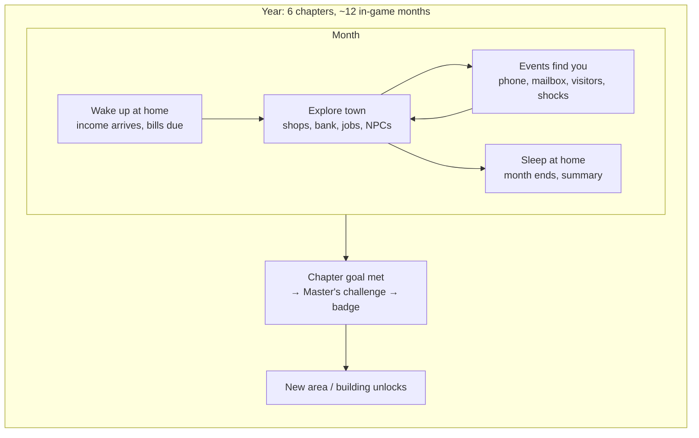
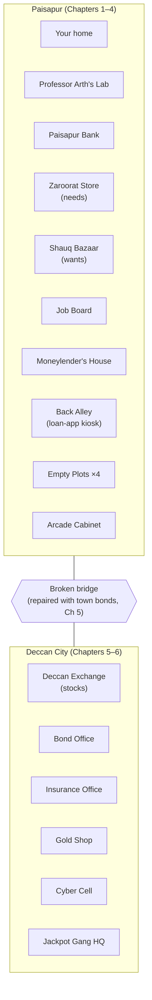
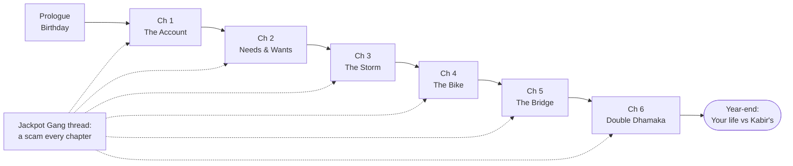
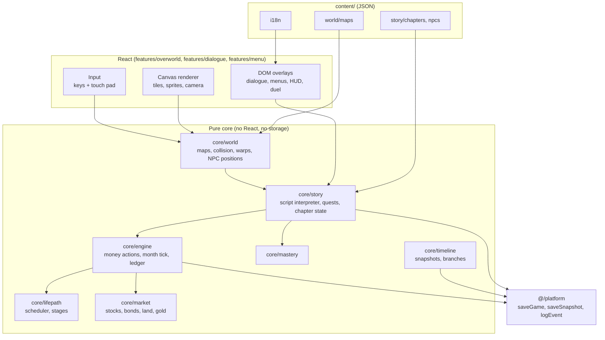

# PaisaPath — Game Design: *Paisapur*

> **A money RPG in the style of the classic handheld monster-collecting games.** You walk around a small town, enter buildings, talk to people, follow a story, and every chapter of that story teaches a money skill.

This document makes the tile-based RPG **the main game**. It sits on top of `Implementation.md`: the engine, concepts, mastery model, telemetry, guardrails and stages S0–S6 all stay. What changes is the *front end of the experience*: instead of menus and month screens, the student lives the LifePath by walking around a town.

*Paisapur* is the working name of the town and the game mode. PaisaPath stays the product name.

---

## Contents

1. [The pitch](#1-the-pitch)
2. [What changes from Implementation.md](#2-what-changes-from-implementationmd)
3. [Core loop](#3-core-loop)
4. [The world](#4-the-world)
5. [Characters](#5-characters)
6. [Story: prologue and six chapters](#6-story-prologue-and-six-chapters)
7. [Game systems](#7-game-systems)
8. [Screens, controls and UI](#8-screens-controls-and-ui)
9. [Technical design](#9-technical-design)
10. [Content format](#10-content-format)
11. [Guardrails](#11-guardrails)
12. [Who builds what](#12-who-builds-what)
13. [Scope and milestones](#13-scope-and-milestones)
14. [Demo script](#14-demo-script)
15. [Open decisions](#15-open-decisions)

---

## 1. The pitch

You are 17 and live in **Paisapur**, a small town outside Hyderabad. On your birthday **Professor Arth**, the town's money scientist, gives you ₹1,000, an old phone and a blank **Money Journal**, and asks you to fill it before the year ends. Your friend and rival **Kabir** gets the same gift and decides to "make it big, fast".

Over one in-game year you open a bank account, survive on a budget, build an emergency fund, decide whether to borrow for a bike, invest in the town's new bonds and stock exchange, buy a plot of empty land, and finally take down the **Jackpot Gang**, a crew of scammers who have been targeting the town all year.

The genre maps unusually well onto money:

| Classic handheld RPG | Paisapur |
|---|---|
| The Professor gives you your first partner | Professor Arth gives you your first money and the Journal |
| Choosing a starter | Choosing a starting life: allowance, tutoring, or helping in the family shop |
| Rival who is always one step ahead | Kabir, who makes the opposite choices; his life is your "parallel life" |
| Gym leaders and badges | Town Masters who award six badges (one per stage S1–S6) |
| A villain team | The Jackpot Gang: fake KYC texts, loan-app sharks, "double your money" schemes |
| The monster encyclopedia (seen / caught) | The Money Journal (concepts *seen* / *mastered*) |
| HP | **Peace of Mind**, which drops when you are broke, in debt or scammed |
| The healing centre | Home: sleep to end the month, collect income, pay bills |
| Battles | **Scam Duels** and other encounters (Section 7.9) |
| New routes and towns | Paisapur grows: the bridge to **Deccan City** opens in Chapter 5 |
| Bag | Wallet, bank card, phone, receipts |

**Design principle:** *the story needs the lesson.* You never get a lesson because a menu says so; you get it because the plot puts you in a situation where it matters, and the Professor or a Master explains it right then.

---

## 2. What changes from Implementation.md

| Area | Before (Implementation.md) | Now |
|---|---|---|
| Main mode | LifePath month screens + home dashboard | The Paisapur overworld *is* LifePath |
| Home screen (§3.1) | Tile dashboard | Removed. The landing page leads to the overworld; the Start menu replaces the dashboard |
| Character builder (§7) | 10 picture questions | Same 10 questions, asked *in dialogue* by Professor Arth in the prologue. Still about the **character**, never the student's family |
| Stages S0–S6 (§8) | Stage map with gates | Chapters. Each gate is a **Master's challenge** that awards a badge |
| Scheduler (§8.4) | Picks 2–4 events per month | Still runs. Its events become NPC visits, phone messages, mailbox letters and shocks at home |
| 8-step module loop (§10.1) | A card-based wrapper | Hook = a story scene; Play = a building activity or encounter; Why / Concept = the Professor or a Master explaining; Check = a short in-dialogue quiz; Reward = an item, badge or Journal entry |
| Rewind (§9) | Timeline strip | **The What-If Machine** in the Professor's lab (Section 7.10) |
| Arcade (§3) | A main mode | Stays as a side mode from the landing page ("Minigames") and from an arcade cabinet in town. Same games, sandbox state |
| Mastery, telemetry, guardrails, privacy | — | **Unchanged** |

The existing starting-point questions at `/onboarding` (what the student knows and wants, with 5 knowledge items) stay as the **pre-check**. The Professor can ask them in the prologue so they feel like part of the story.

---

## 3. Core loop

Three nested loops:



**Month loop (the heartbeat).**
1. **Wake up.** A short morning card: "Month 3. Your allowance of ₹800 arrived. Bus pass (₹200) and phone recharge (₹150) are due."
2. **Free roam.** No clock inside a month. Walk anywhere, buy things, work a shift, talk to people, visit the bank.
3. **Events.** The scheduler (from `Implementation.md` §8.4) places this month's events: a text from an unknown number, a friend asking to borrow money, a festival sale, the phone screen cracking.
4. **Sleep.** Allowed once this month's *required* events are done. Unpaid needs have consequences (Peace of Mind drops, or the story reacts). The night screen shows a one-line month summary and the ledger.

**What takes "time".** Nothing inside a month except **work shifts**: each job can be done a limited number of times per month (e.g. tutoring twice). That makes income a real choice without needing a clock.

---

## 4. The world

### 4.1 Map overview



Paisapur fits on one or two screens of the overworld (Section 9.2). Deccan City is a second map reached by crossing the bridge.

### 4.2 Buildings

| Building | Opens | What you do | What it teaches | Existing use cases reused |
|---|---|---|---|---|
| **Your home** | Prologue | Sleep (end month), read mail, family conversations, piggy bank | Monthly cycle, commitments | — |
| **Professor Arth's Lab** | Prologue | Character creation, Journal, concept explanations, **What-If Machine** | Every concept; rewind | UC-SYS-02, UC-LIFE-04/05 |
| **Paisapur Bank** | Ch 1 | Open an account, deposit, withdraw, fixed deposit, apply for a loan | Why bank, KYC, savings, interest, FD, loans, credit score | UC-BANK-01/02, UC-SM-04, UC-BR-01/02 |
| **Zaroorat Store** (needs) | Ch 2 | Buy rice, bus pass, recharge, school supplies | Needs; prices that repeat every month | UC-PB-01, UC-PB-06 |
| **Shauq Bazaar** (wants) | Ch 2 | Sneakers, games, snacks, the "70% off" sale | Wants, impulse buys, opportunity cost, sales tricks | UC-PB-04, UC-SM-06, UC-PB-07 |
| **Job Board** | Ch 2 | Tutoring, helping at a shop, festival stall | Earned income, irregular income | UC-PB-05 |
| **Moneylender's House** | Ch 4 | Borrow quickly at a high rate | True cost of informal debt | UC-BR-01 |
| **Back Alley** | Ch 4 | A stranger with a tablet offers an "instant loan app" | Predatory loan apps | UC-SAFE-06 |
| **Empty Plots** | Ch 5 | Buy a plot, leave it, rent it out, or build a stall | Property as an asset, illiquidity, rental income | UC-INV-09 |
| **Bond Office** | Ch 5 | Buy town bonds that fund the bridge | Bonds as lending, fixed return, safety vs return | New: UC-INV-12 (town bonds) |
| **Deccan Exchange** | Ch 5 | Buy and sell shares of fictional companies; news board | Stocks, risk/return, diversification, time horizon | UC-INV-03/05/07/08 |
| **Gold Shop** | Ch 5 | Buy and sell gold | Gold as a store of value, making charges | UC-INV-10 |
| **Insurance Office** | Ch 6 | Join a risk pool | Insurance as risk pooling | UC-SM-07 |
| **Cyber Cell** | Ch 6 | Report scams, get the final badge | Recovery steps after fraud | UC-SAFE-10 |
| **Arcade Cabinet** | Ch 1 | Opens the Arcade minigames (sandbox; does not change your money) | Practice | Arcade |

The current `/village` map has six buildings (grocery, food, clothing, stationery, stock market, bank). They become: grocery → **Zaroorat Store**, clothing → **Shauq Bazaar**, food → **Tiffin Centre** (mixed needs/wants, used by Spending Detective), stationery → **Job Board**, bank → **Paisapur Bank**, and the stock market moves to Deccan City.

### 4.3 Local flavour

Content variables from `Implementation.md` §8.5 apply: Bonalu, Sankranti, Ramzan/Eid, Diwali and Christmas arrive as seeded town events (decorations, a festival sale at Shauq Bazaar, a stall job). Irani chai, a kirana, a Charminar-style city gate, Necklace Road-style lakefront in Deccan City.

---

## 5. Characters

| Character | Role | Notes |
|---|---|---|
| **You** | The player character | Created in the prologue. Name, avatar, life stage and starting life come from the 10 questions |
| **Professor Arth** | Mentor | Runs the lab. Explains concepts with simple analogies, never lectures twice. Speaks the "Concept" step of every activity |
| **Kabir** | Rival and friend | Spends on wants, chases tips, takes the loan-app loan in Ch 4, falls for the Ponzi in Ch 6. Not a villain: he learns too. His state is simulated alongside yours (Section 7.10) |
| **Ammi / Amma / Mom** (chosen in the prologue) | Family | Morning conversations, household share, rescues you if Peace of Mind hits zero |
| **Meena Rao** | Master 1, bank manager | Banked badge |
| **Anwar Chacha** | Master 2, Zaroorat Store owner | Budget badge |
| **Lakshmi Aunty** | Master 3, runs the women's savings group | Saver badge |
| **Mr. Iyer** | Master 4, bank loan officer | Smart Borrower badge |
| **Ravi Sharma** | Master 5, a calm old trader at the Exchange | Investor badge |
| **Inspector Fatima** | Master 6, Cyber Cell | Shield badge |
| **The Jackpot Gang** | Villains | Grunts send texts and run the loan-app kiosk; the boss, **Mr. Jackpot**, runs the "Double Dhamaka" Ponzi scheme |
| **Townsfolk** | Flavour and hints | Each says one line that hints at a concept ("I only shop with a list since last Diwali…") |

All companies, banks, apps and shops are fictional (Section 11).

---

## 6. Story: prologue and six chapters

Each chapter = one LifePath stage, 1–3 in-game months, one Master, one badge. The chapter's **goal** is a story goal; the **gate** is the Master's challenge (2–3 scenario questions or a short task, as in `Implementation.md` §8.3).



### Prologue: The Birthday (S0 setup, ~10 min)

- **Scene:** you wake up at home. Mom says the Professor wants to see you.
- **At the lab:** Professor Arth asks the 10 character questions *as conversation* ("So, are you still at school, or at college?"). Your answers shape the character (persona). He also asks the pre-check items as "let's see what you already know".
- **Gift:** ₹1,000 cash, an old phone (no UPI yet), the Money Journal. Kabir bursts in and gets the same.
- **First choice:** Kabir runs off to Shauq Bazaar. Do you follow him or go home? (No wrong answer; it sets the rival relationship.)
- **Teaches:** nothing formally. Introduces the meters and the Journal.

### Chapter 1: The Account (S0–S1, Month 0–1)

- **Goal:** keeping ₹1,000 under your mattress is risky (Mom says the last power cut, someone's cash got stolen). Open a bank account.
- **Quest:** collect the documents around town (Document Hunt): school ID from home, a photo from the studio, a form from the bank. At the counter, choose an account type and a nominee (Bank Counter). Set up UPI on the phone.
- **Jackpot Gang:** that night, a text: *"Your KYC is incomplete, account will be blocked. Click here."* Then someone at the market sends you a UPI **collect** request "to pay you" for your old cycle. → **Scam Duel** (Section 7.9).
- **Master's challenge (Meena Rao):** documents, account type, never share your PIN, pay vs collect.
- **Badge:** Banked. **Unlocks:** the bank's savings features, the Arcade cabinet.
- **Concepts:** `why_bank`, `kyc`, `account_types`, `pin_secrecy`, `upi_collect`, `qr_pay`.

### Chapter 2: Needs & Wants (S2, Months 1–2)

- **Goal:** your allowance (or wages) now arrives every month. Kabir says new sneakers at Shauq Bazaar are 50% off "today only".
- **Quest:** survive two months. Each month you must buy the needs on Mom's list at Zaroorat Store. Sort Anwar Chacha's crates into needs and wants (Swipe Sort). Split your income into jars (Jar Split). Pick a goal with the Professor (Goal Builder). Optionally work at the Job Board.
- **Jackpot Gang:** "Congratulations! You won a lucky draw, pay ₹199 delivery fee."
- **Master's challenge (Anwar Chacha):** plan a month's budget that covers all needs and still saves something.
- **Badge:** Budget. **Unlocks:** Tiffin Centre activities, jobs with higher pay.
- **Concepts:** `needs_wants`, `budgeting`, `opportunity_cost`, `goal_setting`, `sales_tricks`.

### Chapter 3: The Storm (S3, Months 3–4)

- **Goal:** Lakshmi Aunty's savings group meets in the square. She asks what you'd do if something broke tomorrow.
- **Event (seeded shock):** your phone screen cracks (or the cycle breaks). Repair costs ₹2,000. With an emergency fund: you pay and stay calm. Without one: you borrow from Mom, skip a goal, or hear about a "quick loan app".
- **Quest:** pay yourself first (a recurring transfer at the bank), find where your money leaked (Spending Detective at the Tiffin Centre), a friend asks to borrow ₹2,000 (lending to friends), the festival sale (peer pressure).
- **Jackpot Gang:** a WhatsApp "part-time job, earn ₹5,000/day liking videos, pay ₹500 to register".
- **Master's challenge (Lakshmi Aunty):** emergency fund + spending leak questions.
- **Badge:** Saver. **Unlocks:** fixed deposits at the bank.
- **Concepts:** `pay_yourself_first`, `tracking`, `emergency_fund`, `where_to_keep_money`, `lending_to_friends`, `job_scam`.

### Chapter 4: The Bike (S4, Months 5–7)

- **Goal:** you need a bike to reach college or tutoring jobs in the next town. ₹30,000.
- **Choices (the big decision, a checkpoint):** save and buy later · bank loan with EMI (Mr. Iyer) · the moneylender (fast, very expensive) · the loan-app man in the Back Alley. Rank the options by total cost (Debt Cost Ladder). An EMI becomes a monthly commitment that bites if income drops (Commit).
- **Kabir** takes the loan-app loan. Two months later he is getting threatening calls and messages to his contacts. Do you help him? How?
- **Jackpot Gang:** "The Call": someone claiming to be a bank officer asks for an OTP to "stop a fraud". → **Scam Duel**.
- **Master's challenge (Mr. Iyer):** compare two borrowing options by total cost; explain what an EMI and a credit score are.
- **Badge:** Smart Borrower. **Unlocks:** the Bond Office notice board ("Help rebuild the bridge!").
- **Concepts:** `true_cost_of_debt`, `emi`, `bnpl`, `credit_score`, `informal_lending`, `loan_app_trap`, `impersonation`.

### Chapter 5: The Bridge (S5, Months 8–10)

- **Goal:** the bridge to Deccan City is broken. The town council issues **town bonds**: lend the town money, get it back with fixed interest in two years. The bridge gets built, and Deccan City opens.
- **Quest:** buy bonds (or not) at the Bond Office. Chai prices have gone up since the start of the year: inflation (Chai Price Time Travel). The Professor's garden shows compounding. In Deccan City, the **Deccan Exchange** opens: buy shares of fictional companies, read the news board, live through a crash (Risk & Return Ride). Build a basket (diversification). Back home, the **empty plots** go on sale.
- **Kabir** follows a "Telegram tips" channel and buys one stock with everything.
- **Jackpot Gang:** a celebrity deepfake video: "send ₹5,000, get ₹10,000 back".
- **Master's challenge (Ravi Sharma):** match three goals (2 months, 2 years, 10 years) to a place to keep money; hold through a dip without panic-selling.
- **Badge:** Investor. **Unlocks:** Insurance Office, Gold Shop, the Time Machine in the lab.
- **Concepts:** `inflation`, `compounding`, `bonds`, `risk_return`, `time_horizon`, `diversification`, `pooled_funds`, `property`, `gold`, `tips_scam`.
- **Gating that teaches:** the bridge only opens after Ch 3's emergency fund lesson, so investing comes *after* a safety net, mirroring `Implementation.md` §8.3.

### Chapter 6: Double Dhamaka (S6, Months 11–12)

- **Goal:** Mr. Jackpot opens a shiny office in Deccan City: "Double Dhamaka, double your money in 30 days!" Early joiners really are paid (from later joiners' money). Half the town joins, including Kabir.
- **Quest:** gather evidence by talking to townsfolk (who recruited whom, where the returns come from: The Pyramid). Sort offers into investing, gambling or scam. A fire at the market shows why the insurance pool matters. Sort out which of your own accounts and passwords need protecting.
- **Climax:** a final multi-stage **Scam Duel** with Mr. Jackpot, using every tell you have learnt. Inspector Fatima arrests the gang. Kabir loses money; you help him with the Rescue Mission (block, report, change passwords, call the helpline).
- **Master's challenge (Inspector Fatima):** the post-check (counts as the final gate).
- **Badge:** Shield.
- **Concepts:** `insurance`, `ponzi`, `invest_gamble_scam`, `fraud_recovery`, `identity_protection`.

### Year-end: Your Year

At the lab: the "Your Year" summary, **Parallel Lives** (your timeline vs any What-If branches vs Kabir's), **Future Me at 25** (a range with assumptions, never a single number), the certificate. Kabir has the last line: what he'll do differently next year.

---

## 7. Game systems

### 7.1 Money and the ledger

The money model is `GameState.money` from `Implementation.md` §6.1, unchanged: cash, bank, savings jars, debt, investments, monthly income, commitments. Every change is a ledger entry with a reason key. The overworld never edits money directly; it dispatches engine actions.

| Where | Shows |
|---|---|
| HUD (always) | Cash in hand, Peace of Mind, month |
| Phone → Bank app | Bank balance, transactions, UPI |
| Start menu → Wallet | Everything: jars, debts, investments, commitments |

**Starting values** follow `Implementation.md` §7.5 (e.g. school student on allowance: ₹300 cash + the Professor's ₹1,000, ₹800/month, ₹350 fixed needs). Everyone starts unbanked.

### 7.2 Meters

| Meter | Like | Goes down when | Goes up when | At zero |
|---|---|---|---|---|
| **Peace of Mind** (0–100) | HP | Broke, missed needs, debt calls, scammed | Emergency fund in place, goal reached, a calm month | You "feel overwhelmed": you wake at home, family helps, a debt to family is recorded, the Professor explains what went wrong. Never a game over |
| **Trust** (0–100) | Friendship | Breaking promises, not repaying | Repaying, helping Kabir | Some NPCs stop offering jobs or help |
| **Safety** (0–100) | Defence | Sharing PIN/OTP, clicking links, loan apps | Passing Scam Duels, setting up protections | Scams in later chapters are harder |

### 7.3 Calendar and events

- One in-game month per sleep. ~12 months per year. The chapter controls how many months it spans.
- The scheduler (`pickEvents`, `Implementation.md` §8.4) runs at wake-up and places events into the world: **phone** (SMS, UPI, calls), **mailbox** (bills, letters), **visitors** (an NPC walks to your door), **shocks** (seeded from the event tape), **town events** (festivals, sales).
- Required events show a "!" over the NPC or a badge on the phone. You can't sleep until they are handled.
- **Same luck:** all shocks and market moves come from the seeded tape, so a What-If branch sees the same shocks (`Implementation.md` §9.2).

### 7.4 Shops: needs and wants

- Each item has a price, a category (`need` / `want` / `depends`), and sometimes a concept tag.
- Mom's monthly list says which needs must be bought. Missing a need: Peace of Mind falls and the story reacts (no bus pass → you walk to school and miss a tutoring shift).
- **Shauq Bazaar tricks** appear by chapter: "today only", "50% off" on an inflated price, "buy 2 get 1", EMI on a pair of sneakers. Spotting them is part of the lesson.
- Buying is a dialogue with the shopkeeper, not a cart page: pick an item, see what that money could have done instead (opportunity cost, shown at levels 2+).

### 7.5 Work and income

- Income type comes from the persona (allowance, scholarship, tutoring, family shop).
- **Job Board** shifts add earned income, limited per month. Some months are lean (irregular income lesson).
- In Ch 5 a rented plot or a stall gives rental or business income.

### 7.6 Bank, savings and loans

| Product | Opens | Mechanic |
|---|---|---|
| Savings account | Ch 1 | Deposit, withdraw, small interest credited at month start |
| UPI | Ch 1 | Pay at shops by scanning; receive money; collect requests (scam surface) |
| Recurring transfer ("pay yourself first") | Ch 3 | Moves an amount to savings at wake-up |
| Fixed deposit | Ch 3 | Locked for N months, higher rate, penalty to break early |
| Bank loan | Ch 4 | Total cost and EMI shown before signing; EMI becomes a commitment; missed EMI hurts credit score |
| Moneylender | Ch 4 | Instant, no papers, very high interest, collector visits |
| Loan app (Back Alley) | Ch 4 | A trap: hidden fees, contact-list harassment. Exists to be refused or regretted |

Credit score is a simple 300–900 number shown at the bank, moved by on-time vs missed EMIs.

### 7.7 Investing: bonds, stocks, land, gold

All prices come from `core/market` with the world seed (decision 8 in `Implementation.md` §15.2 still open). Every projection shows a range and the Assumptions drawer.

| Asset | Mechanic | Lesson |
|---|---|---|
| **Town bonds** | Fixed interest, paid at maturity; can be sold early at a discount; funds the bridge (story) | Lending vs owning; lower risk, lower return |
| **Stocks** (Deccan Exchange) | 5–6 fictional companies (e.g. *Pearl City Power*, *Tiffin Tech*, *Lakeview Cement*, *Gully Gadgets*, *Bonalu Bikes*); prices move monthly; a news board with real signals and noisy rumours | Risk/return, diversification, rumours vs fundamentals, time horizon |
| **Pooled fund** | A "basket" counter at the Exchange | Diversification without picking |
| **Land** (Empty Plots) | Buy, hold, rent out, or build a stall; slow price changes; selling takes a month | Illiquidity, rental income, big ticket size |
| **Gold** | Buy and sell at the Gold Shop, with making charges and a spread | Store of value, hidden costs |

### 7.8 Money Journal and badges

- **Journal** = the encyclopedia. Each concept from `content/concepts.json` has an entry with three states: *unseen* (silhouette), *seen* (you met it in the story), *mastered* (mastery > 0.7, `Implementation.md` §10.3). Shows the Professor's one-line explanation, an icon and audio.
- **Badges:** six, from the Masters. Shown in the Start menu as a badge case.
- **Mastery** updates exactly as in `Implementation.md` §10.3, from in-story choices (rate 0.15) and Master/Professor checks (rate 0.3).

### 7.9 Encounters: Scam Duels

The signature mechanic for the Stay Safe pillar, and the closest thing to a battle.

- **Trigger:** a scam text, a call, a stranger in the alley, or Mr. Jackpot himself. Screen transition, then a duel screen: the scammer's portrait and **Pressure** bar on one side, your **Safety** and cash on the other.
- **Scammer's turn:** a "move" that is a real manipulation tactic: *Urgency* ("your account will be blocked in 10 minutes"), *Authority* ("I am calling from the bank"), *Greed* ("double your money"), *Fear*, *Social proof* ("everyone in the group earned"), *Ask for OTP / PIN*.
- **Your turn:** pick a response: *Verify through the official number*, *Ask a question*, *Hang up / ignore*, *Report*, or a tempting wrong one (*Share the OTP*, *Click the link*, *Pay the fee*).
- **Spotting a tell** hits the scammer's Pressure. Pressure at zero = scammer gives up, you get the tell added to the Journal. A wrong response costs Safety and may cost money (it really moves in the simulation, as in Act in-situ).
- **Post-mortem:** the four tells shown on the message or transcript, then the Concept step.
- **Timers** follow the accessibility setting: shown but never running out when `timersOff` is on.

This is the **Judge** and **Act in-situ** verbs (`Implementation.md` §10.2) dressed as a duel. Other encounters reuse the same screen: haggling at Shauq Bazaar (stretch), a debt collector visit (Ch 4).

### 7.10 The What-If Machine and Kabir's life

- **What-If Machine** (Professor's lab, from Ch 2): shows your timeline of key decisions (checkpoints). Pick one → "Try a different choice". A branch is created with the same seed, so the same shocks happen. Fast-forward and **compare** the two lives side by side. This is `Implementation.md` §9 with a story wrapper.
- **Kabir** is a scripted rival with his own `GameState`, run by the same engine with a fixed choice list (spender, loan-app borrower, tip-chaser). At chapter ends and at year-end, his numbers sit next to yours. Because he uses the same seed, the comparison is fair: the difference is choices, not luck.

### 7.11 Saving the game

- Autosave on every month change, building exit and story step, using `saveGame(pid, 'paisapur', …)`.
- Snapshots before each checkpoint (`saveSnapshot`) for the What-If Machine.
- Start menu → Save shows "Game saved" for the familiar feel; there is no way to lose progress.

---

## 8. Screens, controls and UI

### 8.1 Screens

| Screen | Notes |
|---|---|
| Landing (`/`) | Exists. "Play Paisapur" and "Minigames" doors |
| Overworld (`/play`) | The main game; replaces `/village` and `/home` |
| Dialogue box | Bottom of the screen, typewriter text, speaker name, ▼ to continue, choice list |
| Start menu | Journal · Wallet · Badges · Phone · Save · Settings |
| Phone | Bank app (balance, UPI, history), Messages (scam surface), Calendar |
| Building activities | Mini-games rendered inside the building, via the ModuleRunner |
| Scam Duel | Section 7.9 |
| Night summary | Month summary, ledger, Peace of Mind change |
| What-If Machine | Timeline, compare view |
| Year-end | Your Year, Parallel Lives, Future Me, certificate |

### 8.2 Controls

| Action | Keyboard | Phone |
|---|---|---|
| Move | Arrows / WASD | D-pad (exists) |
| Talk / confirm (A) | Space / Enter / Z | **A** button |
| Cancel / back (B) | Esc / X | **B** button |
| Start menu | M / Tab | **Menu** button |

Portrait phone layout: game view on top, D-pad + A/B below, like the existing `/village` pad. Target 360×640 and large-text mode, as in `Implementation.md`.

### 8.3 Look and feel

- All art is Kenney CC0, 16×16, in `public/assets/`: **Tiny Town** (grass, trees, houses, roofs), **Tiny Dungeon** (interior furniture) and **RPG Urban Pack** (6 walking characters with 4 directions × 3 frames, street props, shop stalls, water). NPCs reuse the 6 characters with their clothes recoloured (`legend.json` → `sprites`). No art or names from any existing monster-collecting game.
- The game view shows **15×10 tiles** (240×160 px, the classic handheld screen), drawn on one canvas and scaled up with crisp pixels.
- Dialogue box, menus and HUD are React overlays styled like the classic two-border text box.
- Every visible string goes through `t()`. Dialogue lines are translation keys.

---

## 9. Technical design

### 9.1 Layers



**One rule:** the world, the story and the money are pure and deterministic. The UI renders state and sends inputs. Same seed + same inputs = same game, which is what makes the What-If Machine, Kabir's parallel life and tests work. The existing lint rules already enforce this for `core/**` and `**/logic/**`.

### 9.2 Renderer

The current `/village` draws the whole map as a CSS grid, scaled to fit the screen. That works for one small map but not for a scrolling world with NPCs and animation. Proposal:

- **One `<canvas>`** draws the visible 15×10 tiles plus a border, the NPCs and the player, with a **camera that follows the player**.
- **Smooth tile-to-tile walking:** logic moves the player one tile at a time (as `step()` does today); the renderer tweens between tiles over ~200 ms with a 2–4 frame walk cycle. Input during a step is queued.
- **Overlays stay in React DOM** (dialogue, menus, HUD), so `t()`, large text and screen readers keep working.
- **No game framework** at first: a small `requestAnimationFrame` loop keeps the bundle under the 3 MB first-load budget. If the team prefers a framework, a small one can be swapped in later behind the same pure core.
- **Reduce motion:** `prefers-reduced-motion` / the `reduceMotion` setting snaps instead of tweening.

### 9.3 Maps

- Keep the existing **text-row format** from `features/village/logic/world.ts`, extended with layers and an object list, so maps stay easy to edit in a text editor and diff in PRs:

```json
{
  "id": "paisapur",
  "tileset": "tiny-town",
  "ground": ["gggg…", "…"],
  "objects": ["T..L…", "…"],
  "warps": [{ "at": [3, 2], "to": "in:zaroorat", "spawn": [4, 5] }],
  "npcs": [{ "id": "anwar", "at": [4, 1], "facing": "down", "script": "anwar.default" }],
  "triggers": [{ "at": [7, 11], "script": "bridge.broken", "when": "!flag:bridge_built" }]
}
```

- Move `features/village/logic/world.ts` to `core/world/` and generalise `step()` to read these files. Its tests come with it.
- Optional later: author bigger maps in the free Tiled editor and convert to this format in `tools/`.

### 9.4 Story scripts

NPC dialogue and quests are **data**, interpreted by `core/story`. A script is a list of commands:

| Command | Does |
|---|---|
| `say` | Show a line (translation key) with a speaker |
| `choice` | Show options; branch by option id; options can have `requires` (as in scenario JSON) |
| `if` | Branch on a flag, chapter, item, money amount or concept mastery |
| `action` | Dispatch an engine action (pay, deposit, take loan, buy asset). Money only changes here |
| `flag` | Set a story flag |
| `minigame` | Run a registered `MiniGame` through the ModuleRunner (e.g. `jar-split`) |
| `duel` | Start a Scam Duel by id |
| `check` | Ask 2–3 check items (updates mastery) |
| `concept` | Mark a Journal concept as seen and show the Professor's explanation |
| `give` / `take` | Items (documents, phone, receipts) |
| `move` / `face` / `warp` | Move NPCs or the player, change map |
| `log` | `logEvent` for telemetry (most commands log automatically) |
| `badge` | Award a badge, advance the chapter |

The interpreter is a pure function: `(storyState, gameState, command, input) → (storyState', actions[], output)`. React shows the output (a line, a choice list, a minigame) and feeds back the player's input.

### 9.5 State

`GameState` (`Implementation.md` §6.1) gains a `world` and a `story` slice:

```ts
type WorldState = {
  map: string;                 // 'paisapur', 'in:bank', 'deccan'
  x: number; y: number; facing: Dir;
  npcOverrides: Record<string, { map: string; x: number; y: number; facing: Dir }>;
};

type StoryState = {
  chapter: 0 | 1 | 2 | 3 | 4 | 5 | 6;
  badges: BadgeId[];
  flags: Record<string, boolean>;      // shared with meta.flags
  items: ItemId[];
  journal: Record<ConceptId, 'seen' | 'mastered'>;
  activeScript?: { id: string; pc: number; stack: number[] };
  pendingEvents: EventRef[];           // this month's required events
  rival: GameState;                    // Kabir, simulated with the same seed
};
```

Everything stays JSON-serialisable for `saveGame`, snapshots and replay.

### 9.6 Folders

| Folder | What |
|---|---|
| `core/world/` | Maps, collision, warps, NPC movement (moved from `features/village/logic`) |
| `core/story/` | Script interpreter, chapter state machine, required-event checks |
| `core/engine/`, `core/lifepath/`, `core/market/`, `core/mastery/`, `core/timeline/` | As planned; story actions dispatch into the engine |
| `features/overworld/` | Canvas renderer, camera, input, HUD, the `/play` route |
| `features/dialogue/` | Dialogue box and choice list |
| `features/menu/` | Start menu, Journal, Wallet, Badges |
| `features/duel/` | Scam Duel screen |
| `features/phone/` | Phone overlay (reuses `games/safe/phone`) |
| `content/world/maps/` | Map JSON |
| `content/story/` | Chapter and NPC scripts |
| `content/i18n/en/story.*.json` | Dialogue strings, one file per chapter |

---

## 10. Content format

A full NPC script, for review (Anwar Chacha, Chapter 2):

```json
{
  "id": "anwar.ch2",
  "when": "chapter:2",
  "steps": [
    { "say": "story.ch2.anwar.hello", "speaker": "anwar" },
    { "if": "!flag:sorted_crates", "then": [
      { "say": "story.ch2.anwar.crates", "speaker": "anwar" },
      { "minigame": "swipe-sort", "level": 1 },
      { "flag": "sorted_crates" },
      { "concept": "needs_wants" }
    ]},
    { "choice": [
      { "id": "buy_list", "label": "story.ch2.anwar.buy_list", "then": [
        { "action": "buy", "items": ["rice_5kg", "bus_pass"] }
      ]},
      { "id": "challenge", "label": "story.ch2.anwar.challenge",
        "requires": "monthsInChapter>=2", "then": [
        { "check": ["q_budget_01", "q_budget_02", "q_budget_03"], "pass": 2 },
        { "badge": "budget" }
      ]},
      { "id": "bye", "label": "story.common.bye" }
    ]}
  ]
}
```

The content validator (P3, `tools/authoring/`) should check that every `say`/`label` key exists in every language, every `minigame` id is registered, every `concept` is in `concepts.json`, every `action` is a known engine action, and every warp target exists.

---

## 11. Guardrails

All rules from `Implementation.md` §2 apply, with these game-specific notes:

- **Inspired by, not copied.** No names, sprites, music, sounds or text from any existing monster-collecting game. Use our own characters and Kenney CC0 art.
- **Fictional finance only.** Paisapur Bank, the Deccan Exchange and every company, app and fund are invented. The brand word-list test covers story strings too.
- **Simulated only.** The Professor's questions describe the character. The phone, messages and calls are inside the game. Nothing asks about the student's real money, family or messages.
- **Projections are ranges.** The Exchange, bonds, land and Future Me show ranges, the Assumptions drawer, and the banner *"Simulation based on assumptions. Not a prediction or advice."*
- **No shaming.** Peace of Mind at zero is a rescue, never a game over. Kabir is a friend who learns, not a loser. Comparisons explain trade-offs, not verdicts.
- **No gambling loops.** No loot boxes, no paid currency, no random rewards for spending. The Exchange teaches patience, not trading for thrills.

---

## 12. Who builds what

A proposal that keeps each person's area from `work_division.md` and adds the RPG pieces. To be confirmed by the team.

| Person | Existing area | RPG work |
|---|---|---|
| **P1** Persona, Progress & Time Travel | Classifier, mastery, rewind, progress | Professor's prologue dialogue (10 questions + pre-check), Money Journal, badge case, What-If Machine, Kabir's parallel life, year-end |
| **P2** Core Engine & LifePath | Engine, scheduler, runtime | `core/story` script interpreter, chapter state machine, calendar and month loop (wake/sleep), engine actions for every script `action`, `GameState` world/story slices |
| **P3** Everyday Money & Content | Bank/budget/save/borrow games, i18n, validator | Zaroorat Store, Shauq Bazaar, Job Board, Paisapur Bank (account, FD, loans), Moneylender; Chapters 2–4 scripts; validator support for maps and scripts |
| **P4** Investing & Design Kit | Market engine, investing games, UI kit | **Overworld renderer** (canvas, camera, walk animation, input), sprites and tiles, dialogue box and menu UI; Bond Office, Deccan Exchange, Gold Shop, Empty Plots; Chapter 5 scripts |
| **P5** Stay Safe, Platform & Facilitator | Phone, scam games, storage, sync, dashboard | **Scam Duel** system, phone overlay (UPI, Messages), Jackpot Gang events every chapter, Chapters 1 and 6 scripts, autosave, facilitator view of chapter progress |

Shared: map layouts (whoever owns the building lays out its interior), townsfolk lines (everyone), dialogue polish (final phase).

---

## 13. Scope and milestones

### 13.1 MVP (must work for the demo)

- Overworld with canvas renderer, camera, walking, NPCs, dialogue, Start menu, A/B/Menu buttons.
- Story interpreter with `say`, `choice`, `if`, `action`, `flag`, `minigame`, `concept`, `check`, `badge`, `warp`.
- Month loop: wake, income and bills, required events, sleep, night summary.
- **Prologue** and **Chapters 1–2** fully playable, with Document Hunt, Bank Counter, UPI collect Scam Duel, Swipe Sort and Jar Split.
- **Chapter 5 slice:** the Deccan Exchange playable from a debug warp (the "whoa" moment), with fictional companies and the guardrail banner.
- Money Journal (seen/mastered) and badges 1–2.
- Autosave and resume, offline.

### 13.2 Next

Chapters 3 and 4 (emergency fund, the bike decision, loan-app trap), Kabir's parallel numbers, the What-If Machine, bonds and the bridge.

### 13.3 Stretch

Chapter 6 and the Mr. Jackpot final duel, land plots, gold, insurance, year-end Future Me, haggling encounters, Telugu/Hindi/Urdu dialogue, walk-cycle polish, music.

### 13.4 Phases

| Phase | Exit |
|---|---|
| 0. Contracts | `GameState` with world/story slices, script command list, map format, MiniGame contract agreed |
| 1. Walking skeleton | Walk around Paisapur on canvas, enter the bank, talk to Meena Rao, one choice changes cash, save/resume works offline |
| 2. Prologue + Ch 1 | Character created by the Professor, account opened, UPI scam duel won or lost, Banked badge |
| 3. Ch 2 + month loop | Two months survived with budget jars; Budget badge; night summary |
| 4. Exchange slice + polish | Deccan Exchange playable; demo profiles seeded; 360×640 and large text checked |

---

## 13.5 Build status (what exists in code)

Built and tested (`npm test` runs a bot through the whole year, plus content, world and engine checks):

| Piece | Where |
|---|---|
| Overworld renderer: canvas, camera, walk animation, NPCs, doors, fades | `features/paisapur/render.ts`, `PaisapurGame.tsx` |
| Dialogue box (typewriter), choices, concept cards, quizzes, toasts, HUD, touch pad | `features/paisapur/ui.tsx`, `input.ts` |
| Shops, bank (savings, auto-save, FD, loans), loan calculator, bonds, exchange + SIP, news, month summary, Start menu (Journal, Wallet, Badges), year review | `features/paisapur/panels.tsx` |
| Money engine (income, inflation, GST, interest, FDs, bonds, EMIs, cards, credit score, SIP, insurance, scams, peace of mind) | `core/engine` |
| Seeded market (5 companies, index ETF, active fund, gold; a dip in months 9–10) | `core/market` |
| World: maps, collision, doors, warps, counters, conditional NPCs and blockers | `core/world`, `content/world/` |
| Story interpreter, conditions, auto scripts | `core/story`, `content/story/` |
| All six chapters, 60 concepts, 27 challenge questions, 13 maps | `content/` |
| **Goals:** 7 goals in 4 kinds (quick: trip ₹2,500, cycle ₹3,500 · education: fees ₹5,000, laptop ₹25,000 · asset: stall ₹10,000, earns ₹600/month · consumption: phone ₹8,000, bike ₹30,000). Buying your goal is a story moment, then you pick the next one | `core/engine` (`GOAL_DEFS`, `buyGoal`), `content/story/goals.json` |
| **Goal branches:** the Professor reacts to your goal kind; consumption goals get a "no-cost EMI" offer in Ch 2; education goals get a scholarship test (Ch 3) and an education loan (Ch 4); asset goals learn "assets that earn"; consumption goals learn depreciation | `prologue.json`, `ch2`–`ch4` scripts |
| **Income-source events:** allowance → grocery-budget week (Ch 2); family shop → Diwali bonus windfall (Ch 2); college → scholarship lump sum (Ch 2); everyone → a lean month suited to their income (Ch 3) | `goals.json`, `auto.json` |
| **Kabir's parallel life:** re-simulated by the real engine on the same seed and chapter calendar, same goal, always the tempting choice (sneakers, goal on credit, loan app, moneylender, tip stock, Ponzi). "Your life vs Kabir's" panel with a net-worth chart, table and his diary | `core/rival`, `features/paisapur/extras.tsx` |
| **What-If Machine:** checkpoints before 15 big decisions; rewind replays the scene with the same luck; your other life is kept for side-by-side comparison with explanations, and you can switch back | `core/timeline`, lab machine (`whatif` script) |
| **Scam Duels:** six turn-based battles (fake KYC SMS, QR buyer, job task, fake bank call, loan app, Mr. Jackpot). Counter each tactic to drop the scammer's pressure; dodges and falls cost safety; the tells you spot are listed at the end | `core/story/duel.ts`, `content/paisapur/duels.json` |

Balance: a typical year runs 10–12 months (later chapters need time to pass: a safety net for 2 months, 2 months with your borrowing choice, stay invested until month 10). Income: allowance ₹1,500, tutoring ₹1,000–2,400, family shop ~₹1,600 by season. Quick goals are reachable by saving mid-year; the phone near year-end; big goals need a borrowing decision. `playthrough.test.ts` checks every goal × income source.

| **Bag** (Start menu, first tab): three pockets like the classic bag. Key items (wallet, Money Journal, KYC documents, debit card, phone/UPI with recent payments, badge case); Your things (goal items and kept purchases with what they'd resell for now: −15% the day you buy, then ~2% a month); Papers (receipts with GST, FD and bond certificates, loan agreements, card statement, investment statement, insurance policy). Worked out from the game state, never stored separately | `features/paisapur/logic/bag.ts`, `panels.tsx` (`Bag`) |
| **Music and sound:** an original chiptune soundtrack synthesised live with WebAudio (12.5/25/50% pulse waves, triangle bass, noise drums; no audio files). Themes for town, indoors, the Lab, Deccan City and Scam Duels; jingles for victory, defeat, badges, goals and sleep; effects for dialogue, menus, doors, bumps, money in/out, concept cards, quiz answers and duel hits. Volume and mute in Start menu → Sound and the HUD 🔊 button, saved per device | `features/paisapur/audio/` (`logic/score.ts` is the music as data) |

Not built yet: haggling, Telugu/Hindi/Urdu text.

## 13.55 Mini-games inside the story

P3's Everyday Money games run inside story scenes. Rules that keep them coherent with the dialogue:

- **One economy.** Inside the story a game shows the player's real income, needs (at the shop's prices), cash, savings, goal and spending, and the lenders charge the story's rates. The old persona table is only for the Arcade.
- **One decision, one place.** If the game asks it (account type, deposit, how to pay a shock, which lender), the dialogue does not ask it again.
- **Game decisions count.** The deposit in Bank Counter is the real deposit; Goal Builder's choice sets the goal price and the monthly saving; Surprise Month's choice decides how the cracked phone is paid (savings, Mom, a loan app, skipping it, selling something); Debt Ladder's choice becomes a real loan on the same terms, or none.
- **Same scene.** The story stages the game's event (the ₹1,500 cracked phone at the bus stop; Kabir's Ponzi loss in Rescue Mission).

| Scene | Game | What carries over |
|---|---|---|
| Mom's cupboard (Ch 1) | Document Hunt | Documents in hand |
| Meena (Ch 1) | Bank Counter | Account type, nominee, real cash → real deposit, PIN (the KYC scam follows as a Scam Duel) |
| Professor (Ch 2) | Swipe Sort, Jar Split, Goal Builder | Shop prices and needs; goal price and monthly saving |
| Cracked phone (Ch 3) | Surprise Month | How the ₹1,500 repair is paid |
| Professor (Ch 3) | Spending Detective | Last month's real purchases |
| Sahukar (Ch 4) | Debt Ladder | A real loan at the story's rates, or none |
| Fatima (Ch 6) | Rescue Mission | Kabir's recovery after Double Dhamaka |

## 13.6 Curriculum map

Every concept in `content/concepts.json` is taught in the story (a test enforces this) and appears in the Money Journal.

| Chapter | Concepts | Where the player meets them |
|---|---|---|
| Prologue | income, money goals | Professor Arth's character questions |
| 1 The Account | why bank (deposit insurance), KYC, savings account, interest, UPI, PIN/OTP secrecy, phishing, "PIN = paying" | Meena Rao opens your account; fake KYC SMS; fake cycle buyer's QR code |
| 2 Needs & Wants | needs vs wants, 50/30/20 budgeting, opportunity cost, sale tricks, GST, pay yourself first, inflation | Zaroorat Store vs Shauq Bazaar; monthly needs list; Kabir's sneakers; auto-save at the bank; prices rise every month |
| 3 The Storm | emergency fund, compound interest, rule of 72, fixed deposits, lending to friends, net worth (assets − liabilities), fake job scams | Cracked phone; Lakshmi Aunty's savings group; Kabir asks for a loan; WhatsApp task scam |
| 4 Borrowing | good vs bad debt, loan basics, EMI, credit score, credit cards and the minimum-payment trap, BNPL, moneylenders, predatory loan apps, impersonation calls | Loan calculator (total cost vs EMI); Sahukar; the loan-app man in the alley; "bank fraud team" call; card offer at Shauq Bazaar |
| 5 The Bridge | bonds, stocks, risk and return, diversification, mutual funds, index funds/ETFs, SIP, time horizon, volatility, fees, gold, property, real return, tips and rumours | Town bonds rebuild the bridge; Deccan Exchange with fictional companies; market dip; Kabir's Telegram tip; plots for sale |
| 6 Double Dhamaka | insurance, Ponzi schemes, too-good-to-be-true offers, identity protection, fraud recovery (1930), income tax | Mr. Jackpot's scheme; market fire; Cyber Cell; year-end talk |

## 14. Demo script (5 minutes)

1. **The Professor (40 s):** answer three questions in dialogue; the character appears on the map with ₹1,000.
2. **Open an account (40 s):** walk to the bank, Meena Rao, choose an account. Banked badge.
3. **Scam Duel (60 s):** a UPI collect request "to pay you" for your cycle. Pick the wrong move on stage, lose money, then replay and win by spotting the tells. *Hook.*
4. **Needs vs wants (40 s):** Zaroorat vs Shauq Bazaar; Kabir buys the "50% off" sneakers; sleep; the month summary shows who can still afford the bus pass.
5. **What-If Machine (40 s):** go back to the sneakers decision, choose differently, compare both lives under the same luck. *Signature mechanic.*
6. **Deccan Exchange (40 s):** a rumour on the news board, a dip, hold vs panic-sell, with the range and assumptions banner. *Guardrail as the lesson.*
7. **Offline (20 s):** airplane mode, keep playing, reconnect, the facilitator heatmap updates.
8. **One slide** mapping the game to the brief's success measures.

---

## 15. Open decisions

| # | Decision | Options | Default in this doc |
|---|---|---|---|
| 1 | Character sprites | Kenney CC0 characters (no walk frames) · a CC0 4-direction walk sheet · draw our own | **Decided:** Kenney RPG Urban Pack (CC0) has 4-direction × 3-frame walkers |
| 2 | Renderer | Canvas + own loop · a small game framework · keep the CSS grid | Canvas + own loop |
| 3 | Map size | One screen per area · scrolling maps | Scrolling, Paisapur ~30×20 tiles |
| 4 | Scam Duel depth | Full duel screen · dialogue choices only | Full duel screen for 2–3 key scams, dialogue for the rest |
| 5 | Other encounter types | None · haggling · debt collector | Debt collector in Ch 4; haggling is stretch |
| 6 | Kabir's choices | Fixed script · reacts to yours | Fixed script (simpler, fair comparison) |
| 7 | Month pacing | Free roam until you sleep · auto-advance | Free roam, sleep when required events are done |
| 8 | Arcade | Separate mode from landing · only via in-town cabinet · both | Both |
| 9 | Professor's name and look | Professor Arth · other | Professor Arth |
| 10 | Game route | `/play` (new) · keep `/village` | `/play`; `/village` redirects |
| 11 | Market model (from Implementation.md §15.2 #8) | Random walk · regimes · rescaled history | Still open |
| 12 | Rewind availability (from Implementation.md §15.2 #6) | Any time · limited · year-end only | What-If Machine from Ch 2, any checkpoint |
