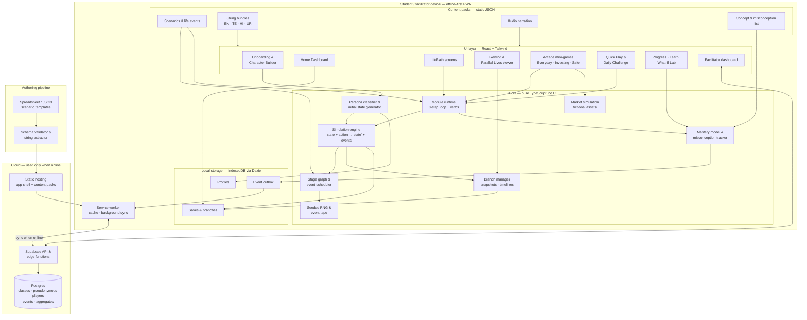
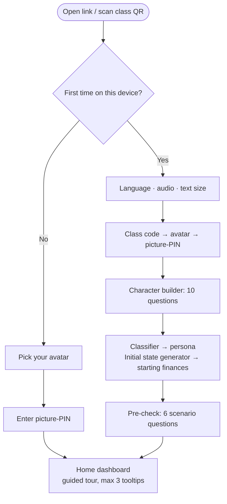
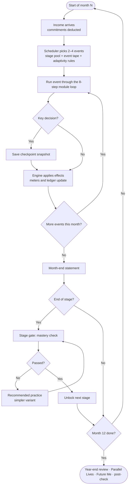
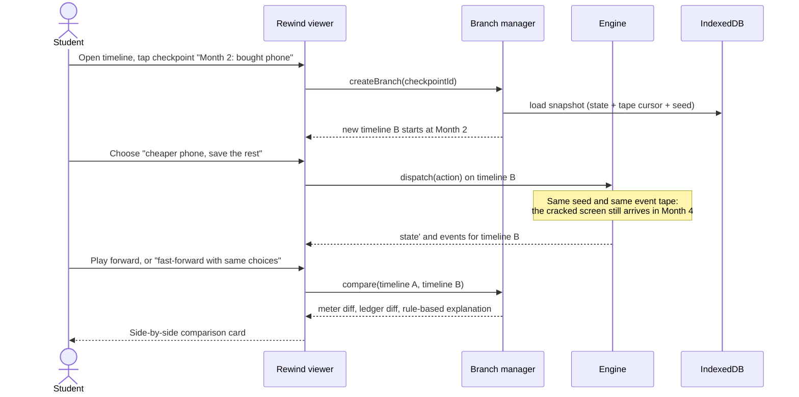
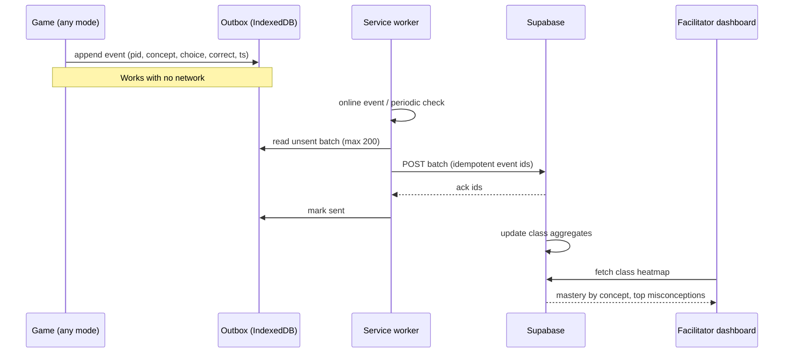
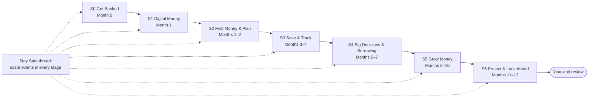
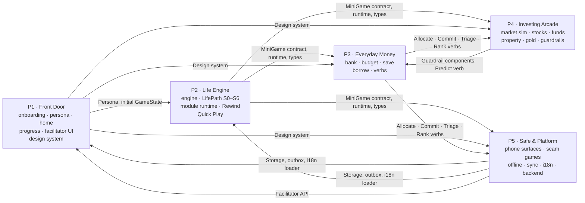

# MoneyPath — Implementation Plan

> **Learn money by living it.**
> A persona-driven financial life simulator for Grade 11–12 students in Hyderabad, built for the Vanguard India *Community Stewardship* problem statement: *"Empowering the Next Generation Through Financial Literacy."*
>
> *MoneyPath is the working product name. **LifePath** is the name of its main life-simulation mode.*

This document combines everything decided so far: the problem brief, the LifePath concept (persona life sim, mini-games, rewind and replay), the MoneyPath README (engine, verbs, scenario library, tech stack), the sequential life path starting from opening a bank account, the 10-question character builder, and the student workflow and use cases. It ends with a work split for five people.

---

## Contents

1. [Summary](#1-summary)
2. [Ground rules: what is in and what is out](#2-ground-rules-what-is-in-and-what-is-out)
3. [Product overview](#3-product-overview)
4. [Architecture](#4-architecture)
5. [End-to-end flow](#5-end-to-end-flow)
6. [Data models and shared contracts](#6-data-models-and-shared-contracts)
7. [Persona system: the 10-question character builder](#7-persona-system-the-10-question-character-builder)
8. [The LifePath sequence (stages S0–S6)](#8-the-lifepath-sequence-stages-s0s6)
9. [Rewind, Replay and Parallel Lives](#9-rewind-replay-and-parallel-lives)
10. [The learning loop and the eight verbs](#10-the-learning-loop-and-the-eight-verbs)
11. [Concept coverage map](#11-concept-coverage-map)
12. [Use cases](#12-use-cases)
13. [Work division (5 people)](#13-work-division-5-people)
14. [Integration plan and milestones](#14-integration-plan-and-milestones)
15. [Decisions log (decided and open)](#15-decisions-log-decided-and-open)
16. [Demo script](#16-demo-script)

---

## 1. Summary

MoneyPath is **a simulator, not a course**. A student builds a fictional character, then lives that character's financial life month by month. The life starts at the very beginning, opening a bank account, and moves forward in order: digital payments, a first budget, saving, borrowing decisions, growing money, and protecting it. Consequences arrive weeks or months later in simulated time. The student can get scammed, overspend and miss goals *safely*, then rewind to an earlier decision and compare the two lives side by side.

Four ways to learn sit on top of one engine:

| Mode | What it is |
|---|---|
| **LifePath** (main mode) | A 12-month persona life that moves through stages S0–S6, mixing events from all four pillars |
| **Rewind & Parallel Lives** | Go back to any key decision, choose differently, and compare both timelines under the same luck |
| **Arcade** (mini-games) | Focused games per topic: stock market, mutual funds, property, gold, compounding, budgeting, scams and more |
| **Quick Play** | A library of 5–10 minute scenarios plus a 2-minute Daily Challenge |

**Core product principle:** *One persistent life, many ways to learn, and the freedom to learn from mistakes.*

**Pilot:** ~1,500 students through NGO partners. **Designed to scale:** offline-first, content as data, language bundles, no per-student running cost.

---

## 2. Ground rules: what is in and what is out

### 2.1 Guardrails from the brief

| Rule | How it is enforced in the product |
|---|---|
| Educate, do not recommend investments | Only fictional assets and companies. No real fund, stock, bank, app or product names anywhere. Asset *categories* (e.g. "a fixed deposit") are explained neutrally. |
| Simulations are assumptions, not promises | Every projection shows a range, not a single number, and has an **Assumptions drawer** (rate, inflation, fees). A fixed banner on investing screens: *"Simulation based on assumptions. Not a prediction or advice."* |
| Educational, scalable, privacy-conscious | No email or phone number. Class code + picture-PIN. Pseudonymous IDs. Only gameplay events are synced. |

### 2.2 The "simulated only" rule

Everything a student does in MoneyPath happens to their **character, in a simulated world**. The app never asks for, stores or analyses the student's real money, real family finances or real messages.

The following ideas from earlier drafts and the README are **removed**, each with its simulated replacement:

| Removed | Why | Replaced by |
|---|---|---|
| *My Money* real pocket-money tracker | Collects real financial data from minors | **Spending Detective** (UC-SM-02) on the character's simulated phone, and the character's in-game ledger |
| *Scam Check* for real messages the student received | Processes real personal messages; a rules-engine verdict on a real message could give false reassurance | **Scam Inbox**, **Red Flag Hunter** and **The Call**, all with simulated messages (UC-SAFE-03 to 05) |
| "Report a scam to your class" / "3 students reported something similar" | Collects real-life incidents | The class sees only aggregate *learning* progress |
| 30-day real-life habit challenge | Tracks real behaviour with money | Habits are practised inside LifePath (UC-SM-01) |
| Onboarding questions on real income, family money or past scams | Sensitive data about minors and their families | The 10 questions describe the **character**, not the student (Section 7) |
| "Teach it at home" cards asking about family money | Pulls family finances into the app | Optional "Share a tip" card that teaches a concept, with nothing asked back |

What the app knows about the *real* student is limited to: preferred language, accessibility settings, a self-rated comfort level with money tasks (no amounts), learning preference, and gameplay results.

---

## 3. Product overview

### 3.1 Home screen

```
┌─────────────────────────────────────────┐
│ 🧑 Playing as: Sana (19) · Builder  🔊 🌐 ⚙️ │
├─────────────────────────────────────────┤
│ ▶ CONTINUE LIFEPATH — Month 4 · Stage S3 │  ← main card, biggest
│   💰 ₹1,240  😌 72  🤝 80  🎯 45%  🛡️ 80  │  ← cash, peace of mind, trust, goal, safety
│   ⏪ Rewind available (3 key decisions)   │
├─────────────────────────────────────────┤
│ 🎮 ARCADE           ⚡ QUICK PLAY         │
│ Stocks · Funds ·    24 scenarios ·       │
│ Property · Gold…    Daily challenge 🔥4   │
├─────────────────────────────────────────┤
│ 📈 MY PROGRESS      📖 LEARN   🧮 WHAT-IF │
│ Mastery map         Glossary   Lab        │
├─────────────────────────────────────────┤
│ 👥 MY CLASS (stretch)      🆘 HELP CARD   │
└─────────────────────────────────────────┘
  ⟳ Saved offline · will sync when online
```

The **Help card** is static educational content (what to do if money is lost to fraud: the 1930 helpline, cybercrime.gov.in, inform the bank, tell a trusted adult). It is the same card students build in the simulated Rescue Mission (UC-SAFE-10). It asks nothing and records nothing.

### 3.2 Feature list

| Feature | Description | Owner |
|---|---|---|
| Onboarding + character builder | Language, accessibility, class code, avatar, picture-PIN, 10 questions, pre-check | P1 |
| Home dashboard | Single screen, no scrolling on a phone | P1 |
| LifePath | 12-month sequential life (S0–S6), monthly events, meters, stage gates | P2 |
| Rewind & Parallel Lives | Branch from checkpoints, compare timelines, Future Me | P2 |
| Quick Play + Daily Challenge | Scenario library and spaced review | P2 (runtime) + P3/P4/P5 (content) |
| Arcade: Everyday Money | Bank Counter, budgeting, saving and borrowing games | P3 |
| Arcade: Investing | Stock Market, Mutual Fund, Property, Gold & Asset, Compounding, Time Machine and more | P4 |
| Arcade: Stay Safe | UPI Simulator, Scam Inbox, The Call, Loan App Trap, Ponzi and more | P5 |
| What-If Lab | Goal, EMI and compounding calculators that work only on the character's hypothetical numbers; nothing is stored | P3 (goal, EMI), P4 (compounding) |
| Learn | Offline glossary and 60-second explainer cards | P1 |
| My Progress | Mastery map, badges, certificate | P1 |
| Facilitator dashboard | Class setup, unlocks, heatmap, misconceptions, reports | P1 (UI) + P5 (backend) |
| Offline, sync, languages, audio | PWA, IndexedDB, sync, translation pipeline | P5 |

### 3.3 Users

| User | Needs |
|---|---|
| **Student** (Grade 11–12, 16–18 years old) | Simple, relatable, playable on a low-end or shared phone, in their language, with audio |
| **NGO facilitator** | Run sessions, see where the class is stuck, unlock content, export reports |
| **NGO / Vanguard program lead** | Aggregate learning gain across classes |
| **Content author** (teacher, NGO staff) | Add local scenarios without a developer |

---

## 4. Architecture

### 4.1 Overall architecture



### 4.2 Layers explained

| Layer | Responsibility | Key rule |
|---|---|---|
| **UI layer** | Screens and mini-game visuals. Reads state, dispatches actions. | No game logic in components. A screen never changes money directly; it sends an action to the engine. |
| **Core** | All game logic, as pure functions. | Same input + same seed = same output. This is what makes rewind, replay, offline play and unit tests possible. |
| **Content packs** | Scenarios, events, strings, audio, concept list. | Adding a scenario is a content task, not a code change. Every visible string is a translation key. |
| **Local storage** | Profiles, saves, branches, unsent events. | The app is fully playable with local storage alone. |
| **Service worker** | Caches the app shell and content packs; sends the outbox when online. | Never blocks gameplay on the network. |
| **Cloud** | Class management, event collection, aggregates for facilitators. | Receives only pseudonymous gameplay events. |
| **Authoring pipeline** | Turns spreadsheets or JSON into validated content packs. | Validation fails if a scenario references a missing string, concept or verb. |

### 4.3 Tech stack (from the README)

| Layer | Choice |
|---|---|
| Frontend | React + Vite + TypeScript |
| Styling | Tailwind CSS |
| Offline | `vite-plugin-pwa` (Workbox) + Dexie (IndexedDB) |
| App state | Zustand; the simulation engine is a separate pure reducer |
| Charts | Recharts (fan charts, ledgers, comparisons) |
| Backend | Supabase (Postgres, auth for facilitators only, edge functions) |
| Hosting | Vercel (or any static host) |

### 4.4 Repository layout

```
src/
  app/            routing, Zustand stores, providers
  design/         design system: tokens, components, icons, audio button  (P1)
  onboarding/     setup flow, character builder, pre/post check            (P1)
  home/           dashboard                                                (P1)
  progress/       mastery map, badges, certificate, Learn glossary         (P1)
  facilitator/    facilitator dashboard UI                                 (P1)
  engine/         reducer, actions, effects, RNG, event tape, mastery      (P2)
  lifepath/       stage graph, scheduler, month screen, gates, review      (P2)
  rewind/         branch manager, timeline viewer, Parallel Lives, Future Me (P2)
  runtime/        8-step module runtime + verb components                  (P2 + verb owners)
  games/
    everyday/     bank, budget, save, borrow games + goal/EMI calculators  (P3)
    investing/    market sim, investing games, compounding calculator      (P4)
    safe/         UPI sim, phone surfaces, safety games                    (P5)
  content/
    scenarios/    scenario + life-event JSON, by pillar                    (all)
    concepts.json master concept and misconception list                    (all, P2 merges)
    i18n/         en, te, hi, ur string bundles                            (P5 pipeline)
    audio/        narration files by language                              (P5 pipeline)
  platform/       PWA config, Dexie schema, sync, analytics, i18n loader   (P5)
tools/
  authoring/      spreadsheet → JSON converter, schema validator           (P5)
supabase/         SQL schema, row-level security, edge functions           (P5)
```

---

## 5. End-to-end flow

### 5.1 Flow explanation

1. **Install.** The student opens a link or scans a class QR code. The PWA installs and caches the app shell and the content pack for the chosen language. From here the app works without internet.
2. **Set up.** The student picks a language, turns on audio or large text if needed, enters the class code, picks an avatar and sets a picture-PIN. No email or phone number is asked.
3. **Build a character.** Ten short questions describe the *character* the student will play, plus how the student likes to learn. The classifier turns the answers into a persona (life stage × circumstance × money personality × maturity state, plus tags). The initial state generator gives that character starting money, income, expenses, obligations and a goal.
4. **Pre-check.** Six quick scenario questions set the starting mastery per pillar and give the baseline for measuring learning gain.
5. **Live the LifePath.** Each month the scheduler picks events for the current stage from the event tape and the content library, filtered by persona and adapted to past mistakes. Each event runs through the same 8-step module loop and is played with one of eight verbs. The engine updates state; key decisions become checkpoints.
6. **Pass stage gates.** At the end of each stage, a short mastery check unlocks the next one (S0 bank account → S1 digital money → … → S6 protect and look ahead).
7. **Branch out.** At any time the student can open the Arcade for focused practice, play Quick Play scenarios, or rewind to a checkpoint and live a parallel life. Mastery from every mode feeds one shared mastery model.
8. **Year-end review.** After month 12: the "Your Year" summary, Parallel Lives comparison, Future Me projection, post-check and certificate.
9. **Sync.** Every meaningful step writes a small anonymous event to the outbox. When the device is online, the service worker sends it to the cloud.
10. **Facilitate.** The facilitator sees class mastery by concept, the top misconceptions with discussion prompts, and students who are stuck, and can unlock stages for a session.

### 5.2 First launch and onboarding



### 5.3 The LifePath monthly loop



### 5.4 Rewind and compare



### 5.5 Offline sync



---

## 6. Data models and shared contracts

These are the interfaces the five people build against. They should be committed in `src/engine/types.ts` and `src/content/concepts.json` at the very start, so everyone can work in parallel with mock data.

### 6.1 Game state (extends the README state vector)

```ts
type GameState = {
  money: {
    cash: number;            // in hand / wallet
    bank: number;            // savings account balance (0 and locked until S0 is done)
    savingsJars: { needs: number; wants: number; future: number; emergency: number };
    debt: Debt[];            // amount, rate, lender type, dueMonth
    investments: Holding[];  // fictional assets only
    monthlyIncome: IncomeSpec;   // amount, regularity (fixed | irregular | seasonal)
    commitments: Commitment[];   // recurring: bus pass, household share, EMI, SIP
  };
  human: {
    peaceOfMind: number;     // 0–100, the felt cost of being broke
    trust: number;           // 0–100, relationships (repaid your friend?)
    safety: number;          // 0–100, how protected the character's accounts and data are
  };
  meta: {
    simMonth: number;        // 0–12
    stage: StageId;          // 'S0' … 'S6'
    goals: Goal[];           // name, target, progress, deadlineMonth
    seed: number;            // world seed, fixed for the whole life
    tapeCursor: number;      // position in the event tape
    timelineId: string;      // 'main' or a branch id
    flags: Record<string, boolean>; // e.g. hasBankAccount, hasUPI, fellForLoanApp
  };
  learn: {
    mastery: Record<ConceptId, number>;      // 0–1
    misconceptions: Record<MisconceptionId, number>; // count seen
    persona: Persona;
  };
  ledger: LedgerEntry[];     // every money movement with a reason key, used by reviews and comparisons
};
```

### 6.2 Persona profile (produced by P1, read by everyone)

```ts
type Persona = {
  lifeStage: 'school_student' | 'college_student' | 'first_earner';
  circumstance: 'dependent' | 'part_time_earner' | 'family_contributor' | 'young_entrepreneur' | 'guided_saver';
  moneyPersonality: 'saver' | 'spender' | 'supporter' | 'risk_curious';
  maturity: 'starter' | 'builder' | 'navigator';
  tags: {
    language: 'en' | 'te' | 'hi' | 'ur';
    audioFirst: boolean;
    largeText: boolean;
    timersOn: boolean;
    householdMoneyStyle: ('cash' | 'bank' | 'gold' | 'committee')[];
    interestFreeView: boolean;          // settings toggle, see Section 15
    focusPillar?: 'plan' | 'save' | 'invest' | 'safe';
    contentMix: 'games' | 'stories' | 'challenges' | 'mix';
  };
  character: { name: string; age: number; avatarId: string; goalId: string };
};
```

### 6.3 Scenario / life event (content schema, extends the README node)

```json
{
  "id": "phone_screen_cracks",
  "pillar": "save",
  "stage": ["S3", "S4"],
  "kind": "life_event",
  "personaFilter": { "lifeStage": ["school_student", "college_student"] },
  "trigger": { "type": "tape", "tapeKey": "shock_minor" },
  "checkpoint": true,
  "module": {
    "hook": { "textKey": "phone_crack.hook", "audioKey": "phone_crack.hook" },
    "play": {
      "verb": "choose",
      "options": [
        { "id": "pay_from_emergency",
          "requires": { "money.savingsJars.emergency": ">=2000" },
          "effects": { "money.savingsJars.emergency": -2000, "human.peaceOfMind": 5 },
          "concepts": { "emergency_fund": 0.9 },
          "next": "phone_crack.result_calm" },
        { "id": "loan_app",
          "effects": { "money.debt.add": { "amount": 2000, "lender": "loan_app" }, "human.safety": -15 },
          "concepts": { "true_cost_of_debt": 0.2 },
          "misconception": "debt_is_free_money",
          "flags": { "fellForLoanApp": true },
          "next": "phone_crack.result_debt" }
      ]
    },
    "why": { "optionsKeys": ["phone_crack.why.a", "phone_crack.why.b", "phone_crack.why.c"], "correct": "a" },
    "concept": { "textKey": "concept.emergency_fund", "icon": "shield" },
    "check": ["q_emergency_01", "q_emergency_02"],
    "reward": { "badge": "emergency_ready", "xp": 20 }
  },
  "advance": { "days": 0 }
}
```

`requires` hides an option the character cannot afford. `next` points to result cards. `flags` feed adaptivity (Section 8.4). Every `textKey` must exist in every language bundle or the validator fails.

### 6.4 Mini-game contract (between P2's runtime and P3/P4/P5's games)

```ts
interface MiniGame {
  id: string;
  verbs: Verb[];
  concepts: ConceptId[];
  levels: (1 | 2 | 3)[];
  play(ctx: MiniGameContext): Promise<MiniGameResult>;   // renders inside the runtime's PLAY step
}

type MiniGameContext = {
  persona: Persona;
  level: 1 | 2 | 3;
  seed: number;               // so a replay is identical
  stateSlice: Partial<GameState>; // e.g. cash and goals when launched from LifePath; a sandbox slice in the Arcade
  mode: 'lifepath' | 'arcade' | 'quickplay' | 'daily';
};

type MiniGameResult = {
  choices: { stepId: string; choiceId: string; correct?: boolean; ms: number }[];
  conceptDeltas: Record<ConceptId, number>;
  misconceptions: MisconceptionId[];
  effects?: EffectMap;        // applied to GameState only in 'lifepath' mode
  summaryKey: string;         // shown on the RESULT step
};
```

Rule: in Arcade and Quick Play mode, `effects` are **not** applied to the LifePath character. Only mastery is shared.

### 6.5 Event log (outbox → cloud)

```json
{ "eid": "01JA…", "pid": "c7f2…", "class": "HYD-OC-07", "mode": "lifepath",
  "activity": "UC-SAFE-01", "concept": "upi_collect", "choice": "entered_pin",
  "correct": false, "misconception": "pin_needed_to_receive",
  "level": 1, "lifeStage": "college_student", "stage": "S1", "timeline": "main",
  "ts": 1760090000 }
```

No names, no free text, no device identifiers. `pid` is a random ID created on the device and linked to the class code only.

### 6.6 Snapshot (rewind)

```ts
type Snapshot = {
  id: string;
  timelineId: string;
  checkpointEventId: string;   // the decision this snapshot sits before
  simMonth: number;
  state: GameState;            // full serialized state, including seed and tapeCursor
  labelKey: string;            // "Month 2: bought a phone"
  createdAt: number;
};
```

### 6.7 Concept and misconception list

One master file, `src/content/concepts.json`, owned jointly and merged by P2. Every scenario, mini-game, mastery check and facilitator view uses these IDs. The full list is in Section 11.

---

## 7. Persona system: the 10-question character builder

### 7.1 Principles

- The questions describe **the character the student wants to play**. Students can choose a life close to their own or explore a different one, without disclosing anything about their actual family.
- Every question is one screen, picture options with audio, a "Surprise me" or "Skip" option, and no typing.
- Settings that come before the questions (language, audio, text size) are not counted in the 10.

### 7.2 The 10 questions

| # | Question (student-facing) | Options | Sets |
|---|---|---|---|
| 1 | **Who do you want to play as?** | School student (17, Class 12) · College student (19) · First-time earner (21) · Surprise me | `lifeStage`, character age |
| 2 | **Where does your character's money come from?** (options filtered by Q1) | Allowance from family · Scholarship · Part-time work (tutoring, delivery) · A first salary · Helping in the family shop | `circumstance`, income type |
| 3 | **Who does your character live with, and what do they pay for?** | Family, pays only for themselves · Family, shares some household bills · Supports younger siblings · Hostel or shared room | Obligations, `circumstance` refinement |
| 4 | **What is your character's big goal this year?** | A laptop · Coaching or college fees · A bike · Starting a small business · Helping family with a big expense · A new phone | Goal, goal amount, storyline |
| 5 | **How does your character's family usually keep its savings?** (pick any) | Cash at home · Bank · Gold · Committee / chit · Not sure | `householdMoneyStyle` (decides which examples appear) |
| 6 | **Your character suddenly gets ₹1,000. What do they do first?** | Save it · Treat friends · Give it to family · Try to make it grow fast | `moneyPersonality` (saver / spender / supporter / risk_curious) |
| 7 | **How much have *you* done with money tasks so far?** (no amounts) | Not much yet · Paid at shops in cash · Used a bank account or UPI · Help with payments at home | Starting `maturity` hint, S0/S1 test-out offer |
| 8 | **What do you want to get better at first?** | Planning and budgeting · Saving · Investing and markets · Staying safe from scams | `focusPillar` (more events and Arcade suggestions in that pillar) |
| 9 | **How do you like to learn?** | Short games · Stories · Timed challenges · A mix | `contentMix`, `timersOn` |
| 10 | **Scenario:** "Your character has ₹500. The bus pass is ₹300 and a friend's party costs ₹250. What do you do first?" | 4 picture options | Baseline `maturity` |

### 7.3 Classification (reference implementation)

The classifier is a pure function `classify(answers): Persona` in `src/onboarding/classify.ts`, so the method can be swapped later (see Section 15).

| Output | Rule |
|---|---|
| `lifeStage` | Q1 directly; "Surprise me" picks randomly, weighted towards school student |
| `circumstance` | Q2 + Q3: allowance + no bills → dependent; part-time → part_time_earner; shares bills or supports siblings → family_contributor; family shop or business goal → young_entrepreneur; allowance + family decides + "help family" goal → guided_saver |
| `moneyPersonality` | Q6 directly |
| `maturity` | Score = Q7 (0–3) + Q10 (0–3). 0–2 → starter, 3–4 → builder, 5–6 → navigator |
| `tags` | Q5, Q8, Q9 and the settings screens |

### 7.4 Persona matrix

| | Dependent | Part-time earner | Family contributor | Young entrepreneur | Guided saver |
|---|---|---|---|---|---|
| **School student (17)** | Allowance, laptop or phone goal | Weekend tutoring | Helps with household bills | Helps in family shop | Family manages money |
| **College student (19)** | Scholarship + allowance | Tutoring or delivery, irregular | Sends money home | Side business | Hostel, fixed allowance |
| **First-time earner (21)** | — (not offered) | Gig work | Salary, main household support | Small business | Salary handed to family |

Each cell × 3 maturity states = up to 42 starting combinations. Content is shared and personalised through variables (names, amounts, places), with a small number of persona-specific events.

### 7.5 Initial state generator

`generateInitialState(persona, seed): GameState` in `src/onboarding/initialState.ts`. Base values, adjusted by modifiers:

| Life stage + income | Starting cash | Monthly income | Regularity | Fixed monthly needs | Starting bank |
|---|---|---|---|---|---|
| School student, allowance | ₹300 | ₹800 | Fixed | ₹350 (bus pass, recharge) | ₹0 (no account until S0) |
| School student, tutoring | ₹500 | ₹1,000–2,000 | Irregular | ₹350 | ₹0 |
| College student, scholarship | ₹1,500 | ₹3,500 (paid twice a year as lump sums + ₹1,000/month allowance) | Seasonal | ₹2,200 (hostel/mess share, transport) | ₹0 |
| College student, part-time | ₹1,000 | ₹2,500–5,000 | Irregular | ₹2,000 | ₹0 |
| First-time earner, salary | ₹2,000 | ₹12,000 | Fixed | ₹6,500 (rent share, transport, food) | ₹0 |
| Family business | ₹800 | ₹2,000–6,000 | Irregular | ₹1,500 | ₹0 |

| Modifier | Effect |
|---|---|
| Shares household bills | +₹1,000–3,000 commitment "household share" |
| Supports siblings | +₹1,500 commitment "siblings' school costs" |
| Hostel | Needs +20%, family meter removed |
| Goal | Laptop ₹25,000 · coaching ₹6,000 · bike ₹30,000 · business ₹10,000 · family expense ₹8,000 · phone ₹8,000. Goals above one year of saving become two-year goals shown in Future Me |
| Maturity | Starter: amounts rounded to ₹50 coins, no percentages. Navigator: percentages and custom jars visible |
| Seed | Small random variation (±10%) so classmates with the same persona don't have identical lives |

All characters start **unbanked** so that every LifePath begins at S0. Students whose Q7 answer shows banking experience get a "test out" option at S0 and S1 (Section 8.3).

---

## 8. The LifePath sequence (stages S0–S6)

### 8.1 Stage map



### 8.2 What happens in each stage

| Stage | Real-life milestone | Core concepts | Main activities (use case IDs) | Safety event in this stage | Gate (to unlock next stage) |
|---|---|---|---|---|---|
| **S0 Get Banked** | Documents, choosing and opening an account, welcome kit | Why bank, documents, account types, minor accounts, KYC, nominee, PIN secrecy | UC-BANK-01 Document Hunt, UC-BANK-02 Bank Counter | Fake "KYC incomplete" SMS right after opening (UC-SAFE-03 item) | 3 questions: documents, account type, never share PIN |
| **S1 Digital Money** | UPI setup, paying, QR codes, transaction history | UPI PIN, pay vs collect, QR, refunds, identity protection | UC-SAFE-01 UPI Simulator, UC-SAFE-02 Identity Vault | Collect-request scam when selling an old item | Pay vs collect check |
| **S2 First Money & Plan** | First allowance, salary or earnings | Needs vs wants, budget jars, goals, opportunity cost | UC-PB-01 Swipe Sort, UC-PB-02 Jar Split, UC-PB-03 Goal Builder, UC-PB-04 Phone vs Coaching | Prize / lucky draw message | Build a budget that covers needs |
| **S3 Save & Track** | Building habits, first surprise expense | Pay yourself first, tracking, emergency fund, where to keep money, lending to friends | UC-SM-01, UC-SM-02, UC-SM-03, UC-SM-04, UC-SM-05, UC-PB-06 market trip, UC-PB-07 festival | Job / task scam on WhatsApp | Emergency fund question + spending leak question |
| **S4 Big Decisions & Borrowing** | Phone or bike purchase, college or coaching costs, lean months | True cost of debt, EMI, BNPL, credit score, education loans vs scholarships, irregular income | UC-BR-01, UC-BR-02, UC-BR-03, UC-PB-05, UC-SM-06 sale, UC-SAFE-06 Loan App Trap | Loan app ad, "The Call" impersonation | Compare two borrowing options by total cost |
| **S5 Grow Money** | Savings start piling up; "what if they grew?" | Inflation, compounding, risk/return, time horizon, diversification, pooled funds, property, gold | UC-INV-01 to UC-INV-05 in LifePath; UC-INV-06 to 10 unlocked in the Arcade | Telegram tips / celebrity "double it" | Match a goal timeline to a risk level |
| **S6 Protect & Look Ahead** | Planning the next year | Insurance as risk pooling, scams around investing, recovery steps | UC-SM-07 Insurance Pool, UC-SAFE-08 Ponzi, UC-SAFE-09 sort, UC-SAFE-10 Rescue Mission | Friend's "double your money" scheme | Post-check (counts as gate) |

### 8.3 Gating and test-out

- A stage gate is 2–3 scenario questions using concepts from that stage. Passing threshold and retry rules are configurable (see Section 15).
- **Test-out:** a student with banking or UPI experience (Q7) can take the S0 or S1 gate first. If they pass, the stage is completed in under 2 minutes and the character's bank account is opened automatically.
- **Facilitator override:** a facilitator can unlock a stage for the whole class for a dedicated session (e.g. an investing workshop). The LifePath still runs in order for each student; overridden stages also open in the Arcade.
- The Arcade's pillar sections unlock in a matching order: Everyday Money and Stay Safe are open from the start; Investing opens once S3 is passed, because you invest from savings after building an emergency fund. **The unlock order itself teaches that.**

### 8.4 Scheduler and adaptivity rules

The scheduler is `pickEvents(state, contentLibrary, tape): EventRef[]` in `src/lifepath/scheduler.ts`.

1. Take the events for the current stage, filtered by `personaFilter` and `requires`.
2. Add any **tape events** due this month (shocks, festivals, scam messages, market moves). These are exogenous and fixed by the seed.
3. Add **adaptive events** from flags and misconceptions:

| If | Then |
|---|---|
| `fellForLoanApp` | Schedule the debt follow-up event next month and UC-BR-01 Debt Cost Ladder later; mark Everyday Money "Recommended" |
| Misconception `pin_needed_to_receive` seen | Repeat a collect-request variant within 2 months |
| `peaceOfMind` < 30 for two months | Schedule a "breathing space" event (a cheaper outing, a small win) and a jar re-plan |
| Goal reached early | Unlock a stretch goal and an S5 "what if it grew?" preview |
| No emergency fund at start of S4 | The next shock is guaranteed before S5 |
| Mastery of a concept < 0.4 after its stage | Add a Daily Challenge item for that concept |

4. Order the month's events so there are 2–4 per month and no two of the same pillar in a row.
5. Persona `focusPillar` adds one extra event from that pillar every other month.

### 8.5 Festivals and local context (content variables)

Festivals and places come from content variables chosen by persona tags and seed: Bonalu, Sankranti, Ramzan/Eid, Diwali, Christmas; Charminar market, Necklace Road, Irani chai, Ramoji Film City trip, local kirana vs supermarket. No festival is tied to a religion question; the seed and household style rotate them so each class sees a mix.

---

## 9. Rewind, Replay and Parallel Lives

### 9.1 What the student can do

| Feature | Description |
|---|---|
| **Timeline** | A horizontal strip of the 12 months with icons for each key decision (checkpoint) |
| **Rewind** | Tap a checkpoint → "Try a different choice". A new timeline branches from that point; the original is kept |
| **Fast-forward** | After the new choice, optionally replay the rest of the year automatically using the same later choices where they still apply |
| **Compare** | Side-by-side cards: meters, cash, savings, debt, goal progress, and a ledger diff ("you paid ₹1,100 in loan fees in Life A") |
| **Parallel Lives** | At year end, see up to three timelines together, plus Future Me at 25 for each |
| **Luck check** | Optional toggle to rerun the *same choices* under a different seed, to show the difference between luck and decisions (used in the investing games and Time Machine) |

### 9.2 Rules that make comparisons fair

- **Same luck:** a branch keeps the world seed and the event tape. A shock scheduled for Month 4 arrives in Month 4 in both timelines. Only consequences of the student's choices differ. This addresses the LifePath document's point that players may otherwise confuse luck with decision quality.
- **Endogenous vs exogenous events:** tape events (shocks, festivals, market moves, scam messages) are fixed. Consequence events (e.g. a loan app harassment message) depend on flags in that timeline.
- **No permanent loss:** the main timeline is never overwritten. The student can mark any timeline as "My life" to continue from it.
- **Not right or wrong:** the comparison explains trade-offs ("Life A had more fun in Month 2 and less peace of mind in Month 4"), not a verdict.

### 9.3 Implementation notes

| Item | Detail |
|---|---|
| Checkpoints | Any event with `"checkpoint": true` saves a `Snapshot` before the decision. Target 6–10 per year |
| Storage | Snapshots in IndexedDB. A full `GameState` is under 30 KB; 10 snapshots × 3 timelines stays under 1 MB |
| Branch limit | Configurable; default 3 timelines per life to keep the comparison readable |
| Fast-forward | Replays recorded actions from the original timeline after the branch point; stops and asks when an action is no longer valid (e.g. not enough money) |
| Explanation | Rule-based, from the ledger diff: largest differences in money, meters and flags, mapped to explanation templates. No AI in the gameplay path |
| Future Me | Deterministic projection to age 25 using the year's habits (savings rate, debt, emergency fund, diversification) with ranges and the Assumptions drawer. The avatar shows habits (calm, prepared), never wealth comparisons |

---

## 10. The learning loop and the eight verbs

### 10.1 The 8-step module loop (every activity)

Every LifePath event, Quick Play scenario and Arcade round runs inside the same wrapper, built by P2 in `src/runtime/ModuleRunner.tsx`. Students learn the pattern once.

| Step | What the student sees | Notes |
|---|---|---|
| 1 **Hook** | 30-second story card with audio | "Imran's phone screen just cracked…" |
| 2 **Play** | The mini-game or decision, using one or more verbs | Rendered by the game owner's component |
| 3 **Result** | Consequence animation, meters change | Ledger entry with reason |
| 4 **Why?** | "What happened?" Tap one of 3 reasons | Detects misconceptions |
| 5 **Concept** | One-line idea + icon + audio | "An emergency fund is money kept only for surprises" |
| 6 **Try again** | Optional rewind or a variant | In LifePath this links to Rewind |
| 7 **Check** | 2–3 scenario questions | Updates mastery |
| 8 **Reward** | Badge or progress, optional "Share a tip" card, back to where they came from | No real-life questions |

Short items (Daily Challenge, gate questions) use only steps 2, 3, 5 and 7.

### 10.2 The eight verbs (from the README)

| Verb | Student does | App shows | Built by |
|---|---|---|---|
| **Choose** | Taps 1 of 2–4 options | Narrative card, state change, ledger entry | P2 |
| **Allocate** | Drags coins or sliders across jars | Month-end statement: what leaked, what survived | P3 |
| **Commit** | Sets a recurring amount and duration | A locked obligation that bites if income drops | P3 |
| **Triage** | Swipes items left/right | Instant feedback plus the ones they got wrong | P3 |
| **Rank** | Orders a list | Cost of their order vs the best order, in ₹ | P3 |
| **Predict** | Guesses an outcome before the reveal | Guess-vs-reality chart; the gap is the lesson | P4 |
| **Judge** | Legit / suspicious / scam verdict | The hidden tells, revealed on the artefact | P5 |
| **Act in-situ** | Taps inside a simulated UPI, chat, SMS or call screen, sometimes on a timer | Money actually moves in the simulation, then the post-mortem | P5 |

Each verb is a reusable React component that takes props from the scenario JSON and returns choices in the `MiniGameResult` format. Any owner can use any verb.

### 10.3 Mastery model

- Each concept has a mastery value from 0 to 1. Every answer moves it: `m = m + rate × (target − m)`, where `target` is the `concepts` value on the chosen option and `rate` is 0.3 for checks and 0.15 for in-play choices.
- Concept status: red < 0.4, amber 0.4–0.7, green > 0.7.
- **Stuck rule:** after 2 misses on a concept, show a hint with audio. After 3, offer a simpler variant (one level down).
- **Spaced review:** a concept that turns green is scheduled for a Daily Challenge item after 3, 7 and 14 days.
- Pre-check and post-check use separate item pools from the same concepts, so learning gain is measured on unseen items.

---

## 11. Concept coverage map

Every concept, where it is taught, and the activity that teaches it. IDs are used in `concepts.json`.

### 11.1 Get Banked and Digital Money (S0–S1)

| Concept ID | Concept | Taught in |
|---|---|---|
| `why_bank_account` | Safety, records, receiving scholarships or salary | UC-BANK-02 |
| `kyc_documents` | Aadhaar, PAN awareness, photo, address proof | UC-BANK-01 |
| `account_types` | Savings, zero-balance (BSBD), minor accounts with a guardian | UC-BANK-02 |
| `minimum_balance_fees` | Minimum balance and charges | UC-BANK-02 |
| `nominee` | Why a nominee matters | UC-BANK-02 |
| `pin_secrecy` | PIN, OTP and password never shared | UC-BANK-02, UC-SAFE-01, UC-SAFE-02 |
| `upi_collect` | A PIN is only needed to pay, never to receive | UC-SAFE-01 |
| `qr_scam` | Scanning a QR code sends money | UC-SAFE-01 |
| `refunds_failed_txn` | Failed payments and refunds | UC-SAFE-01 |
| `identity_protection` | What never to share, what to share carefully | UC-SAFE-02 |

### 11.2 Plan & Budget

| Concept ID | Concept | Taught in |
|---|---|---|
| `needs_vs_wants` | Sorting spending | UC-PB-01 |
| `context_dependence` | The same item can be a need or a want | UC-PB-01 |
| `budget_jars` | Needs / Wants / Future split | UC-PB-02 |
| `fixed_vs_variable` | Fixed and variable costs | UC-PB-02, UC-PB-06 |
| `goal_setting` | Specific, measurable, time-bound goals | UC-PB-03 |
| `opportunity_cost` | What you give up | UC-PB-04 |
| `irregular_income` | Plan for the average month | UC-PB-05 |
| `unit_price` | Comparing price per unit | UC-PB-06 |
| `peer_pressure` | Saying no or "not now" | UC-PB-07 |

### 11.3 Save & Manage, and Borrowing

| Concept ID | Concept | Taught in |
|---|---|---|
| `pay_yourself_first` | Save first, spend the rest | UC-SM-01 |
| `expense_tracking` | Small leaks add up | UC-SM-02 |
| `emergency_fund` | Buffer for surprises | UC-SM-03 |
| `where_to_keep_money` | Safe, accessible, grows trade-off | UC-SM-04 |
| `interest_basics` | Simple interest on savings | UC-SM-04 |
| `lending_boundaries` | Lending to friends, trust | UC-SM-05 |
| `impulse_buying` | Sales and intent | UC-SM-06 |
| `risk_pooling` | Insurance as sharing risk | UC-SM-07 |
| `true_cost_of_debt` | Compare total repaid, not instalment | UC-BR-01 |
| `emi` | How EMIs work | UC-BR-02 |
| `bnpl` | Buy now pay later costs | UC-BR-01 |
| `credit_score` | Credit history as a "trust meter" | UC-BR-02 |
| `education_financing` | Scholarships vs education loans, cost vs return of options | UC-BR-03 |

### 11.4 Understand Investing

| Concept ID | Concept | Taught in |
|---|---|---|
| `inflation` | Money loses buying power | UC-INV-01 |
| `simple_vs_compound` | Growth on growth | UC-INV-02 |
| `start_early` | Time in the market | UC-INV-02 |
| `risk_return` | Higher possible return, bigger swings | UC-INV-03 |
| `volatility_vs_loss` | A dip is not a loss unless you sell | UC-INV-03 |
| `behaviour_gap` | Panic selling, FOMO | UC-INV-03, UC-INV-07 |
| `time_horizon` | Money needed soon takes less risk | UC-INV-04 |
| `uncertainty_ranges` | No one can promise a single number | UC-INV-04 |
| `diversification` | Spreading reduces the chance of losing everything | UC-INV-05, UC-INV-08 |
| `stock_basics` | Owning part of a company, price moves, news | UC-INV-07 |
| `bid_ask_liquidity` | Buyers, sellers, price discovery (Navigator level) | UC-INV-07 |
| `pooled_funds` | How a fund pools money, NAV | UC-INV-08 |
| `fees_cost` | Costs reduce returns over time | UC-INV-08, UC-INV-10 |
| `sip_concept` | Regular investing, rupee cost averaging | UC-INV-08 |
| `property_costs` | Upfront, registration, maintenance, EMI, liquidity | UC-INV-09 |
| `liquidity` | How fast you can turn it into cash | UC-INV-09, UC-INV-10 |
| `gold_costs` | Making charges, purity, resale | UC-INV-10 |
| `asset_comparison` | Cash, deposit, equity, gold, property behave differently | UC-INV-10 |
| `speculation_vs_investing` | Investing vs gambling vs scams | UC-SAFE-09 |

### 11.5 Stay Financially Safe

| Concept ID | Concept | Taught in |
|---|---|---|
| `red_flags` | Urgency, too good to be true, asks for secrets, pretends, secrecy | UC-SAFE-04 |
| `fake_kyc` | Fake bank / KYC messages | UC-SAFE-03 |
| `prize_scam` | Lottery and "processing fee" | UC-SAFE-03 |
| `job_scam` | Task and work-from-home fraud | UC-SAFE-03 |
| `impersonation` | "Mom, new number", fake officers, "digital arrest" | UC-SAFE-03, UC-SAFE-05 |
| `loan_app` | Predatory apps, permissions, harassment is illegal | UC-SAFE-06 |
| `pump_and_dump` | Telegram tips, fake screenshots | UC-SAFE-07 |
| `deepfake_endorsement` | Fake celebrity endorsements | UC-SAFE-07 |
| `ponzi` | Paying old investors with new money | UC-SAFE-08 |
| `regulated_check` | Real lenders and advisers are registered (RBI, SEBI) | UC-SAFE-06, UC-SAFE-09 |
| `recovery_steps` | 1930, cybercrime.gov.in, bank, evidence, trusted adult | UC-SAFE-10 |

### 11.6 Misconceptions tracked (examples)

`everything_i_want_is_need` · `fun_is_bad` · `save_what_is_left` · `small_spends_dont_matter` · `debt_is_free_money` · `compare_emi_not_total` · `pin_needed_to_receive` · `bank_will_call_for_otp` · `guaranteed_returns_exist` · `dip_means_loss` · `one_stock_is_enough` · `property_always_profits` · `gold_has_no_costs` · `recruiting_is_normal_income` · `too_late_to_report`

---

## 12. Use cases

### 12.1 How to read a use case

Each use case has the same structure:

- **Owner** (person from Section 13), **where it lives** (LifePath stage, Arcade, Quick Play, system), **verbs** used, and whether it is in the **MVP** or a **stretch** goal.
- **Goal:** what the student (or facilitator) achieves.
- **Trigger** and **preconditions.**
- **Main flow:** numbered steps of what the user does and what the system does.
- **Alternate flows:** branches, errors and edge cases.
- **Variations:** how persona and level change it.
- **Concepts** taught and **success criteria** (what "done" means for the developer).

### 12.2 Use case index

| ID | Name | Owner | Where | MVP |
|---|---|---|---|---|
| UC-SYS-01 | Install and first launch | P1 | System | ✅ |
| UC-SYS-02 | Build a character (10 questions) | P1 | System | ✅ |
| UC-SYS-03 | Take the pre-check and post-check | P1 | System | ✅ |
| UC-SYS-04 | Return as a player on a shared device | P1 | System | ✅ |
| UC-SYS-05 | Navigate the home dashboard | P1 | System | ✅ |
| UC-SYS-06 | View the mastery map and practise weak spots | P1 | Progress | ✅ |
| UC-SYS-07 | Earn badges and a certificate | P1 | Progress | ✅ |
| UC-SYS-08 | Look up a term in Learn | P1 | Learn | Stretch |
| UC-SYS-09 | Change language, audio and accessibility | P1 | Settings | ✅ |
| UC-FAC-01 | Create a class and join code | P1 (UI) / P5 (API) | Facilitator | ✅ |
| UC-FAC-02 | Plan sessions and unlock stages | P1 / P5 | Facilitator | ✅ |
| UC-FAC-03 | See the class heatmap and top misconceptions | P1 / P5 | Facilitator | ✅ |
| UC-FAC-04 | See individual progress and stuck students | P1 / P5 | Facilitator | Stretch |
| UC-FAC-05 | Print offline worksheets | P1 | Facilitator | Stretch |
| UC-FAC-06 | Export a report | P1 / P5 | Facilitator | Stretch |
| UC-FAC-07 | Answer student doubts | P1 / P5 | Facilitator | Stretch |
| UC-LIFE-01 | Play a LifePath month | P2 | LifePath | ✅ |
| UC-LIFE-02 | Pass a stage gate | P2 | LifePath | ✅ |
| UC-LIFE-03 | Test out of a stage | P2 | LifePath | Stretch |
| UC-LIFE-04 | Rewind to a key decision | P2 | Rewind | ✅ |
| UC-LIFE-05 | Compare timelines and see Parallel Lives | P2 | Rewind | ✅ |
| UC-LIFE-06 | Year-end review and Future Me | P2 | LifePath | ✅ |
| UC-LIFE-07 | Play a Quick Play scenario | P2 | Quick Play | ✅ |
| UC-LIFE-08 | Do the Daily Challenge | P2 | Quick Play | Stretch |
| UC-LIFE-09 | Resume after an interruption | P2 | System | ✅ |
| UC-LIFE-10 | Ask for investment advice (guard) | P2 | System | ✅ |
| UC-CLASS-01 | Class mastery leaderboard | P2 | Class | Stretch |
| UC-CLASS-02 | Challenge a classmate on the same life | P2 | Class | Stretch |
| UC-BANK-01 | Document Hunt | P3 | S0 | ✅ |
| UC-BANK-02 | Bank Counter: open an account | P3 | S0 | ✅ |
| UC-PB-01 | Needs vs Wants Swipe Sort | P3 | S2 | ✅ |
| UC-PB-02 | Jar Split: first monthly budget | P3 | S2 | ✅ |
| UC-PB-03 | Goal Builder | P3 | S2 | ✅ |
| UC-PB-04 | Phone vs Coaching: opportunity cost | P3 | S2 | Stretch |
| UC-PB-05 | Good Month, Lean Month: irregular income | P3 | S4 | Stretch |
| UC-PB-06 | Family Market Trip | P3 | S3 | Stretch |
| UC-PB-07 | Festival and Peer Pressure | P3 | S3 | Stretch |
| UC-SM-01 | Pay Yourself First | P3 | S3 | Stretch |
| UC-SM-02 | Spending Detective | P3 | S3 | ✅ |
| UC-SM-03 | Surprise Month: emergency fund | P3 | S3 | ✅ |
| UC-SM-04 | Where to Keep Your Money | P3 | S3 | Stretch |
| UC-SM-05 | A Friend Needs ₹2,000 | P3 | S3 | Stretch |
| UC-SM-06 | The 70%-Off Sale | P3 | S4 | Stretch |
| UC-SM-07 | Insurance Pool | P3 | S6 | Stretch |
| UC-BR-01 | Debt Cost Ladder | P3 | S4 | ✅ |
| UC-BR-02 | Bike: EMI vs Save-and-Buy | P3 | S4 | Stretch |
| UC-BR-03 | Education Choice | P3 | S4 | Stretch |
| UC-TK-01 | What-If Lab: goal and EMI calculators | P3 | What-If Lab | Stretch |
| UC-INV-01 | Chai Price Time Travel (inflation) | P4 | S5 | ✅ |
| UC-INV-02 | Compounding Garden / ₹500 a month for 10 years | P4 | S5 | ✅ |
| UC-INV-03 | Risk & Return Ride (the crash) | P4 | S5 | Stretch |
| UC-INV-04 | Time Machine (500 futures) | P4 | S5 | ✅ |
| UC-INV-05 | Basket Builder (diversification) | P4 | S5 | Stretch |
| UC-INV-06 | Where to Park ₹10,000 (Arcade hub) | P4 | Arcade | Stretch |
| UC-INV-07 | Stock Market Simulator | P4 | Arcade | ✅ |
| UC-INV-08 | Mutual Fund Challenge | P4 | Arcade | ✅ |
| UC-INV-09 | Property Deal Simulator | P4 | Arcade | Stretch |
| UC-INV-10 | Gold & Asset Challenge | P4 | Arcade | Stretch |
| UC-INV-11 | Trading Pit (classroom multiplayer) | P4 | Arcade | Stretch |
| UC-TK-02 | What-If Lab: compounding calculator | P4 | What-If Lab | Stretch |
| UC-SAFE-01 | UPI Simulator: pay vs collect | P5 | S1 | ✅ |
| UC-SAFE-02 | Identity Vault | P5 | S1 | Stretch |
| UC-SAFE-03 | Scam Inbox | P5 | All stages | ✅ |
| UC-SAFE-04 | Red Flag Hunter | P5 | Arcade | Stretch |
| UC-SAFE-05 | The Call | P5 | S4 | Stretch |
| UC-SAFE-06 | Loan App Trap | P5 | S4 | Stretch |
| UC-SAFE-07 | The Telegram Group and Celebrity Says Double It | P5 | S5 | Stretch |
| UC-SAFE-08 | The Pyramid (Ponzi) | P5 | S6 | Stretch |
| UC-SAFE-09 | Investing, Gambling or Scam? | P5 | S6 | Stretch |
| UC-SAFE-10 | Rescue Mission | P5 | S6 | ✅ |
| UC-PLAT-01 | Play offline and sync later | P5 | System | ✅ |
| UC-PLAT-02 | Receive a content pack update | P5 | System | Stretch |
| UC-PLAT-03 | Author a new scenario | P5 | Authoring | Stretch |
| UC-PLAT-04 | Download another language | P5 | System | ✅ |

MVP totals: P1 11 · P2 8 · P3 8 · P4 5 · P5 5. P4's and P5's MVP items are the heavier simulations (market engine, phone surfaces, sync), which balances the counts (see Section 13.7).

---

### 12.3 System and player use cases (P1)

#### UC-SYS-01 · Install and first launch
**Owner:** P1 (screens) with P5 (PWA install) · **Where:** System · **MVP:** ✅
**Goal:** a student gets from a link or QR code to a ready app without needing data again.
**Trigger:** the facilitator shares a link or shows a class QR code. **Preconditions:** a browser on Android 8+ or any modern phone; internet for this first visit only.
**Main flow**
1. The student opens the link. The app shell loads (target under 3 MB) and shows "Add to home screen".
2. The student picks a language (four big buttons with the language's own script and audio).
3. Accessibility screen: audio narration on/off, larger text, reduce motion.
4. The student enters the class code (6 characters, large keypad) or scans the class QR.
5. The student picks an avatar from 12 illustrated options and sets a 4-picture PIN.
6. The app downloads the content pack for the chosen language in the background and moves on to UC-SYS-02.

**Alternate flows**
- *Invalid class code:* the code is checked against a cached class list; if offline, it is accepted provisionally and validated at the next sync.
- *Data drops mid-download:* the student can continue with the core pack (S0–S2 in their language); the rest downloads later.
- *No class code (self-learner):* "Play without a class" creates a local-only profile with no sync.

**Concepts:** none · **Success criteria:** full setup under 2 minutes; works on a 2 GB RAM Android phone; app usable in airplane mode immediately after.

#### UC-SYS-02 · Build a character (10 questions)
**Owner:** P1 · **Where:** System · **MVP:** ✅
**Goal:** create a persona and starting financial state without asking about the student's real finances.
**Trigger:** first launch after setup, or "New life" from settings. **Preconditions:** language chosen.
**Main flow**
1. Intro card: "You're going to live someone's money life for a year. Build your character."
2. Questions 1–10 (Section 7.2) one per screen, each with pictures and audio; a progress bar shows 1/10 … 10/10.
3. Options in Q2 are filtered by the answer to Q1.
4. The student names the character (pick from suggested local names or type one) and confirms the avatar.
5. `classify(answers)` produces a `Persona`; `generateInitialState(persona, seed)` produces the starting `GameState`.
6. A **character card** shows: name, age, where money comes from, who they live with, the goal and a short story line ("Sana, 19, gets a scholarship twice a year and wants a laptop by next Sankranti").
7. The student taps "Start this life" or "Change something" (goes back to any question).

**Alternate flows**
- *Skip / Surprise me:* default values are used and marked in the persona so analytics can separate them.
- *Student wants a life like their own:* nothing changes; the character card always makes clear it is a character.

**Variations:** the Q10 scenario uses the amounts of the character just built.
**Concepts:** none directly · **Success criteria:** every combination of answers produces a valid persona and state (unit tested for all combinations); completion under 3 minutes.

#### UC-SYS-03 · Take the pre-check and post-check
**Owner:** P1 · **Where:** System · **MVP:** ✅
**Goal:** measure where the student starts and how much they learned.
**Trigger:** after UC-SYS-02 (pre); after the year-end review (post). **Preconditions:** persona exists.
**Main flow**
1. Framing card: "Not a test. Let's see where you start."
2. Six scenario questions, 1–2 per pillar, picture options and audio; no timer.
3. Answers set initial mastery for the concepts each item covers (capped at 0.5 so they still play through).
4. No score is shown at the pre-check; the student sees "Your journey starts at Stage S0".
5. At the post-check, six new items on the same concepts; the result screen shows growth per pillar ("Stay Safe: 2 → 5 out of 6").

**Alternate flows:** *Student exits midway:* answered items are saved; the rest are asked on next launch.
**Success criteria:** pre and post pools never share an item; results emitted as events with `mode: "precheck" | "postcheck"`.

#### UC-SYS-04 · Return as a player on a shared device
**Owner:** P1 · **Where:** System · **MVP:** ✅
**Goal:** several students can use one phone without seeing each other's lives.
**Trigger:** app launch when more than one profile exists, or "Switch player" in the dashboard. **Preconditions:** at least one profile on the device.
**Main flow**
1. A grid of avatars with first names or nicknames.
2. The student taps their avatar and enters their picture-PIN.
3. The dashboard opens at "Continue: Month 4" for that profile.

**Alternate flows**
- *Wrong PIN 3 times:* a 30-second wait; the facilitator can reset a PIN from the dashboard (UC-FAC-04).
- *Forgotten PIN on a self-learner profile:* the profile can be restarted, but not opened.
- *More than 8 profiles:* the grid scrolls; the oldest inactive profiles can be archived to the facilitator's sync.

**Success criteria:** profiles are fully isolated in IndexedDB; switching takes under 5 seconds.

#### UC-SYS-05 · Navigate the home dashboard
**Owner:** P1 · **Where:** Home · **MVP:** ✅
**Goal:** the student always knows what to do next.
**Trigger:** after login or after finishing any activity.
**Main flow**
1. The dashboard (Section 3.1) shows the main LifePath card with current month, stage and meters.
2. The student taps **Continue** (main path), **Arcade**, **Quick Play**, **Progress**, **Learn** or **What-If Lab**.
3. Locked items show a lock and a one-line reason in audio ("Investing opens after you build an emergency fund in Stage S3").
4. A "Recommended" tag appears on the Arcade section the scheduler flags (Section 8.4).

**Alternate flows:** *First visit:* a guided tour with at most 3 tooltips. *Resume available:* an activity left midway shows "Resume" on its card.
**Success criteria:** the dashboard fits a 360×640 screen without scrolling; every tile has an icon, a label and audio.

#### UC-SYS-06 · View the mastery map and practise weak spots
**Owner:** P1 · **Where:** Progress · **MVP:** ✅
**Goal:** the student sees what they understand and fixes weak areas.
**Trigger:** tap "My Progress". **Preconditions:** at least one activity played.
**Main flow**
1. Four pillar rings, each made of concept dots coloured red, amber or green (Section 10.3).
2. Tapping a pillar lists its concepts with a plain-language name and status.
3. "Your weak spots" shows up to 3 red concepts, each with a **Practise** button.
4. Practise opens the shortest Quick Play or Arcade activity that teaches that concept, at one level down if the student has been stuck.

**Alternate flows:** *No weak spots:* shows "Next challenge" (the next locked stage or a harder level).
**Success criteria:** the map reads directly from `learn.mastery`; it works offline; it matches what the facilitator sees after sync.

#### UC-SYS-07 · Earn badges and a certificate
**Owner:** P1 · **Where:** Progress · **MVP:** ✅
**Goal:** reward progress in a way that matters to students, families and NGOs.
**Trigger:** reward step of a module, stage completion, or post-check completion.
**Main flow**
1. A badge animation plays at the Reward step (e.g. 🛡️ *Emergency Ready*, 🕵️ *Scam Spotter*, 🌱 *Patient Planter*).
2. Badges collect in a shelf in My Progress.
3. After the post-check, a certificate is generated on the device: student's display name, class, NGO name, pillars completed, and date.
4. The student can save it as an image or PDF, or the facilitator can print it in bulk.

**Alternate flows:** *Not all stages done:* a "Participation" certificate lists the stages completed.
**Rule:** badges reward understanding and good process (e.g. building an emergency fund), never the amount of simulated money.
**Success criteria:** certificate generation works offline; layout supports all four languages including Urdu right-to-left.

#### UC-SYS-08 · Look up a term in Learn
**Owner:** P1 · **Where:** Learn · **MVP:** Stretch
**Goal:** quick, plain-language explanations of terms such as SIP, FD, inflation, UPI, EMI, KYC, NAV.
**Trigger:** tap "Learn", or tap any underlined term inside a scenario.
**Main flow**
1. Searchable list (works in all languages, also searches English terms typed in any script).
2. Each term has a one-line definition, a 60-second explainer card with an illustration and audio, and "Where you'll see this" linking to the activity that teaches it.

**Success criteria:** fully offline; at least 40 terms at launch; terms are part of the content pack.

#### UC-SYS-09 · Change language, audio and accessibility
**Owner:** P1 (UI) with P5 (bundles) · **Where:** Settings · **MVP:** ✅
**Goal:** the student can learn in the language and format that works for them.
**Trigger:** the 🌐 or 🔊 icon on any screen, or Settings.
**Main flow**
1. Pick English, Telugu, Hindi or Urdu. If the pack is not on the device, UC-PLAT-04 runs.
2. The UI switches immediately; Urdu switches the layout to right-to-left.
3. Toggles: audio narration, auto-play audio, larger text, reduce motion, timers off, interest-free view (see Section 15).

**Success criteria:** no restart needed; every screen tested in RTL; all toggles stored in the persona tags.

---

### 12.4 Facilitator use cases (P1 UI, P5 backend)

#### UC-FAC-01 · Create a class and join code
**Goal:** a facilitator sets up a class in minutes. **Trigger:** facilitator signs in (email login for facilitators only) and taps "New class". **MVP:** ✅
**Main flow**
1. Enter class name, NGO, school/centre, language default and expected size.
2. The system creates a 6-character join code and a QR code.
3. The facilitator prints or shows the QR; students join through UC-SYS-01.
4. A consent checklist reminds the facilitator that parental consent is collected offline by the NGO before students join.

**Success criteria:** class creation works on a phone; the code is unique; the class appears in the dashboard immediately.

#### UC-FAC-02 · Plan sessions and unlock stages
**Goal:** match the app to the session plan. **Trigger:** "Plan" tab. **MVP:** ✅
**Main flow**
1. The facilitator sees the S0–S6 path and the Arcade sections.
2. They can unlock a stage or Arcade section for the whole class, from a date.
3. They can choose a "session focus" (e.g. Stay Safe week), which raises that pillar's events in Quick Play and the Daily Challenge.
4. Changes reach student devices at their next sync; a QR "session code" can apply an unlock instantly in an offline classroom.

**Success criteria:** unlocks never skip a student's LifePath order (Section 8.3); they apply to the Arcade and Quick Play.

#### UC-FAC-03 · See the class heatmap and top misconceptions
**Goal:** know what to discuss in the next session. **Trigger:** "Class" tab. **MVP:** ✅
**Main flow**
1. A heatmap: rows are concepts grouped by pillar, columns are red/amber/green counts (or per-student columns in detailed view).
2. "Top 3 misconceptions this week", each with a ready-made 10-minute discussion prompt and the activity to replay together.
3. Pre → post learning gain per pillar once post-checks exist.
4. Last-sync time per device so the facilitator knows how fresh the data is.

**Success criteria:** works with 50 students per class and 30 classes per NGO; no student names leave the class view.

#### UC-FAC-04 · See individual progress and stuck students
**MVP:** Stretch · **Main flow:** list of students by display name with stage, last active, red concepts and a "stuck" flag (3+ misses on a concept); tapping a student shows their mastery map; the facilitator can reset a forgotten PIN.
**Success criteria:** individual views are visible only to that class's facilitator (row-level security).

#### UC-FAC-05 · Print offline worksheets
**MVP:** Stretch · **Main flow:** pick a stage or concept → a printable PDF with 2–3 scenario cards, a jar-split sheet or a scam message to mark up, in the class language. For no-device days.

#### UC-FAC-06 · Export a report
**MVP:** Stretch · **Main flow:** choose date range and classes → CSV and a one-page PDF summary (participation, completion by stage, learning gain by pillar, top misconceptions). Aggregate only.

#### UC-FAC-07 · Answer student doubts
**MVP:** Stretch · **Main flow:** a student taps "Ask a doubt" on a concept card and picks from preset doubt types ("I didn't understand why", "Can we discuss this in class?"); no free text in v1. The facilitator sees doubts grouped by concept and marks them "discussed".
**Rule:** doubts are about the game's concepts only; no personal financial details can be entered.

---

### 12.5 LifePath, Rewind and Quick Play use cases (P2)

#### UC-LIFE-01 · Play a LifePath month
**Owner:** P2 · **Where:** LifePath · **Verbs:** any · **MVP:** ✅
**Goal:** the student lives one month of the character's life, making 2–4 decisions.
**Trigger:** "Continue LifePath" on the dashboard. **Preconditions:** a persona and a game state exist.
**Main flow**
1. Month intro: calendar page, the character's income arrives (animation of coins into the wallet or bank), commitments are deducted.
2. The scheduler (Section 8.4) returns the month's events.
3. Each event runs in the module runner (Section 10.1), calling the owner's mini-game or verb in the Play step.
4. The engine applies effects; meters update with small animations; a ledger line is added for each money movement.
5. Key decisions are saved as checkpoints (a small ⏪ icon appears on the timeline).
6. Month-end statement: income, spent on needs, wants, saved, debt, and one line of feedback ("Your Future jar grew by ₹200").
7. "Next month" or "Back to home".

**Alternate flows**
- *Not enough money for an option:* the option shows greyed with the reason ("₹600 short").
- *Cash goes negative:* the engine forces a "shortfall" event: borrow from family, a loan app, or cut a want; this sets up later debt lessons.
- *Peace of mind very low:* the next month includes a breathing-space event (Section 8.4).

**Variations:** amounts, places and names from the persona; Starter level shows coins instead of numbers.
**Success criteria:** one month plays in 5–8 minutes; state after the month is identical for the same seed and choices (unit test).

#### UC-LIFE-02 · Pass a stage gate
**Owner:** P2 · **Where:** LifePath · **Verbs:** Choose, Judge, Allocate · **MVP:** ✅
**Goal:** confirm the student understands the stage before moving on.
**Trigger:** the last month of a stage ends.
**Main flow**
1. "Stage check: 3 quick situations" card.
2. Three items from the stage's gate pool, drawn from concepts in that stage.
3. Pass: a stage completion animation, badge, and the next stage's intro story.
4. Fail: the student sees which concept was missed and is offered a short practice activity (one level down), then retries with different items.

**Alternate flows:** *Third fail:* the stage unlocks anyway with a "Recommended practice" tag, so no student is blocked forever; the facilitator sees the flag.
**Success criteria:** gate thresholds and retry counts are configuration, not code.

#### UC-LIFE-03 · Test out of a stage
**Owner:** P2 · **Where:** LifePath (S0, S1) · **MVP:** Stretch
**Goal:** students who already bank or use UPI don't repeat basics.
**Trigger:** start of S0 or S1 when the Q7 answer shows experience.
**Main flow:** offer "Already know this? Take the 1-minute check" → gate items → pass: the stage completes, the character's account or UPI is set up automatically, mastery is set to amber (not green, so the concepts still appear in review) → fail: the normal stage plays.

#### UC-LIFE-04 · Rewind to a key decision
**Owner:** P2 · **Where:** Rewind · **Verbs:** any · **MVP:** ✅
**Goal:** try a different choice and see what changes, without losing the original life.
**Trigger:** the ⏪ button on the dashboard, the "Try again" step of the module loop, or the year-end review. **Preconditions:** at least one checkpoint.
**Main flow**
1. The timeline shows the 12 months with checkpoint icons and short labels ("M2 · Bought a phone ₹7,500").
2. The student taps a checkpoint and sees the original choice highlighted.
3. "Live this differently" creates a branch from the snapshot (Section 9).
4. The student picks a different option; the life continues from that point on timeline B.
5. The student can play forward month by month, or tap "Fast-forward" to replay later choices automatically until something needs a new decision.
6. At any point, "Compare" opens UC-LIFE-05.

**Alternate flows**
- *Branch limit reached:* the student chooses a timeline to replace.
- *Fast-forward hits an impossible action:* it stops and asks the student to choose.

**Success criteria:** shocks and other tape events happen in the same months in both timelines; the original timeline is untouched (unit test comparing serialized states).

#### UC-LIFE-05 · Compare timelines and see Parallel Lives
**Owner:** P2 · **Where:** Rewind · **MVP:** ✅
**Goal:** understand *why* the two lives differ.
**Trigger:** "Compare" in the Rewind viewer, or the year-end review.
**Main flow**
1. Two (or three) columns, one per timeline, at the same month.
2. Rows: cash, bank, savings jars, debt, investments, goal progress, peace of mind, trust, safety.
3. A **"What made the difference"** card lists the top 3 drivers from the ledger diff ("Loan app fees: ₹1,100", "Emergency fund covered the screen repair").
4. A line chart of total money and peace of mind across months for each timeline.
5. A trade-off sentence, not a verdict ("Life A was more fun in Month 2; Life B was calmer in Month 4").

**Success criteria:** the explanation is rule-based and testable; chart readable on a 360 px screen.

#### UC-LIFE-06 · Year-end review and Future Me
**Owner:** P2 · **Where:** LifePath · **MVP:** ✅
**Goal:** pull the year together and show the long-term effect of habits.
**Trigger:** Month 12 ends.
**Main flow**
1. **"Your Year"** summary: goal reached or not, emergencies handled, scams avoided, debt taken, where money went (simple pie).
2. **Parallel Lives:** if branches exist, a side-by-side summary of each.
3. **Future Me at 25:** the avatar's older self, shaped by habits (prepared, calm, in debt), with a projected range and the Assumptions drawer.
4. Post-check (UC-SYS-03).
5. Certificate (UC-SYS-07) and "Replay as a different character".

**Rule:** Future Me shows habits, never a rich vs poor comparison.
**Success criteria:** works from any persona and any combination of branches.

#### UC-LIFE-07 · Play a Quick Play scenario
**Owner:** P2 (runtime and library screen); content by P3/P4/P5 · **Where:** Quick Play · **MVP:** ✅
**Goal:** play a single 5–10 minute scenario outside the LifePath.
**Trigger:** "Quick Play" on the dashboard.
**Main flow**
1. A map grouped by pillar shows the 24 scenarios from the README library plus the capstone; completed ones show a tick and mastery colour.
2. The student picks one; it runs through the module loop with a **sandbox character** generated from their persona (their LifePath character is unaffected).
3. Debrief shows what happened and what it cost; "Replay and take the other branch" compares both runs.

**Success criteria:** scenario effects never touch the LifePath state; mastery updates are shared.

#### UC-LIFE-08 · Do the Daily Challenge
**Owner:** P2 · **Where:** Quick Play · **MVP:** Stretch
**Goal:** a 2-minute item that keeps concepts fresh and builds a streak.
**Main flow:** the review scheduler (Section 10.3) picks a due concept → one short item (a Judge, Triage or Predict) → immediate feedback → streak flame updates.
**Rule:** missing a day never removes badges or progress; the streak simply restarts.

#### UC-LIFE-09 · Resume after an interruption
**Owner:** P2 · **Where:** System · **MVP:** ✅
**Goal:** nothing is lost if the phone is taken away, the battery dies or a call comes in.
**Main flow:** state is saved after every module step → on next login, the dashboard shows "Resume: Month 4, phone screen event" → the student returns to the exact step.
**Success criteria:** killing the app at any step and reopening loses at most the current tap.

#### UC-LIFE-10 · Ask for investment advice (guard)
**Owner:** P2 · **Where:** System · **MVP:** ✅
**Goal:** keep the app within the guardrail when students ask "what should I buy?"
**Trigger:** the "Which one should I buy?" chip that appears on investing screens and in Learn (there is no free-text box).
**Main flow:** a static card in all languages: "MoneyPath teaches how money works, not what to buy. For real decisions, talk to a trusted adult or a registered adviser." It links to the `regulated_check` explainer.

#### UC-CLASS-01 · Class mastery leaderboard
**Owner:** P2 · **MVP:** Stretch · **Main flow:** the class sees a ranking by **concepts mastered** and a class goal ("340 / 500 activities completed"), never by simulated money. Display names only; a student can hide their name.

#### UC-CLASS-02 · Challenge a classmate on the same life
**Owner:** P2 · **MVP:** Stretch · **Main flow:** a student shares a short challenge code (persona + seed + scenario); the classmate plays the same life with the same luck; both see a comparison of decisions and outcomes. Works offline by showing the code as a QR.


---

### 12.6 Everyday Money use cases: Get Banked, Plan & Budget, Save & Manage, Borrowing (P3)

#### UC-BANK-01 · Document Hunt
**Owner:** P3 · **Where:** LifePath S0, Arcade · **Verbs:** Triage · **MVP:** ✅
**Goal:** know which documents are needed to open a bank account and why.
**Trigger:** start of S0 ("Your scholarship can only be paid into a bank account in your name"). **Preconditions:** character is unbanked.
**Main flow**
1. A room scene (desk, cupboard, bag) with tappable items: Aadhaar card, PAN card, passport photo, school ID, a sibling's ID, an electricity bill, a cinema ticket, a guardian's ID.
2. The student drags items into a "Bank folder".
3. The folder is checked: correct items glow; wrong items bounce back with a reason in audio ("This is your sibling's ID. The bank needs yours").
4. For under-18 characters, the guardian's ID is required and a card explains minor accounts.
5. Concept card: "KYC means Know Your Customer: the bank checks you are really you."

**Alternate flows:** *Character lacks a document (seeded):* a branch shows where and how it can be obtained (Aadhaar centre, PAN application) and the stage continues once the "application" completes a month later.
**Variations:** L1 uses only 5 items; L3 adds address-proof edge cases (hostel residents).
**Concepts:** `kyc_documents`, `why_bank_account` · **Success criteria:** all items and reasons are content-driven; works with Triage component.

#### UC-BANK-02 · Bank Counter: open an account
**Owner:** P3 · **Where:** LifePath S0 · **Verbs:** Choose, Allocate · **MVP:** ✅
**Goal:** open the character's first account and understand what comes with it.
**Trigger:** UC-BANK-01 done.
**Main flow**
1. A generic bank counter with a clerk character (no real bank branding).
2. The clerk asks which account; three cards: savings account, zero-balance basic account, minor account with guardian (shown only if the character is under 18). Each card shows minimum balance, charges and features with icons.
3. The student fills a simplified illustrated form: name, address, nominee (with a one-line "why nominee" explanation), and signature.
4. A welcome kit opens: passbook, debit card, a PIN envelope. The student sets the PIN on a screen that dims when "someone is looking" (another character walks by), teaching to cover the keypad.
5. The character's `bank` balance opens with the first deposit; `flags.hasBankAccount = true`.
6. Right after, a "KYC incomplete, click to update" SMS arrives (handed to UC-SAFE-03 as a single message).

**Alternate flows:** *Student picks an account with a minimum balance they can't maintain:* in Month 2 a charge appears on the statement, with an option to switch.
**Concepts:** `account_types`, `minimum_balance_fees`, `nominee`, `pin_secrecy`, `why_bank_account` · **Success criteria:** bank becomes available to every later activity; the account choice affects later statements.

#### UC-PB-01 · Needs vs Wants Swipe Sort
**Owner:** P3 · **Where:** LifePath S2, Arcade, Quick Play ("Pocket Money Week") · **Verbs:** Triage · **MVP:** ✅
**Goal:** sort spending into needs and wants, and see that context matters.
**Trigger:** first S2 event, or from the Arcade.
**Main flow**
1. Cards with picture, price and audio: bus pass ₹300, new sneakers ₹1,800, phone recharge ₹299, biryani with friends ₹250, exam fee ₹500, a gaming skin ₹149.
2. Swipe left for Need, right for Want.
3. Some cards return with context: "Phone recharge, *and your classes are online*". The student sorts again.
4. After 8 cards, a summary explains each one the student sorted differently, with "here's another way to see it" for items that are genuinely ambiguous.

**Variations:** cards are drawn from the persona's life (hostel mess fees for college students, household share for earners).
**Concepts:** `needs_vs_wants`, `context_dependence` · **Misconceptions:** `everything_i_want_is_need`, `fun_is_bad`.
**Success criteria:** 30+ cards in the content pool; no item labelled strictly "wrong" when it is ambiguous.

#### UC-PB-02 · Jar Split: the first monthly budget
**Owner:** P3 · **Where:** LifePath S2 (every payday after), Arcade · **Verbs:** Allocate · **MVP:** ✅
**Goal:** split income into Needs, Wants and Future (and later Emergency), so known bills are covered.
**Trigger:** first payday in S2.
**Main flow**
1. Income arrives as coin stacks scaled to the character (₹800 allowance, ₹3,500 scholarship, ₹12,000 salary).
2. Three jars: 🏠 Needs, 🎉 Wants, 🌱 Future. The student drags coins or moves sliders.
3. Known bills for the month are attached to the Needs jar.
4. Live check: if the bills exceed the Needs jar, it overflows and the Next button asks "Your bus pass won't be covered. Change your plan?"
5. The plan is saved and used by the engine for that month's events; a month-end statement shows what leaked and what survived.

**Alternate flows:** *Family contributor:* needs take ~80%; feedback acknowledges this ("When most money goes to needs, even ₹100 in Future is a strong start").
**Variations:** L1 uses ₹50 coins and no percentages; L3 shows percentages, an Emergency jar and custom jars (e.g. "Family share").
**Concepts:** `budget_jars`, `fixed_vs_variable` · **Success criteria:** the Allocate component is reusable by P4 (e.g. investment mix) and by Debt Cost Ladder.

#### UC-PB-03 · Goal Builder
**Owner:** P3 · **Where:** LifePath S2, Arcade · **Verbs:** Commit, Predict · **MVP:** ✅
**Goal:** turn the character's goal into a concrete plan with a timeline.
**Trigger:** after the first Jar Split.
**Main flow**
1. The character's goal from onboarding (e.g. laptop ₹25,000) appears with a picture.
2. The student predicts how many months it will take at the current Future jar amount.
3. A slider sets the monthly amount; a timeline animation shows the month it's reached ("at ₹500/month: Sankranti next year").
4. The student makes the goal specific by tapping options: exact item, amount, date.
5. The goal becomes the 🎯 meter in LifePath as a `Commit` (a recurring transfer to Future).

**Alternate flows:** *Goal over a year away:* the plan splits into a year-1 milestone and shows the rest in Future Me.
**Concepts:** `goal_setting` · **Success criteria:** the commitment is enforced by the engine in later months and bites if income drops.

#### UC-PB-04 · Phone vs Coaching: opportunity cost
**Owner:** P3 · **Where:** LifePath S2, Quick Play · **Verbs:** Choose · **MVP:** Stretch
**Goal:** see what is given up with each choice.
**Trigger:** tape or story event: friends planning a Ramoji Film City trip (₹1,200), or a new phone vs coaching fees.
**Main flow:** options (pay from Wants, take from goal fund, suggest a cheaper outing such as Necklace Road and chai for ₹150, skip) → result shows what was given up ("This trip = 2.4 months of your laptop goal") and the effect on peace of mind → skipping everything also lowers peace of mind, teaching balance rather than deprivation.
**Concepts:** `opportunity_cost` · **Checkpoint:** yes.

#### UC-PB-05 · Good Month, Lean Month: irregular income
**Owner:** P3 · **Where:** LifePath S4 (part-time, gig and business characters), Arcade · **Verbs:** Allocate, Commit · **MVP:** Stretch
**Goal:** plan for the average month, not the best one.
**Main flow:** a good month (₹6,000) → the student chooses how much to keep as a buffer → a lean month (₹1,500) arrives from the tape → the effect of the buffer is visible on bills and peace of mind → a summary shows average income over the three months.
**Concepts:** `irregular_income`, `emergency_fund`.

#### UC-PB-06 · Family Market Trip
**Owner:** P3 · **Where:** LifePath S3, Arcade · **Verbs:** Allocate, Rank · **MVP:** Stretch
**Goal:** compare prices per unit and stay within a household budget.
**Main flow:** ₹1,000 and a list (rice, dal, oil, vegetables, soap) → two shops (kirana and supermarket) with different prices and pack sizes → the student fills a basket within budget → feedback shows unit prices and how much a better basket would have saved, in ₹.
**Concepts:** `unit_price`, `fixed_vs_variable`.

#### UC-PB-07 · Festival and Peer Pressure
**Owner:** P3 · **Where:** LifePath S3, Quick Play ("Festival Pressure") · **Verbs:** Choose · **MVP:** Stretch
**Goal:** handle social spending pressure.
**Main flow:** a festival from the content variables (Bonalu, Sankranti, Eid, Diwali, Christmas) or "Everyone's buying the new team jersey ₹899" → options include *what the character says to friends* ("I'm saving for something", "next month", "let's do something cheaper") as well as money options → trust and peace of mind change with the response.
**Concepts:** `peer_pressure`, `opportunity_cost`.

#### UC-SM-01 · Pay Yourself First
**Owner:** P3 · **Where:** LifePath S3, Quick Play ("First Income") · **Verbs:** Predict, Commit · **MVP:** Stretch
**Goal:** see that the order of saving matters more than the amount.
**Main flow:** two versions of the character play the same month side by side → A saves what's left at the end, B moves ₹100 to Future on payday → the student predicts which ends with more → the animation runs both → B is offered as a Commit for the rest of the year.
**Concepts:** `pay_yourself_first` · **Misconception:** `save_what_is_left`.

#### UC-SM-02 · Spending Detective
**Owner:** P3 · **Where:** LifePath S3, Arcade · **Verbs:** Triage, Rank · **MVP:** ✅
**Goal:** see how small digital payments add up.
**Trigger:** "Where did my money go?" event in Month 3.
**Main flow**
1. The character's simulated phone shows a UPI-style history for the month generated from their actual LifePath choices plus tape items: ₹20 chai ×22, ₹49 game top-ups ×6, small recharges, food delivery.
2. Task: "Sana thinks she spent ₹500 on small things. Find where the rest went." The student tags transactions by category.
3. A pie chart shows categories; a callout converts one leak to a year ("Chai = ₹440/month = ₹5,280/year").
4. The student ranks leaks by size and picks one to reduce; the effect over 6 months is projected.

**Data rule:** all transactions are simulated; nothing from a real phone or bank is used.
**Concepts:** `expense_tracking` · **Misconception:** `small_spends_dont_matter`.
**Success criteria:** history generated from the ledger so it reflects the student's own in-game choices.

#### UC-SM-03 · Surprise Month: the emergency fund
**Owner:** P3 · **Where:** LifePath S3 (tape shock), Quick Play ("Cracked Screen") · **Verbs:** Choose · **MVP:** ✅
**Goal:** understand why an emergency fund exists.
**Trigger:** a tape shock: phone screen ₹2,000, a family member's medicine ₹1,500, a compulsory school trip fee, bicycle repair.
**Main flow**
1. Hook card with audio.
2. *If the character has a buffer:* they pay calmly; meters stay steady; 🛡️ *Emergency Ready* badge.
3. *If not:* options: borrow from family (trust cost), a loan app (hands over to the Loan App Trap thread), skip a need, sell something.
4. Reflection: "How much buffer would have been enough?" The student sets an emergency target (e.g. one month of needs) and an Emergency jar appears in Jar Split.

**Concepts:** `emergency_fund` · **Checkpoint:** yes (a favourite rewind point).

#### UC-SM-04 · Where to Keep Your Money
**Owner:** P3 · **Where:** LifePath S3, Arcade · **Verbs:** Allocate · **MVP:** Stretch
**Goal:** compare places to keep money by safety, access and growth.
**Main flow:** the student splits savings across cards (cash at home, bank savings, recurring or fixed deposit, post office savings, family committee/chit), each rated 🔒 Safe · ⚡ Easy to access · 🌱 Grows → a 6-month event sequence tests the choice (cash goes missing, an urgent need, a festival) → summary of the trade-offs.
**Guardrail:** categories explained neutrally, no bank or product names. **Interest-free view:** when enabled, interest-free options are shown first with an explanation that it is a valid choice; the lesson stays the trade-off.
**Concepts:** `where_to_keep_money`, `interest_basics`, `liquidity`.

#### UC-SM-05 · A Friend Needs ₹2,000
**Owner:** P3 · **Where:** LifePath S3, Quick Play · **Verbs:** Choose · **MVP:** Stretch
**Goal:** handle lending with trust and boundaries.
**Main flow:** a friend asks for ₹2,000 → options: lend all, lend part, say no kindly, help another way → the tape decides whether the friend repays late, on time or not at all (same in all branches) → trust and money change; the debrief discusses lending only what you can afford to lose.
**Concepts:** `lending_boundaries`.

#### UC-SM-06 · The 70%-Off Sale
**Owner:** P3 · **Where:** LifePath S4, Quick Play · **Verbs:** Choose, Predict · **MVP:** Stretch
**Goal:** tell impulse from intent.
**Main flow:** a flash sale with a countdown on headphones the character didn't plan to buy → buy now / add to goal list / skip → a week later the same item is on sale again; a "wait 48 hours" rule card is introduced.
**Concepts:** `impulse_buying`, `opportunity_cost`.

#### UC-SM-07 · Insurance Pool
**Owner:** P3 · **Where:** LifePath S6, Arcade · **Verbs:** Commit, Predict · **MVP:** Stretch
**Goal:** understand insurance as many people sharing a risk.
**Main flow:** 20 characters each put ₹50 a month into a pool → random events hit a few of them (illness, accident) → those covered by the pool pay little; those outside it face the full cost → the student predicts how many will need help and sees how the pool works; government scheme *types* are mentioned as concepts only.
**Concepts:** `risk_pooling`.

#### UC-BR-01 · Debt Cost Ladder
**Owner:** P3 · **Where:** LifePath S4, Arcade · **Verbs:** Rank, Choose · **MVP:** ✅
**Goal:** compare borrowing options by the total amount paid back.
**Trigger:** the character needs ₹2,000 for 3 months (shortfall event or story).
**Main flow**
1. Options: family or friend (₹0 interest, a trust cost), a local moneylender (~10% a month), an instant loan app (processing fee, high interest, late penalty, harassment risk), buy now pay later.
2. The student ranks them from cheapest to most expensive.
3. A ladder animation shows the total repaid for each (e.g. ₹2,000 vs ₹2,600 vs ₹3,100+), and the cost of their ranking vs the best one.
4. The student chooses one; a follow-up event "you miss one payment" shows what happens for that option.

**Concepts:** `true_cost_of_debt`, `bnpl` · **Misconceptions:** `debt_is_free_money`, `compare_emi_not_total` · **Checkpoint:** yes.

#### UC-BR-02 · Bike: EMI vs Save-and-Buy
**Owner:** P3 · **Where:** LifePath S4, Quick Play · **Verbs:** Commit, Predict · **MVP:** Stretch
**Goal:** see the true cost of credit and what a credit history is.
**Main flow:** a ₹30,000 bike: EMI over 12 months vs saving for 8 months then buying → the student predicts which costs more → both play out; the EMI is a Commit that bites in the lean month → a "trust meter" introduces the idea of a credit score: paying on time builds it, missing payments damages it.
**Concepts:** `emi`, `credit_score`, `true_cost_of_debt`.

#### UC-BR-03 · Education Choice
**Owner:** P3 · **Where:** LifePath S4 (school and college students), Arcade · **Verbs:** Choose, Rank · **MVP:** Stretch
**Goal:** weigh education paths by cost, time and funding.
**Main flow:** options such as entrance coaching, a degree college, ITI or vocational training, a job straight after school → each card shows fees, duration and a range of possible earnings *(illustrative, not a promise)* → funding options: scholarships, an education loan (with total-cost ladder), family support, part-time work → the student picks a path and funding mix; the choice shapes events in S5–S6.
**Concepts:** `education_financing`, `opportunity_cost`, `true_cost_of_debt`.

#### UC-TK-01 · What-If Lab: goal and EMI calculators
**Owner:** P3 · **Where:** What-If Lab · **MVP:** Stretch
**Goal:** explore numbers freely for the character's situation.
**Main flow:** the Goal calculator opens pre-filled with the character's goal and income ("₹X by month Y → ₹Z per month"); the EMI calculator shows total repaid and total interest for a loan amount, rate and duration; the student can change numbers freely.
**Rule:** values are hypothetical and are not stored; every result shows its assumptions.

---

### 12.7 Investing use cases (P4)

**Guardrails on every screen in this section:** fictional assets only (e.g. "Steady Box", "Mixed Basket", "Bumpy Ride", "Chaiwala Ltd", "Hyd Mobile Repairs"); results shown as ranges; the Assumptions drawer; the fixed banner *"Simulation based on assumptions. Not a prediction or advice."*

#### UC-INV-01 · Chai Price Time Travel (inflation)
**Owner:** P4 · **Where:** LifePath S5 opener, Quick Play ("Silent Thief") · **Verbs:** Predict · **MVP:** ✅
**Goal:** understand that money that doesn't grow loses buying power.
**Trigger:** start of S5 ("Sana has ₹4,000 saved. What will it buy in 10 years?").
**Main flow**
1. A chai stall across time: ₹5 when the character's parents were young → ₹10 → ₹15 → ₹20 today.
2. The student predicts the price in 10 years with a slider.
3. A range is revealed (based on a labelled inflation assumption).
4. "₹1,000 kept in a box for 10 years: how many chais then?" The cups visibly shrink from 50 to around 25–30.
5. Concept card: inflation; the Assumptions drawer shows the rate used.

**Concepts:** `inflation` · **Success criteria:** the inflation rate comes from the shared assumptions config.

#### UC-INV-02 · Compounding Garden / ₹500 a month for 10 years
**Owner:** P4 · **Where:** LifePath S5, Quick Play (flagship screen), Arcade · **Verbs:** Predict, Commit · **MVP:** ✅
**Goal:** feel the difference between simple and compound growth, and the value of starting early.
**Main flow**
1. A seed (₹1,000 or ₹500 a month) planted in a garden; each year it grows fruit.
2. Two modes side by side: **simple** (only the seed gives fruit) and **compound** (fruit gives fruit too).
3. The student predicts the value after 10 years before pressing play (README "Predict" pattern).
4. Fast-forward 5, 10, 20 years; a guess-vs-reality chart shows the gap.
5. "Start at 18 vs start at 28": two gardens show how much starting early matters.

**Variations:** L1 visual only (trees and fruit); L2 shows numbers; L3 adds the Rule of 72.
**Concepts:** `simple_vs_compound`, `start_early` · **Success criteria:** the growth rate is a labelled assumption the student can change in the drawer.

#### UC-INV-03 · Risk & Return Ride (the crash)
**Owner:** P4 · **Where:** LifePath S5, Quick Play ("The Crash") · **Verbs:** Choose, Predict · **MVP:** Stretch
**Goal:** see that higher possible return comes with bigger ups and downs, and that panic-selling locks in losses.
**Main flow**
1. Three paths: 🐢 Steady Box (small, steady), 🧺 Mixed Basket (medium, some dips), 🎢 Bumpy Ride (higher average, big swings).
2. The student invests a simulated ₹10,000 in one and watches 5 years month by month.
3. After a 25% drop on the Bumpy Ride (scheduled by the tape for every student who chose it), a choice: sell everything / wait / add more.
4. The outcome plays out; the debrief compares all three choices on the same path.

**Concepts:** `risk_return`, `volatility_vs_loss`, `behaviour_gap` · **Misconception:** `dip_means_loss` · **Checkpoint:** yes.

#### UC-INV-04 · Time Machine (500 futures)
**Owner:** P4 · **Where:** LifePath S5 (signature screen), Arcade · **Verbs:** Allocate, Predict · **MVP:** ✅
**Goal:** match how much risk a goal can take to when the money is needed; understand that no one can promise a single number.
**Main flow**
1. Choose a goal and when it's needed: college in 2 years, a business in 10 years, Future Me at 40.
2. Choose a mix of the three paths (Allocate).
3. Press **Run 500 futures**: a fan chart shows a shaded band (most futures) and a median line.
4. A card: "In most simulated futures you'd have between ₹X and ₹Y. In some bad ones, ₹Z."
5. Insight: for a 2-year goal, the Bumpy Ride band includes losses → "Money needed soon should take less risk." For 20 years, the band is wider but higher.

**Concepts:** `time_horizon`, `uncertainty_ranges`, `risk_return` · **Success criteria:** 500 simulations run in under 1 second on a low-end phone (pre-computed or Web Worker); seeded so the same inputs give the same chart.

#### UC-INV-05 · Basket Builder (diversification)
**Owner:** P4 · **Where:** LifePath S5, Quick Play ("All Eggs, One Basket") · **Verbs:** Allocate · **MVP:** Stretch
**Goal:** see that spreading reduces the chance of losing everything.
**Main flow:** build a basket from 6 fictional mini-businesses (tea shop, mobile repair, farm, tech start-up, textile shop, bus operator) → 10 rounds of sector events from the tape ("heavy rain hurts the farm", "new phone launch helps repair") → compare all-in-one vs spread across several.
**Note:** explained as owning small parts of businesses (profit-sharing), which also suits the interest-free view.
**Concepts:** `diversification` · **Misconception:** `one_stock_is_enough`.

#### UC-INV-06 · Where to Park ₹10,000 (Arcade hub)
**Owner:** P4 · **Where:** Arcade entry screen · **Verbs:** Allocate, Predict · **MVP:** Stretch
**Goal:** a first comparison of asset categories before the deeper games.
**Main flow:** split ₹10,000 between cash at home, a deposit, a fund, gold and "a share of a property deal" → run 5 years with tape events (inflation, a market dip, a gold price rise, an urgent need) → each asset's behaviour is summarised with links to the matching game (UC-INV-07 to 10).
**Concepts:** `asset_comparison`, `liquidity`.

#### UC-INV-07 · Stock Market Simulator
**Owner:** P4 · **Where:** Arcade · **Verbs:** Choose, Predict, Act in-situ · **MVP:** ✅
**Goal:** buy and sell fictional company shares and learn about volatility, company news and risk.
**Trigger:** Arcade → Stocks. **Preconditions:** Investing section unlocked (S3 passed or facilitator override).
**Main flow**
1. A simple market screen: 6 fictional companies with a logo, a one-line business description and a price chart.
2. The student starts with a virtual ₹10,000 and has 12 rounds ("weeks").
3. Each round: a news card ("Chaiwala Ltd opens 20 new stalls", "Monsoon delays hit Deccan Farms") → prices move according to the market model → the student buys, sells or holds.
4. Portfolio panel: holdings, cash, value, gain or loss.
5. Behavioural moments: a sudden rumour on a fake social feed ("buy now!") and a sharp drop test FOMO and panic.
6. Debrief: what moved prices, how diversified the portfolio was, how often the student traded and what that cost (a small fee per trade), comparison with "buy a spread and hold".

**Alternate flows:** *Navigator level:* an order book view with bid and ask prices and limit orders, introducing liquidity and price discovery (Jane Street-style market-making as an advanced mode; see UC-INV-11 for multiplayer).
**Concepts:** `stock_basics`, `volatility_vs_loss`, `diversification`, `behaviour_gap`, `fees_cost`, `bid_ask_liquidity` · **Success criteria:** price paths are seeded (same game for classmates with the same code); no real tickers or names.

#### UC-INV-08 · Mutual Fund Challenge
**Owner:** P4 · **Where:** Arcade · **Verbs:** Allocate, Commit, Predict · **MVP:** ✅
**Goal:** understand pooled investing, diversification, fees, time horizons and SIPs (hypothetically).
**Main flow**
1. A "pool" animation: many people's small amounts form one fund that holds many companies; NAV explained as the price of one unit.
2. Three fictional funds with different mixes and costs (a low-cost index-style fund, a higher-cost active fund, a sector fund).
3. The student chooses lump sum or a hypothetical monthly SIP (Commit) and a duration.
4. Ten simulated years play out with market dips; the SIP buys more units when prices are low (rupee cost averaging).
5. A fee comparison shows how a 1–2% yearly cost difference grows over time.
6. Debrief with ranges and the Assumptions drawer.

**Concepts:** `pooled_funds`, `sip_concept`, `fees_cost`, `diversification`, `time_horizon` · **Success criteria:** fund names clearly fictional; no "best fund" ever shown.

#### UC-INV-09 · Property Deal Simulator
**Owner:** P4 · **Where:** Arcade · **Verbs:** Choose, Rank, Predict · **MVP:** Stretch
**Goal:** evaluate a property purchase beyond its sticker price.
**Main flow**
1. Three fictional properties (a small flat on the city edge, a plot, a shop unit) with price, location notes and expected rent.
2. The student lists all costs by tapping hidden-cost cards: down payment, registration and stamp duty, brokerage, loan EMI and interest, maintenance, repairs, property tax.
3. Simulated years play out: rent, vacancies, a repair, price changes, and a sudden need for cash (testing liquidity: selling takes months and costs money).
4. Comparison with "rent and invest the difference" for the same years.

**Concepts:** `property_costs`, `liquidity`, `true_cost_of_debt` · **Misconception:** `property_always_profits`.

#### UC-INV-10 · Gold & Asset Challenge
**Owner:** P4 · **Where:** Arcade · **Verbs:** Choose, Predict · **MVP:** Stretch
**Goal:** understand how gold behaves and what it costs to buy and sell, compared with other assets.
**Main flow**
1. Context: a family wedding or festival tradition of buying gold (content variable).
2. Options: jewellery (making charges, purity), coins or bars, and a "digital or paper gold" category described generically.
3. The student buys; years pass with gold price swings from the tape.
4. Resale scene: deductions on jewellery, purity checks, and how long selling takes.
5. Comparison across gold, a deposit and a diversified fund over the same years and same events.

**Concepts:** `gold_costs`, `asset_comparison`, `liquidity` · **Misconception:** `gold_has_no_costs`.

#### UC-INV-11 · Trading Pit (classroom multiplayer)
**Owner:** P4 (game) with P5 (local networking) · **Where:** Arcade, facilitator session · **MVP:** Stretch
**Goal:** experience price discovery as a class, inspired by Jane Street's trading games.
**Main flow:** the facilitator's device hosts a market for 2–3 fictional assets whose true value is revealed at the end (e.g. based on hidden cards dealt to students) → students post buy and sell prices in rounds → trades match on the host → at the end, the true value is revealed and the class discusses information, risk and overconfidence.
**Offline option:** host over a phone hotspot on the local network; single-player version uses bots.
**Concepts:** `bid_ask_liquidity`, `behaviour_gap`, `speculation_vs_investing`.

#### UC-TK-02 · What-If Lab: compounding calculator
**Owner:** P4 · **Where:** What-If Lab · **MVP:** Stretch
**Main flow:** "₹500 a month for 10 years" → a growth curve with a range; inflation-adjusted toggle; Assumptions drawer always visible. Values are hypothetical and not stored.

---

### 12.8 Stay Safe use cases (P5)

**Tone rule for every item:** never blame the victim. "Smart people get scammed too; scammers are professionals." All messages, calls, apps and screens are simulated, with generic designs and no real app branding.

#### UC-SAFE-01 · UPI Simulator: pay vs collect
**Owner:** P5 · **Where:** LifePath S1, Quick Play ("The Collect Request") · **Verbs:** Act in-situ · **MVP:** ✅
**Goal:** know that a PIN is needed only to pay, never to receive.
**Trigger:** S1 ("Set up UPI on your phone"), then the character sells an old cricket bat for ₹1,200.
**Main flow**
1. A generic UPI-style app on the character's simulated phone: link the new bank account, set a UPI PIN (with the "cover the keypad" habit from UC-BANK-02).
2. Task 1: pay ₹50 to the canteen by scanning a QR. The student enters the PIN; money goes out. ✅
3. Task 2: a buyer messages "Sending money now bhai." A request appears: "RAHUL K. is requesting ₹1,200", with a 15-second timer.
4. If the student pays (enters PIN): the balance goes *down* by ₹1,200. A slow-motion post-mortem shows the 4 tells: "is requesting" (a pull, not a push), a real payment to you never asks for your PIN, the timer as a pressure tactic, the name mismatch between chat and app.
5. If the student declines: a "safe" post-mortem with the same 4 tells.
6. Rule card: "You never need a PIN to receive money." Also covers "scan this QR to receive" and how failed-payment refunds really work.

**Alternate flows:** *Timers off (accessibility):* the timer is shown but doesn't run out.
**Concepts:** `upi_collect`, `qr_scam`, `pin_secrecy`, `refunds_failed_txn` · **Misconception:** `pin_needed_to_receive` · **Checkpoint:** yes.

#### UC-SAFE-02 · Identity Vault
**Owner:** P5 · **Where:** LifePath S1, Arcade · **Verbs:** Triage · **MVP:** Stretch
**Goal:** know what never to share, what to share carefully, and what is fine.
**Main flow:** sort items into 🔒 Never share · ⚠️ Share carefully · ✅ OK to share: OTP, UPI PIN, ATM PIN, password, Aadhaar photo, PAN, bank account number, name, school name, a selfie holding an ID → follow-up cards on phone privacy: screen lock, not handing the phone to strangers, gaming accounts can be stolen too.
**Concepts:** `identity_protection`, `pin_secrecy`.

#### UC-SAFE-03 · Scam Inbox
**Owner:** P5 · **Where:** every LifePath stage (single messages), Arcade (full game), Quick Play ("Your KYC Expires Today", "₹30,000/mo Work From Home") · **Verbs:** Judge, Act in-situ · **MVP:** ✅
**Goal:** recognise scam messages and respond correctly, without becoming suspicious of everything.
**Main flow**
1. The character's simulated phone with SMS, chat and email tabs. Messages arrive over a "day":
   - "Your bank KYC expires today, update here: bit.ly/…"
   - "Congrats! You won ₹25,000 in the lucky draw. Pay ₹499 processing fee"
   - "Part-time job: like videos and earn ₹3,000/day"
   - "Mom here, new number, I need money urgently"
   - A genuine message from school about fee dates (to test against over-caution)
2. For each, the student chooses: 🚫 Block & report · 🗑️ Ignore · 👆 Open/respond · ❓ Ask a trusted adult (in the game).
3. Opening a scam plays a safe "what would have happened" sequence (a fake KYC page asking for an OTP; a task scam that pays ₹100 first, then asks for a "deposit").
4. Score: correct responses, false alarms on genuine messages, and time taken.
5. Debrief maps each message to its red flags (UC-SAFE-04 categories).

**In LifePath:** single messages are injected by the scheduler at the moments listed in Section 8.2 and use the same component.
**Concepts:** `fake_kyc`, `prize_scam`, `job_scam`, `impersonation`, `red_flags` · **Misconception:** `bank_will_call_for_otp` · **Success criteria:** 40+ messages in the content pool across 4 languages; difficulty rises with level.

#### UC-SAFE-04 · Red Flag Hunter
**Owner:** P5 · **Where:** Arcade, Daily Challenge · **Verbs:** Judge · **MVP:** Stretch
**Goal:** learn a reusable checklist instead of memorising individual scams.
**Main flow:** one message or ad on screen → the student taps the suspicious parts (an urgent deadline, a misspelled bank name, a shortened link, "guaranteed", a personal number, a request for an OTP) → each tap reveals the red-flag category with an icon: ⏰ Urgency · 🎁 Too good to be true · 🔑 Asks for secrets · 🎭 Pretends to be someone · 🤫 Secrecy → missed flags are shown at the end.
**Concepts:** `red_flags`.

#### UC-SAFE-05 · The Call
**Owner:** P5 · **Where:** LifePath S4, Arcade · **Verbs:** Choose, Act in-situ · **MVP:** Stretch
**Goal:** handle a pressure phone call from someone pretending to be a bank, courier or officer.
**Main flow:** an incoming-call screen with recorded audio → the caller escalates from friendly to urgent to threatening ("your account will be blocked", "a parcel in your name contains drugs", a fake "digital arrest" video call) → at each step the student picks a reply → the correct path: refuse to share, hang up, call the official number yourself, tell an adult.
**Accessibility:** audio-first, so it works well for students who struggle with reading.
**Concepts:** `impersonation`, `pin_secrecy`.

#### UC-SAFE-06 · Loan App Trap
**Owner:** P5 · **Where:** LifePath S4 (linked from UC-SM-03 and UC-BR-01), Quick Play ("The 2-Minute Loan App") · **Verbs:** Act in-situ, Choose · **MVP:** Stretch
**Goal:** recognise predatory lending apps and their data harvesting.
**Main flow:** an ad "Instant ₹5,000 loan, no documents!" → installing the simulated app asks for permissions (contacts, photos, messages); the student allows or denies each → if taken, a small loan with huge fees, then harassment messages to the character's contacts → debrief: app permissions, checking whether a lender is registered (RBI-regulated), harassment is illegal and can be reported.
**Concepts:** `loan_app`, `regulated_check`, `true_cost_of_debt` · **Flag:** sets `fellForLoanApp` for adaptivity.

#### UC-SAFE-07 · The Telegram Group and Celebrity Says Double It
**Owner:** P5 · **Where:** LifePath S5, Quick Play · **Verbs:** Judge, Choose · **MVP:** Stretch
**Goal:** spot investment scams on social media.
**Main flow:** the character is added to a "stock tips" group with fake profit screenshots and a ₹999 "VIP" fee → a coordinated "buy now" on a fictional penny stock (pump and dump) shows early members selling to late ones → a video ad with a famous-looking person (fictional, labelled as a deepfake example) promising to double money → the student judges each and identifies the tells.
**Concepts:** `pump_and_dump`, `deepfake_endorsement`, `red_flags`.

#### UC-SAFE-08 · The Pyramid (Ponzi)
**Owner:** P5 · **Where:** LifePath S6, Arcade · **Verbs:** Choose, Predict · **MVP:** Stretch
**Goal:** understand why "recruit your friends" schemes collapse.
**Main flow:** a friend invites the character: "Invest ₹1,000, get ₹2,000 in a month, bonus for recruiting 2 friends" → the student predicts what happens → an animation shows early members paid with later members' money until new members run out and it collapses → the student sees who lost and why.
**Concepts:** `ponzi`, `red_flags` · **Misconception:** `recruiting_is_normal_income`.

#### UC-SAFE-09 · Investing, Gambling or Scam?
**Owner:** P5 · **Where:** LifePath S6, Arcade · **Verbs:** Triage, Judge · **MVP:** Stretch
**Goal:** separate real investing from gambling and scams.
**Main flow:** sort cards: "Guaranteed 30% a month" · "Daily trading tips on Telegram, pay ₹999" · "Long-term growth with ups and downs, no guarantee" · "Cricket betting app" · "A crypto coin a friend says will 10×" → feedback describes honest signs of investing (uncertain, long-term, regulated) vs red flags (guaranteed, urgent, secret, recruit-your-friends), and mentions that legitimate investment firms are regulated (SEBI) and can be checked. No product names.
**Concepts:** `speculation_vs_investing`, `regulated_check` · **Misconception:** `guaranteed_returns_exist`.

#### UC-SAFE-10 · Rescue Mission
**Owner:** P5 · **Where:** LifePath S6, Arcade · **Verbs:** Rank · **MVP:** ✅
**Goal:** know exactly what to do, and how fast, when money is lost to fraud.
**Trigger:** in the story, the character's friend Imran has just lost ₹2,000 to a fake job site.
**Main flow**
1. A clock is shown to show that acting fast matters, not to pressure.
2. The student puts the steps in order: call **1930** (national cybercrime helpline) → inform the bank and block the account or card → report at **cybercrime.gov.in** → save screenshots as evidence → tell a trusted adult → warn friends and family.
3. The simulation shows that a faster correct order gives a better chance of recovery.
4. The steps are saved as the **Help card** on the dashboard (static, works offline).

**Concepts:** `recovery_steps` · **Misconception:** `too_late_to_report` · **Rule:** the game asks nothing about the student's real experiences.

---

### 12.9 Platform use cases (P5)

#### UC-PLAT-01 · Play offline and sync later
**Owner:** P5 · **MVP:** ✅
**Goal:** the whole app works without internet; progress reaches the facilitator when a connection appears.
**Main flow**
1. Every module step writes the state to IndexedDB and appends an event to the outbox.
2. A small badge shows "Saved offline" or "Synced 2 h ago".
3. When the device is online (browser online event, app open, or every 15 minutes), the service worker sends up to 200 events per batch with idempotent IDs.
4. The server acknowledges; the outbox marks them sent; class aggregates update.
5. Facilitator unlocks and content updates download in the same sync.

**Alternate flows:** *Sync fails:* retry with backoff; the outbox keeps up to 10,000 events and compacts old ones into daily summaries if storage is low. *Shared device:* each profile's events are tagged with its `pid`. *No connection for weeks:* the facilitator's device can collect events from student devices via a QR export or local transfer (stretch).
**Success criteria:** demo in airplane mode: play, switch on network, see the facilitator dashboard update within a minute.

#### UC-PLAT-02 · Receive a content pack update
**Owner:** P5 · **MVP:** Stretch
**Main flow:** on sync, the app checks the content version → downloads the changed scenario files and strings in the background → applies them at the next app launch, never mid-activity → saved games keep working because scenario IDs are stable.

#### UC-PLAT-03 · Author a new scenario
**Owner:** P5 (pipeline), any content author · **MVP:** Stretch
**Goal:** a teacher or NGO staff member adds a local scenario without a developer.
**Main flow:** fill a spreadsheet template (one row per option: text, effects, concept, next card) → run the converter → the validator checks the schema, concept IDs, verbs and that all strings have translation keys → a preview link plays the scenario → it is added to the next content pack.
**Stretch:** an AI-assisted authoring helper that drafts the spreadsheet from a description, used only at authoring time, never during gameplay.

#### UC-PLAT-04 · Download another language
**Owner:** P5 · **MVP:** ✅
**Main flow:** the student picks a language not on the device → if online, its string bundle and audio download (text first, audio in the background); if offline, the app explains that the language will download at the next connection and keeps the current language.
**Success criteria:** English and Telugu fully translated for the demo; Hindi and Urdu pipeline demonstrated with at least the S0–S2 content.

---

## 13. Work division (5 people)

### 13.1 Overview

The work is split into five vertical slices. Each person owns their slice end to end: logic, UI, content and tests. Shared pieces (types, concept list, verb components, design system) have a single owner but are used by everyone.

| Person | Slice | In one line |
|---|---|---|
| **P1** | Front Door, Progress & Facilitator UI | Everything the student touches before and around the game, plus the facilitator's screens |
| **P2** | Life Engine, LifePath & Rewind | The engine, the 12-month sequential life, the module runtime, and Rewind & Parallel Lives |
| **P3** | Everyday Money games | Get Banked, Plan & Budget, Save & Manage, Borrowing, and their verbs |
| **P4** | Investing Arcade | Market simulation, all investing games, the guardrail components |
| **P5** | Stay Safe games & Platform | Simulated phone surfaces, all safety games, offline, sync, backend, languages |



---

### 13.2 P1 — Front Door, Progress & Facilitator UI

**Mission:** a student gets from a link to playing their character in under 5 minutes, always knows what to do next, and can see what they've learned; a facilitator can run a class from their phone.

**Owns:** `src/design/`, `src/onboarding/`, `src/home/`, `src/progress/`, `src/facilitator/`.

**Use cases:** UC-SYS-01 to 09, UC-FAC-01 to 07 (UI; P5 builds the API).

**Build tasks**

| # | Task | Details |
|---|---|---|
| 1 | **Design system** (first, used by everyone) | Tailwind tokens (colours with light/dark, spacing, type scale with large-text mode), components: `Card`, `BigButton`, `Meter`, `CoinStack`, `Dialog`, `BottomSheet`, `ProgressBar`, `AudioButton`, `LockedTile`, `Badge`, `Toast`. RTL-safe layout utilities. Icon set (pillar icons, meter icons). Storybook or a simple gallery page |
| 2 | **Setup flow** | Language picker, accessibility toggles, class code entry with QR scan, avatar picker (12 illustrated avatars), picture-PIN (4 of 9 pictures) |
| 3 | **Character builder** | 10 question screens driven by a JSON config (questions, options, images, audio keys, filters); character naming; character card with "change something" |
| 4 | **Classifier** | `classify(answers): Persona` as in Section 7.3; exhaustive unit tests for all answer combinations |
| 5 | **Initial state generator** | `generateInitialState(persona, seed): GameState` as in Section 7.5; values in a config file so they can be tuned without code changes |
| 6 | **Pre-check / post-check** | Item pools in JSON, framing screens, results screen with per-pillar growth |
| 7 | **Profiles on shared devices** | Avatar grid, PIN check, lockout, switch player, archive |
| 8 | **Home dashboard** | Section 3.1 layout; reads LifePath state, meters, lock state and "Recommended" flags from P2's store |
| 9 | **My Progress** | Mastery rings per pillar, concept list, weak spots → launches practice via P2's runtime |
| 10 | **Badges and certificate** | Badge shelf, unlock animations, certificate generation on device (canvas → PNG/PDF), RTL support |
| 11 | **Learn glossary** (stretch) | Searchable term list and explainer cards from the content pack |
| 12 | **Settings** | Language, audio, text size, reduce motion, timers off, interest-free view; writes persona tags |
| 13 | **Facilitator UI** | Login, class list, create class + QR, plan and unlock screen, heatmap, misconceptions with discussion prompts; stretch: student list, worksheets, export, doubts |

**Provides to others:** design system components; `Persona` and initial `GameState`; the Progress screen as the place weak-spot practice is launched from.
**Consumes:** `GameState` and mastery from P2's store; storage, i18n loader and facilitator API from P5.
**Content to author:** 10 questions and options in English, pre/post item pools (12 items), badge list, glossary terms, facilitator discussion prompts for the top 15 misconceptions.
**Done when:** onboarding works end to end offline; a new persona produces a valid state for every answer combination; the dashboard and Progress match the engine state; the facilitator can create a class and see a heatmap with real synced data.

---

### 13.3 P2 — Life Engine, LifePath & Rewind

**Mission:** one deterministic engine that powers every mode, a 12-month life that moves through stages S0–S6, and the ability to rewind and compare lives fairly.

**Owns:** `src/engine/`, `src/lifepath/`, `src/rewind/`, `src/runtime/` (runner + Choose verb), `src/content/concepts.json` (merging), `src/app/` stores.

**Use cases:** UC-LIFE-01 to 10, UC-CLASS-01 and 02.

**Build tasks**

| # | Task | Details |
|---|---|---|
| 1 | **Types and contracts** (first) | `types.ts` with `GameState`, `Persona` (agreed with P1), `MiniGame`, `MiniGameResult`, `EffectMap`, `Snapshot`, `Event`; `concepts.json` skeleton |
| 2 | **Engine reducer** | `reduce(state, action) → { state, events }` for actions: `START_MONTH`, `APPLY_EFFECTS`, `CHOOSE`, `ALLOCATE`, `COMMIT`, `MINIGAME_RESULT`, `END_MONTH`, `TAKE_DEBT`, `REPAY`, `SET_FLAG`. Effects path syntax (`money.savingsJars.emergency`), `requires` checks, ledger entries with reason keys. 100% pure; unit tested |
| 3 | **Seeded RNG and event tape** | A small seeded PRNG; `buildTape(seed, persona)` creates the exogenous events for 12 months (shocks, festivals, scam messages, market regime, friend repayment outcomes) |
| 4 | **Stage graph** | S0–S6 definitions in JSON: months, event pools, gate items, unlock rules; test-out and facilitator override |
| 5 | **Scheduler** | `pickEvents(state, library, tape)` with persona filters and adaptivity rules (Section 8.4), all rules in config |
| 6 | **Mastery model** | Update rule, red/amber/green, stuck rule, review scheduling for the Daily Challenge (Section 10.3) |
| 7 | **Module runtime** | `ModuleRunner` implementing the 8 steps (Section 10.1); mounts the owner's `MiniGame` in the Play step; handles Why?, Concept, Check and Reward from scenario JSON; autosave after every step; emits events to P5's outbox |
| 8 | **Choose verb** | The basic options component (2–4 options, pictures, audio, greyed options with reasons) |
| 9 | **LifePath screens** | Month intro, event sequence, meters, month-end statement, stage intro and gate screens |
| 10 | **Branch manager** | Snapshots at checkpoints, branch creation, timeline storage (via P5's Dexie schema), fast-forward replay of recorded actions, branch limit |
| 11 | **Rewind viewer and comparison** | Timeline strip, checkpoint list, side-by-side comparison, ledger-diff explanation rules, line chart |
| 12 | **Year-end review and Future Me** | "Your Year" summary, Parallel Lives summary, habit-based Future Me projection with P4's range and Assumptions components |
| 13 | **Quick Play** | Scenario map grouped by pillar, sandbox character generation, debrief and branch replay; Daily Challenge (stretch) |
| 14 | **Story content** | Month and stage connective story (intro cards, transitions), the capstone, and the advice guard card |
| 15 | **Class features** (stretch) | Mastery leaderboard; challenge codes (persona + seed + scenario) |

**Provides to others:** types, the `MiniGame` contract, `ModuleRunner`, Choose verb, engine store, concept list.
**Consumes:** `Persona` and initial state from P1; storage and outbox from P5; mini-games from P3, P4, P5; range/Assumptions components from P4.
**Content to author:** stage definitions and gates, month story cards, capstone, adaptivity rules, comparison explanation templates.
**Done when:** a 12-month life plays end to end with stub mini-games; the same seed and choices always give the same state; a branch keeps the same tape events; killing the app at any step and reopening resumes correctly.

---

### 13.4 P3 — Everyday Money games

**Mission:** the games that take the character from unbanked to budgeting, saving and borrowing wisely, plus the shared interaction verbs most other games reuse.

**Owns:** `src/games/everyday/`, verb components `Allocate`, `Commit`, `Triage`, `Rank` in `src/runtime/verbs/`, `src/content/scenarios/plan/`, `/save/`, `/bank/`, `/borrow/`.

**Use cases:** UC-BANK-01 and 02, UC-PB-01 to 07, UC-SM-01 to 07, UC-BR-01 to 03, UC-TK-01.

**Build tasks**

| # | Task | Details |
|---|---|---|
| 1 | **Verb components** (early, used by everyone) | `Triage` (swipe cards with keyboard and tap fallbacks), `Allocate` (drag coins into jars + slider mode, live overflow check), `Commit` (amount + duration picker that creates an engine commitment), `Rank` (drag to order, ₹ cost of order vs best). Each returns `MiniGameResult` choices |
| 2 | **Get Banked** | Document Hunt room scene; Bank Counter with account cards, illustrated form, welcome kit, PIN-cover moment; hands the KYC SMS to P5's Scam Inbox component |
| 3 | **Plan & Budget games** | Swipe Sort (30+ cards with context re-sort), Jar Split (levels L1–L3), Goal Builder (prediction + timeline animation); stretch: opportunity cost, irregular income, market trip, peer pressure |
| 4 | **Save & Manage games** | Spending Detective (generate a UPI-style history from the ledger + tape items, tagging, pie chart, leak projection), Surprise Month (shock handling and emergency target); stretch: Pay Yourself First, Where to Keep Money, Friend Needs ₹2,000, 70%-Off Sale, Insurance Pool |
| 5 | **Borrowing games** | Debt Cost Ladder (ranking + ladder animation + missed-payment follow-up); stretch: Bike EMI vs Save, Education Choice |
| 6 | **What-If Lab** (stretch) | Goal and EMI calculators pre-filled from the character |
| 7 | **Content** | Scenario JSON for every use case above, mastery check items (2–3 per use case), stage gate items for S0, S2, S3, S4 |

**Provides to others:** the four verb components; Get Banked completion flag; Spending Detective's transaction list component (reused by P5 for UPI history).
**Consumes:** runtime, Choose verb and types from P2; design system from P1; Predict verb from P4 (Goal Builder, Pay Yourself First); Scam Inbox single-message component from P5.
**Done when:** S0, S2 and S3 can be played end to end inside LifePath with real games; all 8 MVP use cases work at L1 and L2; verbs are documented with examples.

---

### 13.5 P4 — Investing Arcade

**Mission:** make risk, time, compounding and diversification something students feel, through simulations that are honest about uncertainty and never recommend anything.

**Owns:** `src/games/investing/`, `Predict` verb, guardrail components (`AssumptionsDrawer`, `RangeDisplay`, `FanChart`, `SimBanner`), `src/content/scenarios/invest/`, `src/content/assumptions.json`.

**Use cases:** UC-INV-01 to 11, UC-TK-02.

**Build tasks**

| # | Task | Details |
|---|---|---|
| 1 | **Guardrail components** (early, used by P2 and P3) | Assumptions drawer reading `assumptions.json` (rates, inflation, fees per fictional asset); range display; fan chart (Recharts); fixed simulation banner |
| 2 | **Predict verb** | Slider or option guess before a reveal; guess-vs-reality chart |
| 3 | **Market simulation engine** | Seeded return generator per fictional asset class (Steady Box, Mixed Basket, Bumpy Ride, sector businesses, gold); event-driven shocks from the tape; Monte Carlo runner for 500 futures in a Web Worker or pre-computed; all pure and unit tested |
| 4 | **S5 LifePath games** | Chai Price Time Travel, Compounding Garden (simple vs compound, start early), Time Machine (goal, mix, 500 futures, insight card); stretch: Risk & Return Ride, Basket Builder |
| 5 | **Arcade: Stock Market Simulator** | 6 fictional companies, 12 rounds, news cards, buy/sell/hold, portfolio panel, FOMO and panic moments, trade fees, debrief vs buy-and-hold; Navigator mode with order book (stretch) |
| 6 | **Arcade: Mutual Fund Challenge** | Pool animation, NAV, 3 fictional funds, lump sum vs hypothetical SIP, rupee cost averaging, fee comparison |
| 7 | **Arcade stretch** | Where to Park ₹10,000 hub, Property Deal Simulator, Gold & Asset Challenge, Trading Pit (with P5 for local networking), compounding calculator |
| 8 | **Arcade shell** | Investing section page with game tiles, lock state, "Recommended" tag |
| 9 | **Content** | Company and fund descriptions, news cards, property and gold cost cards, check items, S5 gate items |

**Provides to others:** guardrail components, Predict verb, market engine (P2 uses it for Future Me ranges).
**Consumes:** runtime and types from P2; Allocate and Commit verbs from P3; design system from P1.
**Done when:** S5 plays inside LifePath; Stock Market and Mutual Fund games are complete in the Arcade; every investing screen shows the banner, ranges and the Assumptions drawer; no real names appear (checked by a word-list test over content files).

---

### 13.6 P5 — Stay Safe games & Platform

**Mission:** students get scammed safely and learn the patterns; the whole app installs from a link, runs offline, syncs when it can, and speaks four languages.

**Owns:** `src/games/safe/`, `Judge` and `ActInSitu` verbs and the simulated phone surfaces, `src/platform/`, `tools/authoring/`, `supabase/`, `src/content/i18n/` pipeline, `src/content/scenarios/safe/`.

**Use cases:** UC-SAFE-01 to 10, UC-PLAT-01 to 04, backend for UC-FAC-01 to 07.

**Build tasks: Stay Safe**

| # | Task | Details |
|---|---|---|
| 1 | **Simulated phone surfaces** | Reusable generic screens: UPI-style app (pay, collect request, QR scan, history), SMS list, chat thread, email, incoming call with audio, app permission dialogs. No real branding. Optional timer overlay respecting "timers off" |
| 2 | **Judge and Act in-situ verbs** | Judge: legit / suspicious / scam with tappable tells; Act in-situ: actions inside a surface that produce real simulated money movement, then a post-mortem with highlighted tells and slow-motion replay |
| 3 | **MVP games** | UPI Simulator (S1), Scam Inbox (full game + single-message mode for LifePath injection), Rescue Mission (Rank) → Help card |
| 4 | **Stretch games** | Identity Vault, Red Flag Hunter, The Call, Loan App Trap, Telegram Group and deepfake, The Pyramid, Investing/Gambling/Scam sort |
| 5 | **Content** | 40+ scam and genuine messages, call scripts and audio, red-flag annotations, check items, S1 and S6 gate items |

**Build tasks: Platform**

| # | Task | Details |
|---|---|---|
| 6 | **Project setup** (first) | Vite + React + TS + Tailwind; lint, format, test (Vitest), CI that runs tests and the content validator |
| 7 | **PWA** | `vite-plugin-pwa` config: app shell precache, content packs cached per language, install prompt, update handling; app shell under 3 MB |
| 8 | **Local storage** | Dexie schema: `profiles`, `saves`, `snapshots`, `outbox`, `settings`, `contentMeta`; per-profile isolation; storage-quota handling |
| 9 | **Sync** | Outbox batching, idempotent IDs, retry with backoff, compaction, pull of class unlocks and content versions; sync status indicator |
| 10 | **Backend** | Supabase tables: `ngos`, `classes`, `facilitators`, `players` (pid, class, display name, no other personal data), `events`, `class_concept_daily` (aggregates), `unlocks`, `doubts`; row-level security so facilitators see only their classes; edge function to aggregate events |
| 11 | **i18n** | String loader with fallbacks, RTL switching, pluralisation and number/currency formatting (₹, Indian digit grouping); string extraction from scenario JSON; translation spreadsheet round-trip |
| 12 | **Audio** | Audio file per string key, lazy loading, fallback to device text-to-speech where available |
| 13 | **Authoring pipeline** (stretch for spreadsheet, MVP for validator) | JSON schema for scenarios; validator checking concept IDs, verbs, string keys, effect paths; spreadsheet → JSON converter; preview route |
| 14 | **Analytics and consent** | Event schema (Section 6.5) enforcement; no free text; consent checklist text for facilitators |

**Provides to others:** project scaffold, storage API, outbox API (`logEvent()`), i18n hook (`t(key)`), audio hook, facilitator API, phone surface components, Scam Inbox single-message component.
**Consumes:** runtime and types from P2; design system from P1.
**Done when:** the app installs from a link and runs fully in airplane mode; events sync and appear in the facilitator heatmap; English and Telugu are complete with Urdu RTL working on core screens; UPI Simulator, Scam Inbox and Rescue Mission are complete.

---

### 13.7 Balance check

| | P1 | P2 | P3 | P4 | P5 |
|---|---|---|---|---|---|
| MVP use cases | 11 (mostly screens) | 8 (core logic) | 8 (games) | 5 (heavier simulations) | 5 + platform |
| Shared pieces they supply | Design system | Types, runtime, engine | 4 verbs | Guardrails, Predict, market engine | Scaffold, storage, sync, i18n, phone surfaces |
| Main content load | Questions, checks, glossary, prompts | Story, stages, gates | ~20 scenarios | ~11 scenarios + market data | ~10 scenarios + 40 messages |
| Riskiest part | Facilitator dashboard scope | Rewind determinism | Allocate drag on small screens | Monte Carlo performance on low-end phones | Offline sync + RTL |

If one slice falls behind, the stretch items in that slice are the first to move to the "designed, shown in slides" list.

---

## 14. Integration plan and milestones

The plan is phased so that a working vertical slice exists early and everything else plugs into it. Durations depend on the hackathon timeline; the exit criteria are what matter.

### 14.1 Phase 0 — Contracts (everyone, first)

| Who | Delivers |
|---|---|
| P2 | `types.ts`, `MiniGame` contract, `concepts.json` skeleton, a stub `ModuleRunner` |
| P1 | Design tokens and the 6 most used components |
| P5 | Repo scaffold, CI, Dexie schema, `logEvent()` and `t(key)` stubs |
| P3 | `Allocate` and `Triage` stubs with the agreed props |
| P4 | `assumptions.json`, `SimBanner`, `RangeDisplay` stubs |

**Exit:** everyone can import the shared pieces and build against mock data.

### 14.2 Phase 1 — Vertical slice

One student can: install → set up → build a character → play S0 (Document Hunt + Bank Counter) → S1 (UPI Simulator) → one S2 month (Jar Split) → see the dashboard and Progress update → sync one batch.

**Exit:** the slice works offline on a real low-end Android phone.

### 14.3 Phase 2 — Breadth

All MVP use cases built: S2–S6 in LifePath, Rewind and comparison, Stock Market and Mutual Fund games, Scam Inbox, Rescue Mission, Time Machine, year-end review, facilitator heatmap, Telugu.

**Exit:** a full 12-month life plays end to end with at least one real activity per stage.

### 14.4 Phase 3 — Integration and hardening

| Check | Owner |
|---|---|
| Determinism test: same seed + same choices → identical state, across all games | P2 |
| Content validator passes on all scenario files and all four languages | P5 |
| No real brand, fund, bank or company names in content (word-list test) | P4 |
| Every screen at 360×640, with large text, and in Urdu RTL | P1 |
| Airplane-mode play → reconnect → heatmap updates | P5 |
| Performance: first load < 3 MB, 500 futures < 1 s on a low-end phone | P4, P5 |

### 14.5 Phase 4 — Polish and demo

Audio for English and Telugu on MVP screens, seeded demo profiles, facilitator demo class with synthetic data, slides mapping features to the brief's success measures.

### 14.6 Working agreements

- **Branches and reviews:** one branch per use case; every PR reviewed by one other person; anything touching `types.ts` or `concepts.json` is reviewed by P2.
- **Content changes** go through the validator in CI.
- **Daily integration:** merge to main at least once a day; the vertical slice must always run.
- **Definition of done for a use case:** plays inside the module runner, emits correct events, works offline, all strings keyed, has 2–3 check items, has at least one unit test for its logic.

---

## 15. Decisions log (decided and open)

### 15.1 Already decided

| Decision | Choice | Source |
|---|---|---|
| Product type | Simulator with persona life, mini-games and rewind | LifePath doc, README |
| Simulated only | No real money tracking, no real message checking, no real-life incident questions | This plan, Section 2.2 |
| Structure | Sequential LifePath (S0 bank account → S6) plus Arcade and Quick Play | Team direction |
| Persona input | 10-question character builder about the character, not the student's family | Team direction, LifePath doc |
| Delivery | Offline-first PWA, class code + picture-PIN, no email or phone | README |
| Content | Content as data (JSON), pre-translated string bundles | README |
| Engine | Pure reducer, serializable state, seeded randomness | README |
| Interaction | Eight verbs | README |
| Measurement | Mastery per concept, not score; leaderboard (if any) by concepts mastered | README |
| AI | Not in the gameplay path; optional for authoring | README |
| Tech stack | React + Vite + TS, Tailwind, Dexie, Zustand, Recharts, Supabase | README |

### 15.2 Still open (options, no recommendation)

| # | Decision | Options | Affects |
|---|---|---|---|
| 1 | Classification method | Rule-based (reference implementation in Section 7.3) · Weighted scoring into archetypes · Questions + inference from the first scenario's choices · Student picks a preset character, answers only adjust difficulty | P1 |
| 2 | Persona visibility | Show the persona label · Show only the character · Hide entirely | P1 |
| 3 | Life stages at launch | All three · School and college students only · School student only | P1, P2, all content |
| 4 | Stage gate rules | Must pass · Pass or 3 attempts · Completion only · Facilitator decides | P2 |
| 5 | Test-out | Offered at S0–S1 · Offered at every stage · Not offered | P2 |
| 6 | Rewind availability | Any time · Only at month end · Limited rewind tokens per year · Only in year-end review | P2 |
| 7 | Branch limit | 2 · 3 · Unlimited with archiving | P2, P5 (storage) |
| 8 | Market model | Seeded random walk per asset · Regime-based (calm / boom / crash) · Rescaled historical patterns with fictional names | P4 |
| 9 | Interest-free view | Settings toggle (as written) · Always show both framings to everyone · Facilitator sets per class · Not included | P3, P4 |
| 10 | Leaderboard | None · Class mastery leaderboard · Team/class goals only | P2 |
| 11 | Facilitator tool form | Web dashboard · Facilitator mode inside the same PWA · Both | P1, P5 |
| 12 | Offline transfer when a classroom never gets internet | None · QR export from student to facilitator · Local hotspot sync | P5 |
| 13 | Audio | Recorded voice · Device text-to-speech · Recorded for core screens + TTS elsewhere | P5 |
| 14 | Timers | On by default · Off by default · Only in Safety games | P5, P1 |
| 15 | LifePath month length | 2 events · 2–4 events · Persona-dependent | P2 |
| 16 | Multiplayer Trading Pit | Not built · Bots only · Local hotspot multiplayer | P4, P5 |
| 17 | Certificate branding | NGO only · NGO + Vanguard · Generic | P1 |
| 18 | "Share a tip" card | Include · Leave out | P1, P2 |

---

## 16. Demo script (5 minutes)

All of it uses simulated features only.

1. **Build a character (30 s):** answer three of the ten questions live; show the character card and starting finances.
2. **Get Banked → The Collect Request (60 s):** open the account at the Bank Counter, then get scammed on stage by a UPI collect request. The post-mortem shows the four tells. *Hook.*
3. **Rewind (45 s):** go back to the phone purchase, choose the cheaper phone, fast-forward to the cracked screen in Month 4, and show both lives side by side under the same luck. *Signature mechanic.*
4. **₹500 a month for 10 years → Time Machine (45 s):** predict, then reveal; run 500 futures for a 2-year and a 20-year goal. *The "whoa", and the guardrail as the lesson.*
5. **Stock Market Simulator (30 s):** a news card, a rumour, a dip; the debrief vs buy-and-hold.
6. **Airplane mode (20 s):** keep playing offline, reconnect, watch it sync. *Scalability in ten seconds.*
7. **Facilitator heatmap (30 s):** the class's red concepts and the top misconception with its discussion prompt. *The second user.*
8. **A scenario JSON on screen (20 s):** "A teacher writes this in twenty minutes." *Scale through content.*
9. **One slide** mapping every feature to the brief's success measures: simple, relatable, persona-led, language-ready, game-based, intuitive UI, NGO-integrated.
