# P5 Implementation Plan: Stay Safe, Platform & Facilitator

This file covers **only P5's work**: what to build, in what order, how each piece works, and the design choices you can make at each step.

- **Sources:** this plan follows `work_division.md` (rebalanced split) and `Implementation.md` (use cases UC-SYS-01, UC-SYS-04, UC-PLAT-01, UC-FAC-01 to 03, UC-SAFE-01, UC-SAFE-03).
- **How to use it:** every design decision has an ID like **D3.2** and options **A / B / C**. Options are sometimes combinable (for example "B + D"). Fill in the [Decision log](#decision-log) at the end and send it back for verification.

---

## Contents

1. [What P5 actually builds (plain words)](#1-what-p5-actually-builds-plain-words)
2. [Phase overview and order](#2-phase-overview-and-order)
3. [Phase 0: Project scaffold and contracts](#phase-0-project-scaffold-and-contracts)
4. [Phase 1: Local database and player profiles](#phase-1-local-database-and-player-profiles)
5. [Phase 2: Event logging and the outbox](#phase-2-event-logging-and-the-outbox)
6. [Phase 3: Offline app (PWA)](#phase-3-offline-app-pwa)
7. [Phase 4: Simulated phone and the Judge / Act in-situ verbs](#phase-4-simulated-phone-and-the-judge--act-in-situ-verbs)
8. [Phase 5: UPI Simulator (Stage S1)](#phase-5-upi-simulator-stage-s1)
9. [Phase 6: Scam Inbox](#phase-6-scam-inbox)
10. [Phase 7: Backend (cloud database and server functions)](#phase-7-backend-cloud-database-and-server-functions)
11. [Phase 8: Sync engine](#phase-8-sync-engine)
12. [Phase 9: Facilitator dashboard](#phase-9-facilitator-dashboard)
13. [Phase 10: Integration, hardening and demo](#phase-10-integration-hardening-and-demo)
14. [Stretch work](#stretch-work)
15. [Decision log](#decision-log)
16. [Glossary](#glossary)

---

## 1. What P5 actually builds (plain words)

**Short answer to "do I have to set up the dashboard, structure and database?": yes, but not all at once.** In order:

| # | Piece | What it is in plain words | When |
|---|---|---|---|
| 1 | **Project scaffold** | The empty, working project everyone writes code in: folders, build tool, test tool, automatic checks on every pull request. Nobody can start coding until this exists, which is why it is **day one**. | Phase 0 |
| 2 | **Local database (on the phone)** | Where each student's profile, saved games and unsent events live, inside the browser. Works without internet. | Phase 1 |
| 3 | **Profiles and setup screens** | Language picker, class code, avatar, picture-PIN, the "who is playing?" grid on shared phones. | Phase 1 |
| 4 | **`logEvent()` and outbox** | One function every game calls to record "the student did X". Events wait in an outbox until there is internet. | Phase 2 |
| 5 | **Offline app (PWA)** | Makes the website installable and usable in airplane mode. | Phase 3 |
| 6 | **Simulated phone** | Fake SMS, chat, email, call and payment screens that scams play out on. | Phase 4 |
| 7 | **UPI Simulator** | The S1 game: pay by QR, then a fake "collect request" scam. | Phase 5 |
| 8 | **Scam Inbox** | A day of messages to judge, plus single scam messages inside LifePath months. | Phase 6 |
| 9 | **Cloud database and server** | Where class data ends up (Supabase). Tables, access rules, a function that totals up events. | Phase 7 |
| 10 | **Sync** | Moves events from phones to the cloud and brings class unlocks back down. | Phase 8 |
| 11 | **Facilitator dashboard** | The teacher's screens: create class, unlock stages, heatmap of what the class understands. | Phase 9 |

**Two databases, not one:**

```
Student phone                                  Cloud (Supabase)
┌───────────────────────────────┐              ┌──────────────────────────────┐
│ IndexedDB (via Dexie)         │   sync       │ Postgres                     │
│  profiles, saves, snapshots,  │ ───────────▶ │  ngos, classes, facilitators,│
│  outbox, settings, contentMeta│ ◀─────────── │  players, events, unlocks,   │
└───────────────────────────────┘  unlocks     │  class_concept_daily         │
        ▲ works fully offline                  └──────────────────────────────┘
        │                                                   ▲
   games call logEvent()                        facilitator dashboard reads it
```

**What P5 does *not* build:** the character builder, LifePath months, mastery maths, rewind, the money games, investing games, the design kit, translations. You *use* those through other people's APIs.

---

## 2. Phase overview and order

The order follows the Gantt chart in `work_division.md`. Units are working blocks, not calendar days.

| Phase | Blocks | What you ship | Who is waiting on it |
|---|---|---|---|
| 0. Scaffold and contracts | 0–1 | Repo, build, CI, folder layout, mock APIs | **Everyone** |
| 1. Local database and profiles | 1–3 | Dexie schema, storage API, profile API, setup screens | P1 (snapshots, setup), P2 (autosave) |
| 2. Event logging and outbox | 2–4 | `logEvent()`, event schema, outbox table | Everyone (every game logs events) |
| 3. Offline app (PWA) | 3–4 | Installable app, offline caching | Demo, all players |
| 4. Simulated phone and verbs | 3–6 | Phone shell, apps, Judge, Act in-situ, scenario scripts | P3 (KYC SMS), P2 (scheduler) |
| 5. UPI Simulator | 5–7 | UC-SAFE-01 complete in S1 | P2 (S1 stage) |
| 6. Scam Inbox | 6–9 | UC-SAFE-03 full game + single-message mode | P2 (all stages) |
| 7. Backend | 7–9 | Supabase schema, access rules, ingest and aggregate functions | Sync, dashboard |
| 8. Sync engine | 8–11 | Push events, pull unlocks, sync status | P2 (dashboard sync badge) |
| 9. Facilitator dashboard | 10–13 | Create class, plan and unlock, heatmap | Demo |
| 10. Hardening and demo | 12–13 | Airplane-mode demo, performance, bug fixes | Demo |

```mermaid
gantt
    dateFormat X
    axisFormat %s
    section Platform
    Scaffold and contracts        :0, 1
    Local DB and profiles         :1, 3
    logEvent and outbox           :2, 4
    PWA                           :3, 4
    section Stay Safe
    Phone shell and verbs         :3, 6
    UPI Simulator                 :5, 7
    Scam Inbox                    :6, 9
    section Cloud
    Backend                       :7, 9
    Sync engine                   :8, 11
    Facilitator dashboard         :10, 13
    section Finish
    Hardening and demo            :12, 13
```



**Rule of thumb:** anything another person imports (types, APIs, script formats) ships first as a **stub** with the final shape, then gets filled in. Never make someone wait on your real implementation.

---

## Phase 0: Project scaffold and contracts

### Goal
By the end of day one, all five people can clone the repo, run `pnpm dev`, see a blank app, run tests, and import stub versions of every shared API.

### What "scaffold" means
A **scaffold** is the empty skeleton of the project: the folder layout, the build tool, the language settings, the test runner, the linter and the CI pipeline. It has no features yet. It exists so that five people writing code in parallel produce one app that builds, instead of five that don't fit together.

### Step-by-step

1. **Create the app**
   - `pnpm create vite moneypath --template react-ts`
   - Add Tailwind CSS (P4 will put design tokens in it, you only install it).
   - Add Zustand (app state), React Router (screens), Dexie (local DB), `vite-plugin-pwa` (installed now, configured in Phase 3).
2. **Set strict TypeScript**
   - `strict: true`, `noUncheckedIndexedAccess: true`, path aliases (`@platform/*`, `@engine/*`, `@games/*`, `@design/*`).
3. **Create the folder layout** from [`REPO_STRUCTURE.md`](REPO_STRUCTURE.md) (`frontend/`, `backend/`, `shared/`), with an `index.ts` and an owner comment in each folder. The scaffold already exists; see `readme.md` to run it.
4. **Lint and format**
   - ESLint (React, hooks, TypeScript rules) and Prettier. One config, no debates later.
   - Add `eslint-plugin-boundaries` or an import rule so that `engine/` cannot import from `platform/` or React. This protects P2's "pure reducer" rule.
5. **Tests**
   - Vitest with `fake-indexeddb` so storage code is testable in Node.
   - One sample test per folder so the pattern is obvious.
6. **CI (GitHub Actions)**
   - On every pull request: install → typecheck → lint → unit tests → content validator (P3's script, a no-op stub until P3 ships) → build.
   - Fail the PR if any step fails.
7. **Write the contract stubs** (the most important part of Phase 0)
   - `frontend/src/platform/storage/index.ts`: storage API with the final function names, backed by an in-memory `Map` for now.
   - `frontend/src/platform/telemetry/logEvent.ts`: final signature, prints to console for now.
   - `frontend/src/platform/profiles/index.ts`: `getActiveProfile()`, `listProfiles()`, returns one fake profile.
   - `frontend/src/platform/sync/status.ts`: `useSyncStatus()` returning `"offline"`.
   - `frontend/src/games/safe/phone/`: an empty `PhoneShell` component so P3 can import it.
8. **Write `CONTRIBUTING.md`**: how to run, branch naming, "shared files need owner review", where stubs live.
9. **Protect shared files** with a `CODEOWNERS` file (`frontend/src/platform/** @P5`, `frontend/src/core/types/** @P2`, and so on).

### Design decisions

#### D0.1 Repo structure

| Option | What it is | Pros | Cons | Pick this if |
|---|---|---|---|---|
| **A. Single app with folders** | One `package.json`, everything under `src/`. | Simplest; zero setup; matches the existing plan. | Pure logic and UI live together; easy to accidentally import React into logic. | You want speed above all. |
| **B. pnpm workspace** | `apps/student`, `apps/facilitator`, `packages/event-schema`, `packages/sync-core`, `packages/phone-script`. | Logic is testable in plain Node; the facilitator app can be a separate small bundle; clean boundaries. | ~half a day of extra setup; team must learn workspace commands. | You want the facilitator app separate and cleaner tests. |
| **C. B + a `mocks` package** | Adds `packages/mocks` with fake `logEvent`, fake storage, fake profiles, and seed data. | Others build against realistic fakes from hour one; demos work before the real thing exists. | Mocks must be kept in sync with real APIs. | Several people will be blocked on your APIs early (they will be). |

#### D0.2 Quality tooling

| Option | What it is | Pros | Cons |
|---|---|---|---|
| **A. Vitest + lint in CI** | Unit tests and lint only. | Fast, enough for logic. | "Works offline" is never checked automatically. |
| **B. A + Playwright offline tests** | A real browser runs the built app, turns the network off, and clicks through setup and one game. | Catches the most embarrassing demo failure (app breaks offline). | Slower CI (~2 minutes); flaky if written carelessly. |
| **C. B + component gallery (Storybook or Ladle)** | A page that shows every phone screen in every state without running the game. | P3 and P2 can see and reuse your phone screens; easy to review translations and RTL. | Another tool to maintain. Ladle is lighter than Storybook. |

#### D0.3 State management inside P5's games

| Option | What it is | Pros | Cons |
|---|---|---|---|
| **A. Local React state** | `useState` / `useReducer` inside each game. | Nothing new to learn. | Timers, branches and replay get messy fast. |
| **B. Zustand store per game** | Same library P2 uses for app state. | Consistent with the rest of the app. | Still ad-hoc logic for flows. |
| **C. State machine (XState or a tiny hand-rolled one)** | The game is a set of named states and allowed moves. | Flows are explicit, testable and replayable; impossible states are impossible. | Learning curve for XState; hand-rolled is ~100 lines. |

### Done when
- `pnpm dev`, `pnpm test`, `pnpm build` work on a fresh clone.
- CI runs on a test PR and blocks a failing one.
- Every stub API is importable and documented with a JSDoc comment showing its final shape.

---

## Phase 1: Local database and player profiles

### Goal
A student can set up a profile on a phone, several students can share one phone safely, and every other part of the app has a simple place to save data.

### User workflow: first launch (UC-SYS-01, P5 parts)
1. Student opens the link; the app shell loads and offers "Add to home screen" (Phase 3).
2. **Language screen:** four big buttons in each language's own script (English, తెలుగు, हिन्दी, اردو), each with an audio button.
3. **Accessibility screen:** audio narration on/off, larger text, reduce motion, **timers off**.
4. **Class screen:** 6-character code on a large keypad, or "Scan QR", or "Play without a class".
5. **Avatar screen:** pick one of 12 illustrated avatars; type or pick a display name.
6. **Picture-PIN screen:** tap 4 pictures in order, then repeat to confirm.
7. Profile saved locally; app hands over to P1's character builder.

### User workflow: returning on a shared phone (UC-SYS-04)
1. App opens on an **avatar grid** of profiles on this phone.
2. Student taps their avatar, enters their picture-PIN.
3. Wrong 3 times → 30-second wait (counter shown); after that, the facilitator can reset it.
4. Correct → dashboard opens at "Continue: Month 4".
5. "Switch player" in the dashboard returns to the grid.

### Step-by-step

1. **Define the Dexie schema** (`frontend/src/platform/storage/db.ts`):
   ```ts
   class MoneyDB extends Dexie {
     profiles!: Table<Profile, string>;        // pid
     saves!: Table<Save, [string, string]>;     // [pid, slot]
     snapshots!: Table<Snapshot, string>;      // P1's format, id
     outbox!: Table<OutboxEvent, string>;      // eid
     settings!: Table<Setting, [string, string]>; // [pid | 'device', key]
     contentMeta!: Table<ContentMeta, string>; // pack id → version
     classCache!: Table<ClassInfo, string>;    // join code → class info, unlocks

     constructor() {
       super('moneypath');
       this.version(1).stores({
         profiles: 'pid, classCode, lastActiveAt',
         saves: '[pid+slot], pid, updatedAt',
         snapshots: 'id, pid, timelineId, [pid+timelineId]',
         outbox: 'eid, pid, status, ts, [status+ts]',
         settings: '[scope+key]',
         contentMeta: 'packId',
         classCache: 'code',
       });
     }
   }
   ```
2. **Write the storage API** that everyone else calls. Nobody else touches Dexie directly:
   ```ts
   saveGame(pid, slot, data)        loadGame(pid, slot)
   saveSnapshot(snapshot)           listSnapshots(pid, timelineId?)
   getSetting(scope, key)           setSetting(scope, key, value)
   storageHealth()                  // { usedMB, quotaMB, persisted }
   ```
   - Every function takes `pid` explicitly, so one student's code can never read another's data by accident.
3. **Profile API** (`frontend/src/platform/profiles/`):
   ```ts
   createProfile({ displayName, avatarId, pinPictures, classCode?, language, a11y })
   listProfiles()          // for the avatar grid: pid, displayName, avatarId only
   unlockProfile(pid, pinPictures) → { ok } | { locked: secondsLeft }
   getActiveProfile()      switchPlayer()      resetPin(pid, newPin) // facilitator only
   ```
4. **PIN storage:** never store the pictures; store `PBKDF2(pictureIds.join('-'), salt, 100_000)` using the browser's built-in `crypto.subtle`. Store `failedAttempts` and `lockedUntil` on the profile.
5. **Class code check:** look the code up in `classCache`. Offline and not found → accept provisionally, mark `classStatus: 'pending'`, validate on next sync (Phase 8). Invalid on sync → show a gentle "check your class code" banner, keep all progress.
6. **Setup screens** using P4's design kit (`BigButton`, `Card`, `AudioButton`). Each screen is one decision, big targets, audio on every label.
7. **Storage health:** on startup, call `navigator.storage.persist()` and `navigator.storage.estimate()`. Warn the facilitator view and the student if under 50 MB free.
8. **Tests:** two profiles cannot read each other's saves; lockout timing; PIN hash never equals the raw input; schema migration from v1 to v2 keeps data.

### Design decisions

#### D1.1 How data is stored on the phone

| Option | What it is | Pros | Cons |
|---|---|---|---|
| **A. Plain tables (Dexie)** | Save the current state of each thing: latest save, latest settings, list of unsent events. | Matches the plan; simple; fast. | Outbox and saves are separate concepts you keep in sync by hand. |
| **B. Event log as the source of truth** | Store only "things that happened" in order. Saves, progress and the outbox are views computed from that log. | Sync is "send everything after the last sent position"; matches P1's replay; full audit trail. | Must handle format changes carefully; computing views needs caching. |
| **C. SQLite in the browser (WASM + OPFS)** | A real SQL database compiled to run in the browser. | Powerful queries (good for on-device facilitator reports). | ~1 MB extra download; less tested on cheap Android; overkill for this data size. |

#### D1.2 Student login on shared phones

| Option | What it is | Pros | Cons |
|---|---|---|---|
| **A. Avatar grid + 4-picture PIN** | As in the plan. 12 pictures, 4 taps = 20,736 combinations. | No reading or typing needed; works for young or low-literacy students. | Students may watch each other's taps. |
| **B. Personal QR badge card** | Facilitator prints a small card per student with a QR. Scan it to log in. Picture-PIN as a backup. | Fastest switching in a busy class; feels like a real ID card. | Cards get lost or swapped; needs a camera. |
| **C. Pattern lock** | Draw a pattern on a 3×3 grid. | Familiar from Android phones; can teach "cover your screen" habits. | Smudge trails; harder for some motor abilities. |
| **D. A + a "shoulder-surfing" lesson** | Picture-PIN, but the setup screen shows a passer-by character peeking, linking to the PIN-secrecy concept (same idea as P3's Bank Counter). | Turns login itself into a teaching moment about `pin_secrecy`. | A few extra screens. |

#### D1.3 Protecting each profile's data

| Option | What it is | Pros | Cons |
|---|---|---|---|
| **A. Separation by `pid` only** | All data tagged with `pid`; API refuses cross-profile reads. | Simple; enough to stop accidental mixing. | Someone with browser dev tools can read any profile. |
| **B. A + encrypted saves** | Encrypt saves with a key derived from the PIN. | A borrowed phone can't reveal another student's game, even with dev tools. | Forgotten PIN means the save is unrecoverable (facilitator reset only works for new saves). |

#### D1.4 Pseudonymous student ID (`pid`)

| Option | What it is | Pros | Cons |
|---|---|---|---|
| **A. Random ID on the device** | A random ULID created at profile setup. | No link to anything real; simplest. | A new phone = a new student in the data. |
| **B. Recovery code** | Same random ID, plus a short "recovery word pair" (e.g. *mango-tiger-42*) shown once and printable by the facilitator. | Student can move to a new phone and keep their history. | One more thing for students to keep safe. |

### Done when
- Setup works end to end, offline, in all four languages (strings from P3's `t(key)`).
- Two profiles on one phone are fully isolated (test).
- Switching player takes under 5 seconds.

---

## Phase 2: Event logging and the outbox

### Goal
Every game in the app can record what a student did with one function call, without knowing about internet, servers or storage.

### How it works (plain words)
1. A game calls `logEvent({ activity: 'UC-SAFE-01', concept: 'upi_collect', choice: 'entered_pin', correct: false, ... })`.
2. `logEvent` fills in the boring fields (event ID, student ID, class, timestamp, current stage), checks the event is valid, and drops it into the **outbox** table with `status: 'pending'`.
3. The game carries on immediately. It never waits for the network.
4. Later, the sync engine (Phase 8) empties the outbox.

### Step-by-step

1. **Event schema** (`shared/telemetry/event.ts`, shared with the backend), matching `Implementation.md` §6.5:
   ```ts
   type GameEvent = {
     eid: string;            // ULID, unique, sortable by time
     pid: string;            // pseudonymous student ID
     class: string | null;   // null for "play without a class"
     mode: 'lifepath' | 'arcade' | 'quickplay' | 'daily' | 'precheck' | 'postcheck';
     activity: string;       // use case ID, e.g. 'UC-SAFE-03'
     concept: ConceptId;     // from concepts.json
     choice: string;         // choice ID, never free text
     correct: boolean | null;
     misconception: MisconceptionId | null;
     level: 1 | 2 | 3;
     lifeStage: string;
     stage: 'S0' | 'S1' | 'S2' | 'S3' | 'S4' | 'S5' | 'S6' | null;
     timeline: string;       // 'main' or a branch ID from P1
     ts: number;             // seconds since epoch
     v: 1;                   // schema version
   };
   ```
2. **Validation:** use Zod (or Valibot, smaller) to check every event. Reject anything with unknown keys, unknown concept IDs, or strings that look like free text (longer than 64 characters, spaces in ID fields). In development, throw; in production, drop and count.
3. **`logEvent(partial)`:** fills `eid`, `pid`, `class`, `ts`, `stage`, `lifeStage`, `timeline` from the active profile and P2's store, validates, writes to `outbox`.
4. **Helper for P2's runtime:** `logResult(miniGameResult, context)` converts a `MiniGameResult` into one event per choice, so game owners don't have to call `logEvent` manually for standard flows.
5. **Outbox limits:** keep up to 10,000 events. Above that, compact old **sent** events first (delete them), then compact old pending events into daily summary events (`activity: 'summary'`, counts per concept and correctness).
6. **Debug panel** (development only): a floating button that lists the last 50 events. Everyone else will thank you.
7. **Tests:** invalid events are rejected; free text is rejected; compaction keeps totals correct; 1,000 events/second does not freeze the UI.

### Design decisions

#### D2.1 Event encoding (how an event is written down)

| Option | What it is | Pros | Cons |
|---|---|---|---|
| **A. JSON** | Plain text objects. | Easy to read and debug; native everywhere. | Bigger: ~300 bytes per event. |
| **B. Compact binary (CBOR or MessagePack)** | Same data, binary format. | 2–4× smaller; matters on 2G and for QR transfer. | Need a small library; harder to eyeball. |
| **C. JSON on the device, compressed when sending** | Store as JSON, gzip the batch at sync time (`CompressionStream`, built into browsers). | Easy debugging *and* small uploads. | Compression API is missing on some older browsers (fallback: send uncompressed). |

#### D2.2 What exactly gets logged

| Option | What it is | Pros | Cons |
|---|---|---|---|
| **A. One event per choice** | As in the plan. | Fine-grained heatmaps; simple. | Many events; mastery has to be recomputed on the server. |
| **B. A + mastery snapshot** | Each event also carries `masteryAfter` (P1's model output for that concept). | Server doesn't need to re-implement P1's formula; heatmap matches the student's Progress screen exactly. | Needs agreement with P1 and P2; slightly bigger events. |
| **C. B + timing signals** | Also log `ms` (time to decide) and `hesitations` (how many times they hovered options). | Facilitators can see "guessed fast" vs "thought and got it wrong". | More data; must not become surveillance. Keep it aggregate-only. |

#### D2.3 Privacy guard on events

| Option | What it is | Pros | Cons |
|---|---|---|---|
| **A. Schema check only** | Zod rejects unknown fields. | Simple. | A careless `choice: 'typed my mom name'` could slip through. |
| **B. A + allow-list of choice IDs** | `choice` must exist in the scenario JSON's option list. | Free text is impossible by construction. | Needs scenario data loaded at log time (it is, via P2's runtime). |

### Done when
- Every other person can call `logEvent` and see events appear in the debug panel.
- Invalid or free-text events never reach the outbox.
- Outbox survives app restarts and phone reboots.

---

## Phase 3: Offline app (PWA)

### Goal
The app installs from a link, and after the first visit it opens and plays fully in airplane mode.

### User workflow
1. Student opens the link once with internet.
2. The browser downloads the **app shell** (code, styles, images, under 3 MB) and the **content pack** for their language.
3. "Add to home screen" appears; the app gets an icon like a normal app.
4. From now on, the app opens without internet.
5. When a new version exists, it downloads quietly and applies **only when the student is not in the middle of a game** ("New version ready, restart when you finish this game").

### Step-by-step

1. **Configure `vite-plugin-pwa`:** manifest (name, icons, theme colour, `display: standalone`, `orientation: portrait`), precache the app shell.
2. **Caching rules** (Workbox):
   - App shell: precached at install.
   - Content packs (`/content/{lang}/*.json`): cache-first, versioned by file hash.
   - Audio (`/audio/{lang}/*.mp3`): cache-first, downloaded lazily per stage, so the first install stays small.
   - API calls: network-only (sync handles retries itself).
3. **Core pack first:** download S0–S2 content for the chosen language at install; download the rest in the background. If data drops halfway, the student can still play S0–S2.
4. **Install prompt:** catch `beforeinstallprompt`, show your own big friendly button at the right moment (after language selection), not the browser's tiny bar. On iPhone, show a picture guide ("tap Share → Add to Home Screen").
5. **Safe updates:** `registerType: 'prompt'`. P2's runtime exposes `isInActivity()`; only show "restart to update" when it's false.
6. **Bundle budget:** add a CI check that fails if the precached shell exceeds 3 MB. Lazy-load the facilitator dashboard and charts so students never download them.
7. **Test:** Playwright test that loads the app, goes offline, reloads, and completes setup.

### Design decisions

#### D3.1 Service worker setup

| Option | What it is | Pros | Cons |
|---|---|---|---|
| **A. Auto-generated (`generateSW`)** | The plugin writes the service worker from config. | Five minutes to set up. | Hard to add custom logic (per-language packs, sync triggers). |
| **B. Custom (`injectManifest`)** | You write the service worker; the plugin injects the file list. | Full control: per-language caching, background sync, update rules. | More code to own and test. |

#### D3.2 How the app gets to students

| Option | What it is | Pros | Cons |
|---|---|---|---|
| **A. Link only** | Facilitator shares a URL or QR. | Simplest; no app store. | Every student needs data for the first visit. |
| **B. A + Android APK wrapper (Capacitor or TWA)** | Same app packaged as an `.apk` file. | NGOs can share the file over Bluetooth or ShareIt; looks like a "real app". | Extra build step; APK updates are slower. |
| **C. A + device-to-device content sharing** | A student who has the app can share content packs to a classmate's phone via Web Share or a local hotspot page. | One phone with data can seed a whole classroom. | Complex; works best on Android Chrome. Stretch. |

#### D3.3 When content downloads

| Option | What it is | Pros | Cons |
|---|---|---|---|
| **A. Everything at install** | All stages, all audio for the chosen language. | Never missing anything later. | 20–40 MB first download; painful on 2G. |
| **B. Core pack + background** | S0–S2 first, rest quietly later. | Fast start; resilient to dropped data. | Must handle "content not yet downloaded" states. |
| **C. B + predictive prefetch** | When a student reaches S2, prefetch S3–S4 on the next Wi-Fi or charging moment (Network Information API where available). | Saves mobile data. | API missing on iPhone; fallback to B. |

### Done when
- Install → airplane mode → reload → full setup and one game work.
- Shell under 3 MB; Lighthouse PWA checks pass.

---

## Phase 4: Simulated phone and the Judge / Act in-situ verbs

### Goal
One reusable **fake phone** that any scam scenario can play on, and two **verbs** (interaction styles) that P5's games and others reuse.

### What the student sees
A phone frame inside the app with a status bar (time, battery, signal), a home screen with app icons (Messages, Chat, Mail, Pay, Phone), notifications sliding down, incoming calls taking over the screen, and permission pop-ups. All generic, no real brand names or logos.

### The two verbs

- **Judge:** a message, call or screen appears. The student labels it **Legit / Suspicious / Scam** and taps the parts that look wrong (the **tells**). Feedback shows which tells they found and missed.
- **Act in-situ:** the student uses the phone normally (opens the link, types the OTP, pays). Money moves in the simulation. Afterwards a **post-mortem** replays what happened and highlights the tells.

### Step-by-step

1. **Phone shell** (`frontend/src/games/safe/phone/PhoneShell.tsx`):
   - Status bar whose clock shows the simulated LifePath time.
   - App switcher and back button.
   - Notification queue (`pushNotification({ app, title, body, at })`).
   - Overlay layer for calls and permission dialogs.
   - Timer overlay that respects the "timers off" setting (timer is shown but never runs out).
2. **Apps** (each a small component inside the shell):
   - `PayApp`: link account, set PIN, balance, scan QR, pay, collect requests, history (reuses P3's transaction-list component).
   - `MessagesApp`: SMS list and thread.
   - `ChatApp`: chat list and thread with profile pictures and "online" status.
   - `MailApp`: inbox and message view with a visible sender address.
   - `CallScreen`: incoming call, caller name or number, accept/decline, audio playback.
   - `BrowserView`: renders a fake page (fake KYC form, fake job site) inside a fake address bar.
   - `PermissionDialog`: "Allow this app to read your contacts?"
3. **Scenario script format** (runner in `frontend/src/games/safe/phone/logic/`, scripts in `frontend/src/content/scenarios/safe/`): a scam is data, not code.
   ```json
   {
     "id": "kyc_expiry_01",
     "concepts": ["fake_kyc", "red_flags"],
     "steps": [
       { "at": 0, "do": "notify", "app": "messages",
         "from": "AX-BNKUPD", "textKey": "safe.kyc01.sms",
         "tells": [
           { "id": "urgency", "span": "safe.kyc01.sms#today" },
           { "id": "short_link", "span": "safe.kyc01.sms#link" }
         ] },
       { "on": "open_link", "do": "browser", "page": "fake_kyc_form",
         "tells": [{ "id": "asks_otp", "field": "otp" }] },
       { "on": "submit_otp", "do": "effect", "effects": { "money.bank": -4999 },
         "then": "postmortem" }
     ],
     "correct": ["block_report", "ignore", "ask_adult"]
   }
   ```
4. **Script runner:** reads a script, schedules notifications, listens to the student's actions, applies simulated effects, records every step for the replay. Uses the seeded RNG from P2 so the same seed replays identically.
5. **Judge verb component** (`frontend/src/runtime/verbs/judge/`): takes any phone item plus its tell list; returns `MiniGameResult` with one choice per item and `conceptDeltas`.
6. **Act in-situ verb component** (`frontend/src/runtime/verbs/act-in-situ/`): wraps the shell, runs a script, then shows the post-mortem; returns `MiniGameResult` (with `effects` applied only in LifePath mode, per P2's contract).
7. **Single-message component** (`SingleMessage.tsx`): shows one message inside a LifePath month (used by P3's KYC SMS and P2's scheduler).
8. **Register with P2's scheduler hook:** `registerEvent({ id, stage, pillar: 'safe', mount: SingleMessage, script })`.
9. **Gallery entries** (if D0.2 C): every app in every state, LTR and RTL.
10. **Tests:** script runner timing; tells mapped correctly; effects only applied in LifePath mode; timers-off never auto-fails.

### Design decisions

#### D4.1 How phone surfaces are built

| Option | What it is | Pros | Cons |
|---|---|---|---|
| **A. Separate screens per game** | Each game builds its own SMS view, payment view, and so on. | Fast for the first game. | Duplicated code; inconsistent look; others can't add scams easily. |
| **B. One phone shell + JSON scripts** | A single fake phone with apps; scams are data files. | P3 and content writers add scams without code; consistent; easy to translate. | Upfront design of the script format (half a day). |
| **C. B + LifePath-aware phone** | The phone's clock, balance and contacts come from the character's real game state (the friend's name, the character's bank balance, festival dates from P2's tape). | Scams feel personal to *this* character's life; much more engaging. | Needs a read-only selector from P2's store. |

#### D4.2 How students inspect a suspicious message

| Option | What it is | Pros | Cons |
|---|---|---|---|
| **A. Tap highlighted words** | Tells are tappable spans. | Simple and clear. | Highlights give the answer away. |
| **B. Scam lens** | Long-press (or a magnifier button) reveals hidden details: the real URL behind a short link, the real number behind "Mom", the sender ID behind a bank name. Nothing is highlighted until inspected. | Teaches the real habit (check before you trust), not memorising answers. | Slightly more UI work; needs a clear hint the first time. |
| **C. B + tell collection** | Every tell type found for the first time becomes a collectible card (⏰ Urgency, 🎁 Too good to be true, 🔑 Asks for secrets, 🎭 Pretends to be someone, 🤫 Secrecy). | Builds a reusable checklist in the student's head; gives a sense of progress. | Needs a card screen (small). |

#### D4.3 Post-mortem after Act in-situ

| Option | What it is | Pros | Cons |
|---|---|---|---|
| **A. Static summary** | A card listing the tells. | Quick to build. | Low impact. |
| **B. Slow-motion replay** | Replays the student's own taps step by step, pausing at each tell with an explanation. | Students see *their own* moment of being tricked; strong memory. | Needs the runner to record every step (it does in step 4). |
| **C. B + "rewind to that moment"** | From any point in the replay, jump back and choose differently. | Same "what if" power as P1's Rewind, scoped to one scam. | More state handling; script runner must support restarting from a step. |

#### D4.4 Realism

| Option | What it is | Pros | Cons |
|---|---|---|---|
| **A. Visual only** | Screens and text. | Simple. | Less pressure, less like real life. |
| **B. Sound and vibration** | Notification sounds, ringtone, phone vibration (Vibration API) for calls. | Feels real; works for students who read slowly. | Must respect audio-off and reduce-motion settings; quiet in class mode. |

### Done when
- One script plays in the shell with notifications, a fake page and a post-mortem.
- P3 can trigger the KYC SMS through `SingleMessage` with only a JSON file.
- Judge and Act in-situ return valid `MiniGameResult`s inside P2's runtime.

---

## Phase 5: UPI Simulator (Stage S1)

### Goal
UC-SAFE-01 complete: students learn that **a PIN is needed only to pay, never to receive**.

### User workflow (inside LifePath S1)
1. **Hook:** "Your character just got a bank account. Time to set up UPI on the phone."
2. **Set up:** open the Pay app, link the bank account from S0, set a UPI PIN (with the "cover the keypad" habit).
3. **Task 1, pay:** scan the canteen's QR, pay ₹50, enter PIN, balance goes down by ₹50. ✅
4. **Story:** the character lists an old cricket bat for ₹1,200. A buyer chats: "Sending money now bhai 👍".
5. **Task 2, the trap:** a request appears: **"RAHUL K. is requesting ₹1,200"** with a 15-second timer.
   - **Enters PIN** → balance goes **down** by ₹1,200. Slow-motion post-mortem shows the four tells:
     1. "is requesting" means money is being pulled, not pushed.
     2. Receiving money never needs a PIN.
     3. The timer is a pressure tactic.
     4. The name in the chat doesn't match the name on the request.
   - **Declines** → "safe" post-mortem with the same four tells.
   - **Timer ends** → treated as declined, gentle explanation. With timers off, the timer never ends.
6. **Rule card:** "You never need a PIN to receive money."
7. **Extras:** "scan this QR to receive" (the same trick with a QR), and how real refunds for failed payments work (automatic, no PIN, no calls).
8. **Check:** 2–3 quick questions; mastery updates; events logged.

### Step-by-step

1. **Write the flow as a state machine:**
   ```
   intro → linkAccount → setPin → payQr → payPinEntry → paid
     → buyerChat → collectRequest ──enterPin──▶ lost → postmortem
                                  ├─decline──▶ safe → postmortem
                                  └─timeout──▶ safe → postmortem
     → ruleCard → qrReceiveTrick → refundInfo → done
   ```
2. **Build the PayApp screens** on the phone shell (Phase 4): account link, PIN pad (with a "cover keypad" passer-by animation), QR scanner (a simulated camera view, not the real camera), payment success, collect request card, history.
3. **Seeded variation:** buyer name, item, amount (₹800–₹2,000) and buyer's wording come from the seed, so classmates sitting together see different details.
4. **Effects:** in LifePath mode, `effects: { 'money.bank': -1200 }` when tricked, plus `flags: { fellForCollect: true }` so P2's scheduler can bring a variant back within 2 months.
5. **Events:** `concept: 'upi_collect' | 'qr_scam' | 'pin_secrecy' | 'refunds_failed_txn'`, `misconception: 'pin_needed_to_receive'` when the student enters the PIN.
6. **Checkpoint:** mark the collect request as `checkpoint: true` so P1 can offer "Live this differently".
7. **Content:** all strings as keys; 3 check items; Quick Play entry "The Collect Request".
8. **Tests:** every path ends in `done`; timer never fails with timers off; balance changes only in LifePath mode.

### Design decisions

#### D5.1 How the flow is coded

| Option | What it is | Pros | Cons |
|---|---|---|---|
| **A. Linear script** | Screens in a fixed order with `if` statements for branches. | Fastest to write. | Bugs like "timer fires after the student already paid". |
| **B. State machine** | Named states and allowed moves, as above. | Every path is visible and testable; timers can't fire in the wrong state. | Small learning curve. |

#### D5.2 Replay value

| Option | What it is | Pros | Cons |
|---|---|---|---|
| **A. Fixed scenario** | Always Rahul, always ₹1,200, always a cricket bat. | Matches the use case exactly; easy to discuss in class. | Second play is boring; students copy each other. |
| **B. Seeded variants** | Names, items, amounts, wording vary by seed. | Fresh every time; still reproducible for rewind. | Must keep the four tells present in every variant. |
| **C. B + escalating tactics by level** | L1: obvious request with timer. L2: request with a friendly voice note. L3: "I sent extra by mistake, please return ₹500" (refund trick). | Difficulty grows with mastery; covers more real tactics. | More content to write. |

#### D5.3 Consequences

| Option | What it is | Pros | Cons |
|---|---|---|---|
| **A. Lesson only** | Balance drops in the game, then resets. | Simple. | No lasting stakes. |
| **B. Real LifePath effect** | The ₹1,200 loss stays in the character's ledger and affects later goals. | Students feel it later ("I couldn't afford the phone in month 4 because of Rahul"); links to P1's Rewind. | Must be fair: P2's scheduler should offer recovery chances. |

### Done when
- Plays inside P2's runtime in S1 and as a Quick Play scenario.
- Every path tested; events and effects correct; works offline.

---

## Phase 6: Scam Inbox

### Goal
UC-SAFE-03 complete: students recognise scam messages and respond correctly **without becoming suspicious of everything**.

### User workflow: full game (Arcade or Quick Play)
1. The character's phone opens with Messages, Chat and Mail tabs.
2. Messages arrive across a simulated "day" (morning to night), for example:
   - "Your bank KYC expires today, update here: bit.ly/…"
   - "Congrats! You won ₹25,000 in the lucky draw. Pay ₹499 processing fee"
   - "Part-time job: like videos and earn ₹3,000/day"
   - "Mom here, new number, I need money urgently"
   - A **genuine** message from school about fee dates
3. For each one the student chooses: 🚫 **Block & report** · 🗑️ **Ignore** · 👆 **Open / respond** · ❓ **Ask a trusted adult**.
4. Opening a scam plays a safe "what would have happened" sequence:
   - KYC: a fake form asks for the OTP.
   - Job scam: pays ₹100 for liking videos, then asks for a ₹2,000 "deposit".
5. End-of-day score: correct responses, **false alarms** (blocking the real school message), time taken.
6. Debrief: each message mapped to its red-flag categories.

### User workflow: single message (inside LifePath)
1. In the middle of a month, a notification slides in on the phone.
2. The student picks one of the four responses.
3. A short result card appears; the month continues.

### Step-by-step

1. **Message content model:**
   ```ts
   type InboxMessage = {
     id: string;
     channel: 'sms' | 'chat' | 'mail';
     kind: 'scam' | 'genuine';
     tactic?: 'fake_kyc' | 'prize' | 'job' | 'impersonation' | 'loan' | 'investment';
     stage: StageId[];              // where it can appear
     level: 1 | 2 | 3;
     from: { nameKey: string; number?: string; email?: string };
     bodyKey: string;
     tells: Tell[];                 // tell id + where it is in the text
     correct: Response[];           // e.g. ['block_report', 'ask_adult']
     whatIf?: ScriptId;             // sequence played if the student opens it
   };
   ```
2. **Write 40+ messages** (or templates, see D6.1) with red-flag annotations, at least 1 genuine message for every 4 scams.
3. **Day scheduler:** picks 5–8 messages for the day, mixes channels, places the genuine one at an unpredictable position, spaces arrivals.
4. **What-if sequences** as phone scripts (Phase 4 format).
5. **Scoring:** +1 correct, −1 false alarm on genuine, small time bonus (removed when timers are off).
6. **Single-message mode:** register messages with P2's scheduler for every stage (`stage` field above); one per month at most.
7. **S1 gate items** (2–3) for P2's stage gate.
8. **Events:** one per message with `concept`, `choice`, `correct`, `misconception` (`bank_will_call_for_otp` when the student opens a KYC message).
9. **Translations:** all bodies as keys; scam spelling mistakes are intentional and must be marked so translators keep them.
10. **Tests:** every message has at least one tell (scams) or zero (genuine); score maths; genuine message is never auto-scored as scam.

### Design decisions

#### D6.1 How messages are written

| Option | What it is | Pros | Cons |
|---|---|---|---|
| **A. 40 hand-written messages** | Each one written fully, in every language. | Natural wording; easy to review. | 40 × 4 languages; students memorise them. |
| **B. Templates with blanks** | ~40 skeletons like *"Dear {name}, your {bank} account will be blocked {deadline}. Update: {link}"*. The seeded RNG fills blanks from lists. Tells are attached to the blanks, so every variant knows its red flags. | Hundreds of variants; tells are always correct; translators translate skeletons and lists. | Grammar across 4 languages needs care (gender, plurals); some outputs may read oddly. |
| **C. B + local scam patterns from facilitators** | Facilitators submit *patterns* they see locally (not real messages, no names or numbers) through a form; you review and turn approved ones into templates. | Content stays current with real local trends. | Moderation work; must never include real personal data. Stretch. |

#### D6.2 Difficulty

| Option | What it is | Pros | Cons |
|---|---|---|---|
| **A. Fixed by stage** | Level set by LifePath stage. | Simple. | Too hard for some, too easy for others. |
| **B. Adaptive per tactic** | Track how well the student handles each tactic (KYC, prize, job, impersonation). Strong → harder variants of that tactic (fewer typos, more convincing sender). Weak → more practice of that tactic. Uses P1's mastery values. | Every student is challenged at their level. | Needs care that "harder" still contains fair tells. |

#### D6.3 Engagement hook

| Option | What it is | Pros | Cons |
|---|---|---|---|
| **A. End-of-day score** | Points and a summary. | Simple. | Little reason to come back. |
| **B. Tell card collection** | Shared with D4.2 C: each red-flag type found becomes a card; cards reappear in later inboxes for spaced review. | Builds a mental checklist; collecting is motivating. | Small extra screen. |
| **C. Recurring scammer character** | A fictional scam crew (e.g. "The Fast Money Gang") whose tactics evolve across stages: KYC texts in S1, job scams in S3, loan apps in S4, investment groups in S5. The student "defeats" each tactic. | Turns scattered messages into one story across the year; students anticipate the next trick. | Needs writing across stages; coordinate with P2 for the story skeleton. |
| **D. Design-a-scam mode** | The student assembles a scam from parts (sender, hook, deadline, link) and the app shows which red flags it would trip. | Thinking like a scammer deepens understanding of why tells work. | Must be framed carefully ("so you can spot it"); unlock only after strong mastery. |

#### D6.4 Class-level hook

| Option | What it is | Pros | Cons |
|---|---|---|---|
| **A. None** | Individual play only. | Simple. | No social motivation. |
| **B. Class shield meter** | Every correct catch adds to a shared class "shield" shown on the facilitator dashboard and students' home screens. No individual ranking. | Cooperative, not competitive; avoids shaming. | Needs sync to show live progress. |

### Done when
- Full game playable in Arcade and Quick Play; single messages appear in every LifePath stage.
- 40+ messages (or equivalent template coverage) with annotations; English and Telugu complete.
- False alarms are scored and explained.

---

## Phase 7: Backend (cloud database and server functions)

### Goal
A cloud database that receives student events, keeps classes private, and produces the numbers the facilitator dashboard shows.

### What lives in the cloud
- **Facilitators** and the **classes** they run.
- **Players**: only a pseudonymous ID, class and display name.
- **Events**: the same events from the outbox.
- **Unlocks**: which stages a facilitator has opened for a class.
- **Daily summaries**: per class, per concept, how many students are red, amber, green.

### Step-by-step

1. **Create a Supabase project** (free tier), store keys in `.env` (never committed), add `supabase/` with migrations.
2. **Tables** (`supabase/migrations/001_init.sql`):
   ```sql
   create table ngos (id uuid primary key default gen_random_uuid(), name text not null);

   create table facilitators (
     id uuid primary key references auth.users,
     ngo_id uuid references ngos, display_name text not null
   );

   create table classes (
     id uuid primary key default gen_random_uuid(),
     ngo_id uuid references ngos,
     facilitator_id uuid references facilitators not null,
     name text not null, join_code char(6) unique not null,
     language text not null, expected_size int,
     created_at timestamptz default now()
   );

   create table players (
     pid text primary key, class_id uuid references classes,
     display_name text not null, first_seen timestamptz default now(),
     last_sync timestamptz
   );

   create table events (
     eid text primary key,               -- idempotent: duplicates ignored
     pid text references players, class_id uuid references classes,
     mode text, activity text, concept text, choice text,
     correct boolean, misconception text, level int,
     life_stage text, stage text, timeline text,
     ts timestamptz, received_at timestamptz default now()
   );
   create index on events (class_id, concept);

   create table unlocks (
     class_id uuid references classes, target text,   -- 'S3', 'arcade.investing'
     from_date date, primary key (class_id, target)
   );

   create table class_concept_daily (
     class_id uuid, day date, concept text,
     red int, amber int, green int, primary key (class_id, day, concept)
   );
   ```
3. **Row-level security (RLS):** turn it on for every table. Facilitators can read and write only rows whose `class_id` belongs to them:
   ```sql
   alter table events enable row level security;
   create policy fac_reads_own_events on events for select
     using (class_id in (select id from classes where facilitator_id = auth.uid()));
   ```
   Students never read anything directly.
4. **Facilitator login:** Supabase Auth with email magic link or one-time code. Facilitator accounts are created by an NGO admin (or you, via a script) so strangers cannot sign up.
5. **`ingest` function** (edge function): receives a batch from a student device, checks the class code, upserts the player, inserts events with `on conflict (eid) do nothing`, updates `players.last_sync`, returns the accepted IDs plus the class's current unlocks.
6. **`aggregate` job:** turns events into `class_concept_daily` using P1's thresholds (red < 0.4, amber 0.4–0.7, green > 0.7).
7. **Join code generator:** 6 characters from an unambiguous alphabet (no 0/O, 1/I/L), check uniqueness.
8. **Seed script:** 1 NGO, 2 facilitators, 3 classes, 50 fake students, 5,000 fake events, so the dashboard can be built before real data exists.
9. **Tests:** RLS test (facilitator A cannot read class B); duplicate events ignored; ingest rejects unknown class codes.

### Design decisions

#### D7.1 Backend platform

| Option | What it is | Pros | Cons |
|---|---|---|---|
| **A. Supabase** | Hosted Postgres, auth, edge functions, dashboard. | In the existing plan; login and access rules built in; free tier is enough. | Depends on an outside service; edge functions use Deno. |
| **B. Cloudflare Workers + D1** | Small server functions and a SQLite database at the edge. | Very cheap, fast worldwide, no cold starts. | You build auth and access rules yourself. |
| **C. PocketBase** | One downloadable server file with database, auth and admin UI. | An NGO could run it on its own laptop or server and own all data. | You host and maintain it; less scalable. |

#### D7.2 How students send data without accounts

| Option | What it is | Pros | Cons |
|---|---|---|---|
| **A. `ingest` function with the class code** | Students call one server function; it checks the class code and writes with server privileges. | Students have no database access at all; simple. | Anyone with a class code could send fake events (low risk, low reward). |
| **B. Anonymous auth per device** | Supabase anonymous sign-in gives each device a token; RLS lets it insert only its own events. | Stronger; each device is identifiable for abuse limits. | More moving parts; tokens can expire offline. |
| **C. A + signed batches** | The device signs each batch with a key created at setup (WebCrypto); the server checks the signature matches the `pid`'s registered key. | Fake events for someone else's `pid` become impossible. | Key management; recovery if the key is lost. |

#### D7.3 How class summaries are computed

| Option | What it is | Pros | Cons |
|---|---|---|---|
| **A. Edge function after each ingest** | Recompute affected classes when new events arrive. | Dashboard is fresh within a minute (the demo goal). | More work per sync. |
| **B. Database views refreshed on a schedule** | Postgres materialized views refreshed by `pg_cron` every few minutes. | All logic in SQL; cheap. | Up to a few minutes stale. |
| **C. Compute on the facilitator's device** | Dashboard downloads the class's raw events and computes summaries locally. | Works offline for the facilitator; server stays simple. | Heavier download for big classes. |

#### D7.4 Privacy in the dashboard

| Option | What it is | Pros | Cons |
|---|---|---|---|
| **A. RLS only** | Facilitators see only their classes. | Required minimum. | In a class of 6, one red cell can identify a student. |
| **B. A + minimum group size** | Hide or merge cells with fewer than 5 students ("too few to show"). | Protects individuals in small classes. | Very small classes see less detail. |

### Done when
- Migrations run on a fresh project; seed data loads.
- RLS tests pass; ingest is idempotent.
- Summaries update within a minute of a sync (if D7.3 A).

---

## Phase 8: Sync engine

### Goal
Events move from phones to the cloud automatically when there is internet, and class unlocks come back down, without the student ever noticing or waiting.

### User workflow
1. Student plays offline; a small badge says **"Saved on phone"**.
2. Phone connects to internet (or the app is opened, or 15 minutes pass).
3. Events upload in batches in the background; the badge changes to **"Synced just now"**.
4. If the facilitator unlocked a new stage, it appears on the next screen ("New: Stage S3 is open!").
5. If upload fails, nothing is lost; it tries again later.

### Step-by-step

1. **Triggers:** browser `online` event, app start, app comes back to foreground, every 15 minutes while open, and Background Sync API where supported (Android Chrome).
2. **Push loop** (`frontend/src/platform/sync/push.ts`):
   ```
   take up to 200 pending events (oldest first)
   → mark them 'sending'
   → POST to ingest (gzip if supported)
   → server returns accepted eids + unlocks
   → mark accepted 'sent', others back to 'pending'
   → repeat while more pending and still online
   ```
3. **Retry with backoff:** after a failure wait 30 s, then 1 min, 2 min, 4 min… up to 30 min. Reset on success.
4. **Lock:** only one sync at a time across tabs (Web Locks API, fallback to a flag in IndexedDB).
5. **Pull:** apply returned unlocks to `classCache`; validate provisional class codes; check content versions (stretch: UC-PLAT-02).
6. **Sync status store** for P2's dashboard: `{ state: 'offline' | 'pending' | 'syncing' | 'synced' | 'error', pending: number, lastSyncAt }`.
7. **Session QR unlock:** facilitator shows a QR containing `{ class, unlocks, expires, signature }`. Student scans → unlock applies instantly offline. Signature prevents students from making their own unlock QRs (see D8.3).
8. **Tests:** offline → online → all events arrive once; server returns errors → retries; two tabs don't double-send; 10,000 pending events sync without freezing the UI.

### Design decisions

#### D8.1 Sync approach

| Option | What it is | Pros | Cons |
|---|---|---|---|
| **A. Custom push/pull** | The loop above, ~200 lines. | Full control; events are append-only, so it's simple. | You write and test it. |
| **B. Sync library (PowerSync, ElectricSQL, Replicache)** | A library that syncs a local database with the cloud. | Handles edge cases for you. | Heavy; designed for editable shared data, which you don't have; another vendor. |

#### D8.2 Sync without internet (stretch, but decide early because it affects encoding)

| Option | What it is | Pros | Cons |
|---|---|---|---|
| **A. Internet only** | Nothing extra. | Simple. | Rural classes may not sync for weeks. |
| **B. QR hand-off** | Student phone shows a sequence of QR codes containing compressed events; facilitator phone scans them and uploads later. | Works with zero internet and no pairing. | Slow for many events (~1–2 KB per QR); use D2.1 B or C. |
| **C. Classroom hotspot (WebRTC)** | Facilitator phone runs a hotspot; student phones send events to it directly. | Fast; also enables P4's Trading Pit multiplayer. | Complex; some networks block peer connections. |

#### D8.3 Offline unlock QR security

| Option | What it is | Pros | Cons |
|---|---|---|---|
| **A. Plain QR** | QR just says "unlock S3 for class X". | Simple. | Any student could make one. |
| **B. Signed QR** | Facilitator's dashboard signs the QR with a class key; student app checks it with the class's public key (cached at join). | Can't be faked; still fully offline. | A bit of crypto code (WebCrypto Ed25519 or ECDSA). |

### Done when
- Airplane-mode demo: play → reconnect → events in the cloud within a minute.
- No duplicates, no lost events across restarts.
- Unlocks arrive by sync and by QR.

---

## Phase 9: Facilitator dashboard

### Goal
A facilitator can create a class, plan which stages are open, and see what the class understands, all from a phone.

> Note: `Implementation.md` lists the facilitator UI under P1, but the rebalanced `work_division.md` gives the facilitator dashboard (`frontend/src/facilitator/`) to P5. Confirm with P1 before starting.

### User workflow: create a class (UC-FAC-01)
1. Facilitator logs in with email and a one-time code.
2. "Your classes" is empty → taps **New class**.
3. Enters class name, NGO, centre, default language, expected size.
4. Gets a 6-character join code and a **printable QR sheet** (one QR + code + simple instructions in the class language).
5. Ticks the **consent checklist** ("Parents or guardians informed by the NGO", "Devices permitted for use"). The class activates only after all ticks.

### User workflow: plan sessions (UC-FAC-02)
1. Opens the **Plan** tab: S0–S6 as a path of locks, plus Arcade sections.
2. Unlocks a stage or section for the class from a chosen date.
3. Optionally picks a **session focus** (e.g. "Stay Safe week").
4. Optionally shows a **session QR** so students in an offline room get the unlock instantly.

### User workflow: see what the class understands (UC-FAC-03)
1. Opens the **Class** tab.
2. **Heatmap:** concepts grouped by pillar, red/amber/green counts.
3. **Top 3 misconceptions this week**, each with a 10-minute discussion prompt and the activity to replay together.
4. **Pre → post gain** per pillar once post-checks exist.
5. **Last sync per device**, so the facilitator knows how fresh the data is.

### Step-by-step

1. **Routing:** `/facilitator/*`, lazy-loaded so students never download it.
2. **Auth screens:** email entry, code entry, logged-in shell with tabs (Classes, Plan, Class view).
3. **Class list and create form** → calls Supabase with the facilitator's session (RLS applies).
4. **QR sheet:** generate QR (`qrcode` library) and a print-friendly page (`@media print`).
5. **Plan screen:** stage path from P2's stage graph JSON; toggles write to `unlocks`; session QR signed as in D8.3.
6. **Heatmap:** reads `class_concept_daily`; rows = concepts (labels from `concepts.json` via `t(key)`), grouped by pillar.
7. **Misconceptions:** top 3 by count in the last 7 days; prompts from a content file `facilitator_prompts.json` (one per misconception).
8. **Pre/post gain:** compare `precheck` vs `postcheck` events per pillar.
9. **Device freshness:** from `players.last_sync`.
10. **Test with seed data:** 50 students, 30 classes; the page loads under 2 seconds on a mid-range phone.

### Design decisions

#### D9.1 Where the dashboard lives

| Option | What it is | Pros | Cons |
|---|---|---|---|
| **A. A route inside the student app** | `/facilitator` in the same app, lazy-loaded. | One deploy; shares the design kit and i18n. | Student bundle config must be careful to exclude it. |
| **B. A separate app** (with D0.1 B) | `apps/facilitator` in the workspace. | Fully separate; can be online-only and heavier. | Two deploys; duplicated setup. |

#### D9.2 Charts

| Option | What it is | Pros | Cons |
|---|---|---|---|
| **A. Recharts** | Ready-made chart library (already in the stack for P4). | Fast to build. | ~100 KB; less control over the heatmap. |
| **B. Hand-built SVG or CSS grid** | The heatmap is just a grid of coloured cells. | Tiny, fully custom, accessible (real table underneath). | You build legends and tooltips yourself. |

#### D9.3 From data to action

| Option | What it is | Pros | Cons |
|---|---|---|---|
| **A. Heatmap + misconceptions** | As in the use case. | Meets MVP. | Facilitator still has to plan the discussion. |
| **B. A + ready-to-run discussion cards** | Each misconception opens a card: 1 opening question, 1 short scenario to read aloud, 2 follow-up questions, the in-app activity to replay together. Printable. | Facilitator can run a session from the card with no preparation. | Content to write (one card per misconception, ~15). |
| **C. B + live class poll** | Facilitator projects a scenario ("Rahul is requesting ₹1,200, what do you do?"); students answer anonymously on their devices (via sync or hotspot); results appear as a bar chart, then the facilitator reveals the heatmap figure. | Turns the dashboard into a classroom activity; very engaging in a demo. | Needs real-time connection (Supabase Realtime or hotspot). |

#### D9.4 Facilitator offline mode

| Option | What it is | Pros | Cons |
|---|---|---|---|
| **A. Online only** | Dashboard needs internet. | Simple. | Useless in a room with no signal. |
| **B. Cached dashboard** | Last-loaded data and the Plan screen work offline; changes queue and sync later. Session QR still works. | Facilitator can run a class anywhere. | Needs its own small outbox (reuse Phase 2 code). |

### Done when
- Create class → QR → student joins → plays offline → syncs → heatmap updates within a minute.
- Facilitator A cannot see facilitator B's classes.
- Works on a phone screen.

---

## Phase 10: Integration, hardening and demo

### Step-by-step
1. **Full rehearsal on a real cheap Android phone** (2 GB RAM, Chrome): install, setup, S1 with UPI Simulator, Scam Inbox, airplane mode, reconnect, dashboard.
2. **Performance:** app opens under 3 seconds on that phone; phone shell animations at 60 fps or reduce-motion fallback.
3. **Accessibility pass:** large text doesn't break the phone shell; audio on every label; timers off honoured everywhere; Urdu right-to-left inside the phone shell (message bubbles flip).
4. **Privacy pass:** search events for any free text; confirm no real brand names (shared word-list test with P4).
5. **Failure drills:** kill the network mid-sync; fill storage; wrong class code; forgotten PIN; app update mid-game.
6. **Demo script** (2 minutes):
   1. Facilitator creates a class on a laptop and shows the QR.
   2. Student phone scans, sets up, switches to airplane mode.
   3. Plays the UPI collect-request trap, falls for it, sees the slow-motion post-mortem.
   4. Turns network on; the badge goes to "Synced".
   5. Facilitator dashboard shows `pin_needed_to_receive` as a top misconception with its discussion card.

### Done when
The demo runs three times in a row without a hitch.

---

## Stretch work

In rough priority order. Each is designed so it can be shown in slides if not built.

| Item | Use case | Builds on |
|---|---|---|
| Red Flag Hunter | UC-SAFE-04 | Judge verb, scam lens |
| The Call (audio, fake "digital arrest") | UC-SAFE-05 | CallScreen, phone scripts |
| Loan App Trap | UC-SAFE-06 | PermissionDialog, phone scripts |
| Identity Vault | UC-SAFE-02 | P3's Triage verb |
| Content pack updates | UC-PLAT-02 | Sync pull |
| QR / hotspot sync to facilitator | UC-PLAT-01 alt | D8.2 |
| Individual student view and PIN reset | UC-FAC-04 | Dashboard, RLS |
| Report export, worksheets, doubts inbox | UC-FAC-05 to 07 | Dashboard |
| Local networking for P4's Trading Pit | UC-INV-11 | D8.2 C |

---

## Decision log

Fill in your choice for each decision and send this table back for verification.

| ID | Decision | Options | Your choice | Notes |
|---|---|---|---|---|
| D0.1 | Repo structure | A single app · B workspace · C workspace + mocks | **A + `shared/`** (built) | frontend/ + backend/ + shared/; mocks replaced by in-memory IndexedDB in tests |
| D0.2 | Quality tooling | A unit · B + offline e2e · C + gallery | **A** (built) | Playwright can be added later |
| D0.3 | State in P5 games | A React · B Zustand · C state machine | | |
| D1.1 | Phone storage model | A tables · B event log · C SQLite | **A** (built) | |
| D1.2 | Shared-phone login | A picture-PIN · B QR badge · C pattern · D picture-PIN + lesson | | |
| D1.3 | Profile protection | A by pid · B + encryption | | |
| D1.4 | Student ID | A random · B + recovery code | | |
| D2.1 | Event encoding | A JSON · B binary · C JSON + gzip | **A** (built) | Can add gzip at sync time |
| D2.2 | What is logged | A per choice · B + mastery · C + timing | | |
| D2.3 | Privacy guard | A schema · B + choice allow-list | **A** (built) | IDs limited to short code-like strings |
| D3.1 | Service worker | A generated · B custom | **A** (built) | Revisit in Phase 3 |
| D3.2 | Distribution | A link · B + APK · C + device sharing | | |
| D3.3 | Content download | A all · B core + background · C + prefetch | | |
| D4.1 | Phone surfaces | A per game · B shell + scripts · C + LifePath-aware | | |
| D4.2 | Inspecting messages | A tap · B scam lens · C + tell cards | | |
| D4.3 | Post-mortem | A static · B replay · C + rewind | | |
| D4.4 | Realism | A visual · B + sound/vibration | | |
| D5.1 | UPI flow code | A linear · B state machine | | |
| D5.2 | UPI replay value | A fixed · B seeded · C + escalating tactics | | |
| D5.3 | UPI consequences | A lesson only · B LifePath effect | | |
| D6.1 | Message writing | A hand-written · B templates · C + facilitator patterns | | |
| D6.2 | Difficulty | A by stage · B adaptive per tactic | | |
| D6.3 | Engagement hook | A score · B tell cards · C scammer character · D design-a-scam | | |
| D6.4 | Class hook | A none · B class shield | | |
| D7.1 | Backend platform | A Supabase · B Cloudflare · C PocketBase | **A** (built) | |
| D7.2 | Student write access | A ingest fn · B anonymous auth · C + signed batches | **A** (built) | |
| D7.3 | Summaries | A on ingest · B scheduled views · C on facilitator device | | |
| D7.4 | Dashboard privacy | A RLS · B + min group size | | |
| D8.1 | Sync approach | A custom · B library | | |
| D8.2 | Offline sync channel | A internet · B QR · C hotspot | | |
| D8.3 | Unlock QR | A plain · B signed | | |
| D9.1 | Dashboard location | A route · B separate app | **A** (built) | Lazy-loaded `/facilitator` |
| D9.2 | Charts | A Recharts · B hand-built | | |
| D9.3 | Data to action | A heatmap · B + discussion cards · C + live poll | | |
| D9.4 | Facilitator offline | A online · B cached | | |

**Decisions to make first** (others depend on them): D0.1, D1.1, D2.1, D2.2, D4.1. Share D2.2 and D4.1 with P1, P2 and P3 before building.

---

## Glossary

| Term | Meaning |
|---|---|
| **Scaffold** | The empty project skeleton: folders, build, tests, CI. |
| **CI** | Automatic checks that run on every pull request. |
| **Stub** | A fake version of an API with the real shape, so others can build against it early. |
| **IndexedDB / Dexie** | The browser's built-in database / a library that makes it easy to use. |
| **PWA** | A website that installs like an app and works offline. |
| **Service worker** | A background script that caches files so the app works offline. |
| **Outbox** | A table of events waiting to be sent to the cloud. |
| **Idempotent** | Sending the same thing twice has the same effect as sending it once. |
| **Backoff** | Waiting longer after each failed retry. |
| **Supabase** | Hosted Postgres database with login and server functions. |
| **RLS (row-level security)** | Database rules that decide which rows each user can see. |
| **Edge function** | A small piece of server code that runs when called. |
| **State machine** | A flow described as named states and the moves allowed between them. |
| **Seed / seeded RNG** | A starting number that makes "random" choices repeatable. |
| **Tell** | A clue that something is a scam (urgency, wrong name, asks for PIN). |
| **pid** | Pseudonymous player ID; never linked to a real name. |
| **ULID** | A unique ID that also sorts by time. |
