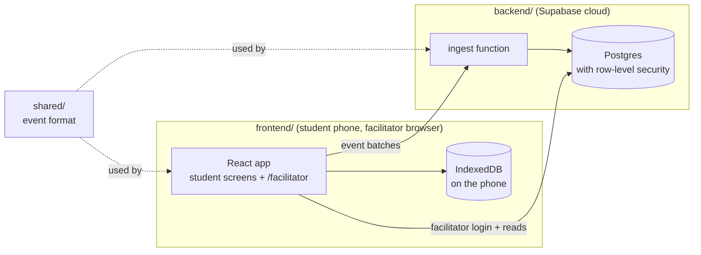

# PaisaPath Repository Structure

How the code is organised, who owns which folder, and the rules that keep it clean. Ownership follows `work_division.md`.

---

## 1. Three top-level parts

```
megathon26-codeformoney/
├── frontend/     Everything that runs in the browser (React + Vite PWA)
├── backend/      Everything that runs in the cloud (Supabase)
└── shared/       Code both sides use (event format, sync protocol)
```



| Part | Runs where | Secrets it may hold |
|---|---|---|
| `frontend/` | Student phones, facilitator browsers | Only public values (`frontend/.env.local`: project URL, anon key) |
| `backend/` | Supabase | Service role key is injected by Supabase, never stored in the repo |
| `shared/` | Imported by both | None |

---

## 2. Full tree

Owner tags: **P1** Persona & Time Travel · **P2** Engine & LifePath · **P3** Everyday Money & Content · **P4** Investing & Design Kit · **P5** Stay Safe, Platform & Facilitator.

```
megathon26-codeformoney/
│
├── frontend/                            React + Vite + TypeScript + Tailwind PWA
│   ├── .env.example                     Template for Supabase URL + anon key       P5
│   ├── .env.local                       Your real values (git-ignored)
│   ├── .oxlintrc.json                   Lint + folder import rules                 P5
│   ├── vite.config.ts                   Build, PWA, aliases, tests                 P5
│   ├── package.json
│   ├── public/                          Icons
│   └── src/
│       ├── main.tsx                     Entry point                                P5
│       ├── index.css                    Tailwind + design tokens                   P4
│       │
│       ├── app/                         App shell: router, providers, stores       P2
│       │   ├── router.tsx               All routes in one place
│       │   └── DevHome.tsx              Temporary landing page (delete later)
│       │
│       ├── core/                        PURE logic: no React, no storage, no network
│       │   ├── types/                   GameState, Persona, MiniGame contract      P2
│       │   ├── engine/                  Reducer, actions, effects, ledger          P2
│       │   ├── random/                  Seeded RNG, event tape                     P2
│       │   ├── lifepath/                Stage graph, gates, scheduler              P2
│       │   ├── persona/                 Classifier, initial state                  P1
│       │   ├── mastery/                 Mastery model, red/amber/green             P1
│       │   ├── timeline/                Snapshots, branches, replay                P1
│       │   └── market/                  Asset returns, Monte Carlo                 P4
│       │
│       ├── platform/                    The ONLY code that touches IndexedDB,
│       │   │                            the network or Supabase
│       │   ├── index.ts                 Public API: import from '@/platform'        P5
│       │   ├── env.ts                   Reads .env.local                            P5
│       │   ├── storage/                 Dexie database + saveGame, loadGame, …      P5
│       │   ├── profiles/                Profiles, picture-PIN, lockout              P5
│       │   ├── telemetry/               logEvent(), logResult(), outbox             P5
│       │   ├── sync/                    Sync status badge, syncNow()                P5
│       │   ├── supabase/                The one Supabase client                     P5
│       │   ├── i18n/                    t(), RTL                                    P3
│       │   └── audio/                   Audio loader, TTS fallback                  P3
│       │
│       ├── ui/                          Design kit: tokens, components, guardrails  P4
│       │
│       ├── runtime/                     ModuleRunner (8 steps)                      P2
│       │   └── verbs/
│       │       ├── choose/                                                          P2
│       │       ├── allocate/  commit/  triage/  rank/                               P3
│       │       ├── predict/                                                         P4
│       │       └── judge/  act-in-situ/                                             P5
│       │
│       ├── features/                    Screens that are not mini-games
│       │   ├── setup/                   Language, a11y, class, avatar, PIN          P5
│       │   ├── onboarding/              Character builder, pre/post check           P1
│       │   ├── home/                    Home dashboard                              P2
│       │   ├── lifepath/                Month screen, gates, story cards            P2
│       │   ├── rewind/                  Timeline, compare, year-end, Future Me      P1
│       │   ├── quickplay/               Scenario map                                P1
│       │   ├── progress/                Mastery map, badges, certificate            P1
│       │   └── arcade/                  Arcade shell                                P4
│       │
│       ├── games/                       Mini-games, one folder per game
│       │   ├── registry.ts              List of all games, looked up by ID          P2
│       │   ├── example/                 Template game to copy                       P5
│       │   ├── everyday/                Bank, budget, save, borrow games            P3
│       │   ├── investing/               Investing games                             P4
│       │   └── safe/                                                                P5
│       │       ├── phone/               Shared fake phone
│       │       ├── upi-simulator/
│       │       └── scam-inbox/
│       │
│       ├── facilitator/                 Teacher dashboard, lazy-loaded at           P5
│       │                                /facilitator
│       ├── content/                     Scenarios, strings, concepts (JSON)         all
│       │   ├── concepts.json            Concept + misconception IDs                 P2 merges
│       │   └── README.md                Which subfolder belongs to whom
│       │
│       └── test/                        Test setup and fixtures                     P5
│
├── backend/                                                                         P5
│   ├── README.md                        How to connect, deploy, add facilitators
│   └── supabase/
│       ├── config.toml                  Local Supabase settings
│       ├── migrations/                  Tables + row-level security
│       ├── functions/ingest/            Receives event batches from phones
│       └── seed.sql                     Local demo data
│
├── shared/                                                                          P5
│   ├── telemetry/event.ts               GameEvent type + validateEvent()
│   └── sync/protocol.ts                 Ingest request/response shapes
│
├── .github/workflows/ci.yml             Typecheck → lint → test → build             P5
├── .gitignore                           Keeps .env files out of git
├── readme.md                            Setup in 3 commands
├── REPO_STRUCTURE.md                    This file
├── Implementation.md                    Product spec
├── work_division.md                     Who builds what
└── P5_implementation.md                 P5's phased plan
```

---

## 3. Where to put things

| You are writing… | Put it in | Example |
|---|---|---|
| Logic that decides money, rules, scores | `core/` (shared) or `logic/` inside your game | `core/engine/reduce.ts`, `games/safe/upi-simulator/logic/machine.ts` |
| A full-screen page that isn't a game | `features/<name>/` | `features/progress/MasteryMap.tsx` |
| A mini-game | `games/<pillar>/<game>/` | `games/everyday/jar-split/` |
| An interaction style used by several games | `runtime/verbs/<verb>/` | `runtime/verbs/triage/` |
| A reusable visual component | `ui/` | `ui/components/BigButton.tsx` |
| Anything that saves, loads or sends data | `platform/` (ask P5) | `platform/storage/` |
| Scenario text, options, strings | `content/` | `content/scenarios/safe/scam-inbox.json` |
| Database tables or server code | `backend/supabase/` | `migrations/…sql` |
| A type both frontend and backend need | `shared/` | `shared/telemetry/event.ts` |

---

## 4. Import rules

The linter enforces these (`frontend/.oxlintrc.json`), so a wrong import fails CI.

| Folder | May NOT import | Why |
|---|---|---|
| `core/**`, any `logic/**` | React, Dexie, Supabase, `@/platform`, `@/ui`, `@/app`, `@/features`, `@/games`, `@/runtime`, `@/facilitator` | Logic stays pure, replayable and fast to test |
| `ui/**` | Dexie, Supabase, `@/app`, `@/features`, `@/games`, `@/runtime`, `@/facilitator` | Components stay presentational |
| `app/`, `features/`, `games/`, `runtime/` | Dexie, Supabase, `@/platform/<subfolder>` | Data access goes through `@/platform`'s public API |

Also, by agreement (not linted):
- A game never imports another game. Screens find games through `games/registry.ts`.
- `shared/` has no dependencies and uses `.ts` extensions on imports, so Deno can load it too.

Import aliases: `@/…` → `frontend/src/…`, `@shared/…` → `shared/…`.

---

## 5. Shape of a game folder

Copy `games/example/` to start:

```
games/safe/upi-simulator/
├── index.ts                 Exports the MiniGame: id, verbs, concepts, levels, play()
├── UpiSimulator.tsx         Top-level component
├── components/              Screens used only by this game
└── logic/                   Pure logic (no React, no platform) + *.test.ts
```

Register it in `games/registry.ts`. Put its content in `content/scenarios/<pillar>/`.

---

## 6. Platform API (what P5 provides)

Everything is imported from `@/platform`.

| Function | Use |
|---|---|
| `saveGame(pid, slot, data)` / `loadGame(pid, slot)` | Save and resume |
| `saveSnapshot(s)` / `listSnapshots(pid, timelineId?)` | P1's rewind checkpoints |
| `getSetting(scope, key)` / `setSetting(scope, key, value)` | Per-player or device settings |
| `createProfile`, `listProfiles`, `unlockProfile`, `getActiveProfile`, `switchPlayer` | Profiles and picture-PIN |
| `logEvent({ activity, concept, choice, correct?, misconception?, level?, mode? })` | Record what a student did |
| `logResult(result, { activity, concept })` | Log a finished MiniGameResult (P2's runtime) |
| `setTelemetryContext({ mode, stage, lifeStage, timeline, level })` | P2 calls this when the stage or mode changes |
| `useSyncStatus()` | Sync badge state (P2's dashboard) |
| `t(key, vars)` | Translation (stub until P3 ships the loader) |

Tests get a real in-memory IndexedDB automatically. Use `resetDb()` and `createTestProfile()` from `@/test/fixtures`.

---

## 7. Secrets

| Value | File | Committed? |
|---|---|---|
| Supabase project URL | `frontend/.env.local` | No |
| Supabase anon / publishable key | `frontend/.env.local` | No (safe in the browser, still kept out of git) |
| Service role / secret key | Not in the repo. Supabase gives it to edge functions | Never |
| Templates | `frontend/.env.example` | Yes |
