# MoneyPath — Work Division (5 People, Rebalanced)

## How the work is split

The split is balanced by **effort and complexity**, not by number of features. Two rules shaped it:

1. **Nobody waits until the end to do their main work.** Each person has a substantial logic-heavy piece to build from day one. Screen polish happens in a shared final phase, not as one person's job.
2. **The life simulator is split across two people.** P2 builds the engine and the forward-moving life; P1 builds everything that looks back across a life (Rewind, Parallel Lives, year-end review) plus the player's persona and progress.

| Person | Slice | Main complexity |
|---|---|---|
| **P1** | Persona, Progress & Time Travel | Classifier, mastery model, snapshot/branch manager, deterministic replay, timeline comparison |
| **P2** | Core Engine & LifePath | Pure simulation reducer, seeded event tape, stage graph, scheduler, module runtime |
| **P3** | Everyday Money & Content Pipeline | Four interaction verbs, bank/budget/save/borrow games, translation and validation pipeline |
| **P4** | Investing, Design Kit & Investment Scams | Market simulation and Monte Carlo, investing games, guardrail components, shared UI kit |
| **P5** | Stay Safe, Platform & Facilitator | Simulated phone surfaces, scam games, offline storage and sync, backend, facilitator dashboard |

### Effort balance

Effort is in relative points (1 point ≈ half a day of focused work for one person). MVP points are what must be built; stretch points are optional.

| | P1 | P2 | P3 | P4 | P5 |
|---|---|---|---|---|---|
| **MVP effort** | 15 | 14.5 | 14.5 | 14.5 | 15 |
| Stretch effort | 4 | 2 | 8 | 9 | 5 |
| Early work (Phase 0–1) | Classifier, initial state, mastery model, snapshot format | Types, reducer, RNG and tape, runtime | Triage and Allocate verbs, i18n loader, validator | Design kit, guardrail components, market engine | Scaffold, storage, outbox, phone surfaces |
| Late work (Phase 3–4) | Progress screens, certificate | Dashboard, story polish | Translations, audio files | Arcade shell polish | Facilitator dashboard polish |

### Timeline at a glance

```mermaid
gantt
    dateFormat X
    axisFormat %s
    section P1
    Classifier, initial state, mastery model   :0, 3
    Onboarding screens, pre/post check         :3, 6
    Branch manager and replay                  :3, 7
    Comparison, Parallel Lives, year-end        :7, 10
    Quick Play, Progress, certificate           :10, 13
    section P2
    Types, reducer, RNG and tape               :0, 4
    Module runtime and Choose verb              :2, 5
    Stage graph, gates, scheduler               :5, 9
    LifePath screens, dashboard                 :8, 12
    Story skeleton, capstone                    :11, 13
    section P3
    Triage, Allocate, i18n loader, validator    :0, 4
    Get Banked games                            :3, 6
    Budget and save games                        :5, 10
    Commit, Rank, Debt Ladder, Rescue Mission   :8, 11
    Translations, audio pipeline                :10, 13
    section P4
    Design kit and guardrail components          :0, 3
    Market engine and Predict verb              :2, 6
    Chai Price, Compounding, Time Machine        :5, 9
    Stock Market and Mutual Fund games           :8, 12
    Arcade shell, investment-scam sort           :11, 13
    section P5
    Scaffold, storage, outbox, profiles          :0, 4
    Phone surfaces, UPI Simulator                :3, 7
    Scam Inbox                                   :6, 9
    Sync and backend                             :7, 11
    Facilitator dashboard                        :10, 13
```

*(Units are working blocks, not calendar dates; stretch it to your hackathon length.)*

---

## P1 — Persona, Progress & Time Travel

### Mission
Turn ten answers into a believable character, track what each student understands, and let students look back across a life: rewind any key decision, compare parallel lives under the same luck, and review their year.

### Owns
`src/onboarding/` · `src/mastery/` · `src/rewind/` · `src/quickplay/` · `src/progress/`

### Responsibilities

**1. Classifier and initial state (early, pure logic — 2.5 pts)**
- `classify(answers): Persona` producing:
  - life stage: school student (17) / college student (19) / first-time earner (21)
  - circumstance: dependent / part-time earner / family contributor / young entrepreneur / guided saver
  - money personality: saver / spender / supporter / risk-curious
  - maturity: starter / builder / navigator (score from the experience question + the scenario question)
  - tags: language, audio, text size, timers, household savings style, focus pillar, content mix
- `generateInitialState(persona, seed): GameState`: starting cash, income and its regularity (fixed / irregular / seasonal), fixed needs, commitments (household share, siblings' costs), goal and goal amount, ±10% seeded variation. Every character starts unbanked so every life begins at Stage S0.
- All values in a config file so they can be tuned without code changes.
- Exhaustive unit tests: every answer combination gives a valid persona and state.

**2. Character builder screens (1 pt)**
- Ten question screens driven by a JSON config (text keys, options, images, audio keys, filters), one per screen, picture options, "Skip" or "Surprise me".
- The questions describe the *character*, never the student's real family or money:
  1. Who do you want to play as?
  2. Where does your character's money come from? (filtered by Q1)
  3. Who does your character live with, and what do they pay for?
  4. What is your character's big goal this year?
  5. How does your character's family keep its savings?
  6. Your character suddenly gets ₹1,000. What do they do first?
  7. How much have *you* done with money tasks so far? (experience only, no amounts)
  8. What do you want to get better at first?
  9. How do you like to learn?
  10. A short budgeting scenario (baseline knowledge)
- Character naming and a character card ("Start this life" / "Change something").
- Setup screens before the questions (language, accessibility, class code, avatar, picture-PIN) use P5's profile API.

**3. Pre-check and post-check (1 pt)**
- Two separate pools of 6 scenario questions (1–2 per pillar), never sharing an item.
- Pre-check sets starting mastery (capped at 0.5), no score shown. Post-check after the year-end review, with growth per pillar.

**4. Mastery model (early, pure logic — 1.5 pts)**
- `updateMastery(state, conceptDeltas, kind)`: `m = m + rate × (target − m)`, rate 0.3 for checks and 0.15 for in-play choices.
- Status thresholds: red < 0.4, amber 0.4–0.7, green > 0.7.
- Stuck rule: hint with audio after 2 misses on a concept, simpler variant after 3.
- Spaced review queue: green concepts come back after 3, 7 and 14 days (used by Daily Challenge).
- Misconception counters.
- Used by P2's runtime and scheduler; unit tested.

**5. Branch manager (core complexity — 3 pts)**
- Snapshot format: full serialized `GameState` (including seed and tape cursor), timeline ID, checkpoint event ID, month, label.
- Save a snapshot before every event marked `checkpoint: true` (6–10 per year) through P5's storage API.
- `createBranch(snapshotId)`: new timeline that keeps the world seed and event tape, so outside events (shocks, festivals, scam messages, market moves) arrive in the same months in every timeline. Consequence events depend on that timeline's own flags.
- Fast-forward: replay the original timeline's recorded actions after the branch point through P2's reducer, stopping when an action is no longer possible (e.g. not enough money).
- Branch limit (configurable, default 3), "make this my life", and a guarantee that the original timeline is never overwritten.
- Tests: tape events identical across branches; original state unchanged after branching; fast-forward stops correctly.

**6. Rewind viewer and comparison (2.5 pts)**
- Timeline strip of 12 months with checkpoint icons and labels ("M2 · Bought a phone ₹7,500").
- Tap a checkpoint → see the original choice → "Live this differently".
- Side-by-side comparison of 2–3 timelines: cash, bank, jars, debt, investments, goal, peace of mind, trust, safety.
- "What made the difference": rule-based top 3 drivers from the ledger diff, explanation templates, a line chart across months, and a trade-off sentence instead of a verdict.

**7. Year-end review, Parallel Lives and Future Me (1.5 pts)**
- "Your Year": goal, emergencies handled, scams avoided, debt, where the money went.
- Parallel Lives summary across branches.
- Future Me at 25: older avatar shaped by habits (prepared, calm, in debt), with a projected range from P4's market engine and the Assumptions drawer. Never a rich vs poor comparison.
- Hands over to the post-check, then "Replay as a different character".

**8. Quick Play (1 pt)**
- Scenario map grouped by pillar (24 scenarios + capstone), completion ticks and mastery colours.
- Each scenario runs in P2's module runtime with a sandbox character generated from the persona; the LifePath character is never affected, only mastery is shared.
- Debrief and "take the other branch and compare" (reusing the comparison view).

**9. Progress, badges and certificate (late — 1 pt)**
- Mastery rings per pillar, concept list, "Your weak spots" with Practise buttons.
- Badge shelf; badges reward understanding and good process, never money.
- Certificate generated on the device (name, class, NGO, pillars completed, date), offline, in all four languages including Urdu right-to-left.

**Stretch (4 pts)**
- Daily Challenge (one due concept per day, a streak that never removes progress).
- Test-out of S0 and S1 for students who already bank or use UPI.
- Class leaderboard by concepts mastered; challenge codes (persona + seed + scenario as a QR) so a classmate plays the same life with the same luck.

### Use cases owned
| ID | Name | MVP |
|---|---|---|
| UC-SYS-02 | Build a character (10 questions) | ✅ |
| UC-SYS-03 | Pre-check and post-check | ✅ |
| UC-SYS-06 | Mastery map and weak-spot practice | ✅ |
| UC-SYS-07 | Badges and certificate | ✅ |
| UC-LIFE-04 | Rewind to a key decision | ✅ |
| UC-LIFE-05 | Compare timelines and Parallel Lives | ✅ |
| UC-LIFE-06 | Year-end review and Future Me | ✅ |
| UC-LIFE-07 | Quick Play scenario | ✅ |
| UC-LIFE-03 | Test out of a stage | Stretch |
| UC-LIFE-08 | Daily Challenge | Stretch |
| UC-CLASS-01 | Class mastery leaderboard | Stretch |
| UC-CLASS-02 | Challenge a classmate on the same life | Stretch |

### Provides to others
`Persona` and initial `GameState` (P2), mastery model (P2's runtime and scheduler, P5's facilitator aggregates use the same thresholds), snapshot format and branch manager, comparison view.

### Depends on
- **P2:** types, reducer (for replay), checkpoint flags, runtime.
- **P4:** design kit, range and Assumptions components, market engine for Future Me.
- **P5:** storage API, profile API, `logEvent()`.
- **P3:** i18n hook.

### Content to write
The 10 questions and options, pre/post item pools (12 items), badge list, comparison explanation templates, Quick Play map labels.

### Done when
Every answer combination gives a valid persona; mastery updates match the formula in tests; a branch keeps the same luck and never changes the original; the year-end review works from any persona and any combination of branches.

---

## P2 — Core Engine & LifePath

### Mission
Build the deterministic engine that powers every mode, and the 12-month life that moves forward through stages S0–S6.

### Owns
`src/engine/` · `src/lifepath/` · `src/runtime/` (module runner + Choose verb) · `src/home/` · `src/app/` stores · merging of `src/content/concepts.json`

### Responsibilities

**1. Types and contracts (first, everyone depends on them — 1 pt)**
- `types.ts`: `GameState` (money, human meters, meta, learn, ledger), `Persona` (agreed with P1), `MiniGame`, `MiniGameContext`, `MiniGameResult`, `EffectMap`, `Event`.
- `concepts.json` skeleton with every concept and misconception ID.
- A stub `ModuleRunner` so P3, P4 and P5 can mount their games from day one.

**2. Engine reducer (core complexity — 3 pts)**
- `reduce(state, action) → { state, events }`: pure and fully serializable.
- Actions: `START_MONTH`, `APPLY_EFFECTS`, `CHOOSE`, `ALLOCATE`, `COMMIT`, `MINIGAME_RESULT`, `END_MONTH`, `TAKE_DEBT`, `REPAY`, `SET_FLAG`.
- Effect paths (`money.savingsJars.emergency: -2000`), `requires` checks that grey out unaffordable options, commitments that deduct every month and bite when income drops, debt with interest and due dates, a ledger entry with a reason key for every money movement.
- Shortfall handling: cash below zero forces a shortfall event.
- Property-based tests: same seed + same actions → identical state; money is never created or lost except through effects.

**3. Seeded randomness and the event tape (1.5 pts)**
- A seeded random number generator shared by all games.
- `buildTape(seed, persona)`: all outside events for 12 months (shocks, festivals, scam messages, market regime, whether a friend repays). The tape is what makes P1's rewind fair.

**4. Module runtime (2 pts)**
- `ModuleRunner` running the 8 steps: Hook → Play → Result → Why? → Concept → Try again → Check → Reward.
- Mounts the owner's `MiniGame` in Play; renders Why?, Concept, Check and Reward from scenario JSON; a short mode for gate items.
- Autosave after every step (resume from any step); events through P5's `logEvent()`; mastery through P1's model.
- Arcade and Quick Play modes never apply effects to the LifePath character.

**5. Choose verb (0.5 pt)**
- 2–4 options with pictures and audio; greyed options with reasons ("₹600 short").

**6. Stage graph and gates (1.5 pts)**
- JSON definitions: S0 Get Banked (month 0), S1 Digital Money (1), S2 First Money & Plan (1–2), S3 Save & Track (3–4), S4 Big Decisions & Borrowing (5–7), S5 Grow Money (8–10), S6 Protect & Look Ahead (11–12).
- Per stage: event pool, gate items, unlock rules, the safety event for that stage.
- Gate flow: 2–3 items; fail → practice one level down → retry with new items; after a third fail, unlock with a "Recommended practice" flag.
- Arcade unlock order (Everyday Money and Stay Safe open; Investing after S3) and facilitator overrides from P5's sync.

**7. Scheduler and adaptivity (2 pts)**
- `pickEvents(state, library, tape)`: stage events filtered by persona and `requires`, plus tape events due this month, plus adaptive events; 2–4 per month; no two of the same pillar in a row; focus-pillar bonus.
- Adaptivity rules in config: loan app taken → debt follow-up and Debt Cost Ladder later; collect-request mistake → a variant within 2 months; low peace of mind → breathing-space event; no emergency fund by S4 → guaranteed shock; concept still red → review item.
- A hook so other owners can register single events (e.g. P5's scam messages, P3's KYC SMS).

**8. LifePath screens (2 pts)**
- Month intro (calendar page, income arrives, commitments deducted), event sequence, meter animations, month-end statement (income, needs, wants, saved, debt, one line of feedback), stage intro and gate screens, checkpoint markers for P1.

**9. Home dashboard (late — 0.5 pt)**
- The single-screen dashboard: LifePath card with month, stage and meters, Arcade, Quick Play, Progress, What-If Lab, Help card, locked tiles with reasons, "Recommended" and "Resume" tags, sync status from P5, a guided tour of at most 3 tooltips.

**10. Story skeleton and capstone (0.5 pt)**
- Month and stage connective cards, the capstone "One Year of Your Life", and the static advice-guard card ("We teach how money works, not what to buy"). Pillar events themselves are written by P3, P4 and P5.

**Stretch (2 pts)**
- Seasonal and festival variety engine (content variables by seed); facilitator "session focus" weighting in the scheduler.

### Use cases owned
| ID | Name | MVP |
|---|---|---|
| UC-LIFE-01 | Play a LifePath month | ✅ |
| UC-LIFE-02 | Pass a stage gate | ✅ |
| UC-LIFE-09 | Resume after an interruption | ✅ |
| UC-LIFE-10 | Ask for investment advice (guard) | ✅ |
| UC-SYS-05 | Navigate the home dashboard | ✅ |

### Provides to others
Types, `MiniGame` contract, `ModuleRunner`, Choose verb, reducer (P1 uses it for replay), tape, scheduler hook, concept list.

### Depends on
- **P1:** persona and initial state, mastery model.
- **P4:** design kit.
- **P5:** storage, `logEvent()`, facilitator unlocks.
- **P3, P4, P5:** the mini-games and pillar events for each stage.

### Done when
A 12-month life plays end to end (stub games first, real ones as they land); same seed and actions always give the same state; resume works from any step; every stage gate works.

---

## P3 — Everyday Money & Content Pipeline

### Mission
Take the character from unbanked to budgeting, saving and borrowing wisely; build the four interaction verbs most games reuse; and own the pipeline that turns content into validated, translated packs.

### Owns
`src/games/everyday/` · verbs `Allocate`, `Commit`, `Triage`, `Rank` · `src/content/scenarios/bank/`, `plan/`, `save/`, `borrow/` · `src/platform/i18n/` · `src/content/i18n/` · `tools/authoring/`

### Responsibilities

**1. Verb components (early, others use them — 2.5 pts)**
- **Triage:** swipe cards with tap and keyboard fallbacks, context re-sort, summary of disagreements.
- **Allocate:** drag coin stacks into jars plus slider mode, live overflow check, L1 coins only, L3 percentages and custom jars.
- **Commit:** amount + duration picker that creates a recurring engine commitment (savings, EMI, SIP).
- **Rank:** drag to order, ₹ cost of the student's order vs the best one.
- Each returns `MiniGameResult` choices and is documented with an example.

**2. Content pipeline (early validator, late translations — 2 pts)**
- i18n loader `t(key)` with fallbacks, plural rules, ₹ formatting with Indian digit grouping, right-to-left switching for Urdu.
- Content validator in CI: JSON schema for scenarios; checks concept IDs, verbs, effect paths, and that every string key exists in every language.
- String extraction from scenario JSON and a translation spreadsheet round-trip; English and Telugu complete, Hindi and Urdu for at least S0–S2.
- Audio pipeline: one file per string key, lazy loading, fallback to device text-to-speech.

**3. Get Banked, Stage S0 (2 pts)**
- **Document Hunt:** room scene with tappable documents (Aadhaar, PAN, photo, school ID, a sibling's ID, a bill, a cinema ticket, guardian's ID); drag into a bank folder; wrong items bounce back with reasons; guardian ID for under-18s; branch for a missing document.
- **Bank Counter:** a generic counter (no real branding); savings / zero-balance / minor account cards; illustrated form with nominee; welcome kit; PIN setting with a passer-by to teach covering the keypad; sets `hasBankAccount`; triggers a fake KYC SMS through P5's single-message component.

**4. Plan & Budget, Stage S2 (3 pts)**
- **Swipe Sort:** 30+ persona-specific needs/wants cards with context re-sorts and explanations.
- **Jar Split:** income as coins scaled to the character; Needs / Wants / Future (later Emergency); bills attached to Needs; overflow warning; month-end statement; feedback for family contributors whose needs take ~80%.
- **Goal Builder:** predict months to the goal, slider, timeline animation, make the goal specific, saved as a commitment and the 🎯 meter.

**5. Save & Manage, Stage S3 (2.5 pts)**
- **Spending Detective:** UPI-style history built from the character's ledger plus tape items; tag categories; pie chart; one leak converted to a year; rank leaks; 6-month projection. All simulated.
- **Surprise Month:** tape shock (screen, medicine, school trip, bike repair); calm path with a buffer and the *Emergency Ready* badge, or options without one; set an emergency target and add the Emergency jar.

**6. Borrowing and recovery (1.5 pts)**
- **Debt Cost Ladder (S4):** need ₹2,000 for 3 months; family, moneylender, loan app, buy-now-pay-later; rank by cost; ladder animation of total repaid; missed-payment follow-up.
- **Rescue Mission (S6):** the character's friend lost ₹2,000 to a fake job site; order the steps (1930, bank, cybercrime.gov.in, evidence, trusted adult, warn others); faster correct order → better recovery chance; result saved as the dashboard's Help card. (Built here because it uses the Rank verb.)

**7. Pillar events and checks (1 pt)**
- LifePath events for S0, S2, S3, S4 (shocks, festivals, peer pressure), 2–3 check items per use case, gate items for those stages.

**Stretch (8 pts)**
- Phone vs Coaching, Good Month/Lean Month, Family Market Trip, Festival and Peer Pressure, Pay Yourself First, Where to Keep Your Money (with interest-free view), A Friend Needs ₹2,000, 70%-Off Sale, Insurance Pool, Bike EMI vs Save, Education Choice, What-If goal and EMI calculators, Learn glossary, spreadsheet → JSON authoring converter.

### Use cases owned
| ID | Name | MVP |
|---|---|---|
| UC-BANK-01 | Document Hunt | ✅ |
| UC-BANK-02 | Bank Counter | ✅ |
| UC-PB-01 | Needs vs Wants Swipe Sort | ✅ |
| UC-PB-02 | Jar Split | ✅ |
| UC-PB-03 | Goal Builder | ✅ |
| UC-SM-02 | Spending Detective | ✅ |
| UC-SM-03 | Surprise Month | ✅ |
| UC-BR-01 | Debt Cost Ladder | ✅ |
| UC-SAFE-10 | Rescue Mission | ✅ |
| UC-SYS-09 | Language, audio and accessibility (pipeline side) | ✅ |
| UC-PLAT-04 | Download another language | ✅ |
| UC-PB-04 to 07, UC-SM-01, 04 to 07, UC-BR-02, 03, UC-TK-01, UC-SYS-08, UC-PLAT-03 | Stretch games and tools | Stretch |

### Provides to others
Four verbs, `t(key)` and audio hooks, content validator, transaction-list component (reused by P5's UPI history), Help card content.

### Depends on
- **P2:** runtime, Choose verb, types, engine actions.
- **P4:** design kit, Predict verb.
- **P5:** single-message scam component, storage for downloaded language packs.

### Done when
S0, S2 and S3 play end to end inside LifePath; all MVP games work at L1 and L2; the four verbs are used in at least one other person's game; the validator runs in CI; English and Telugu are complete.

---

## P4 — Investing, Design Kit & Investment Scams

### Mission
Make risk, time, compounding and diversification something students feel, with simulations that are honest about uncertainty and never recommend anything. Also provide the shared UI kit so nobody waits on design.

### Owns
`src/design/` · `src/games/investing/` · `Predict` verb · guardrail components · `src/content/scenarios/invest/` · `src/content/assumptions.json`

### Responsibilities

**1. Design kit (day one — 1.5 pts)**
- Set up a ready-made Tailwind component approach (copy-in components rather than designing from scratch) with tokens for colours (light and dark), spacing and a large-text type scale.
- Core components: `Card`, `BigButton`, `Meter`, `CoinStack`, `Dialog`, `BottomSheet`, `ProgressBar`, `AudioButton`, `LockedTile`, `Badge`, `Toast`; RTL-safe utilities; pillar and meter icons.
- A gallery page. Functional first; visual polish happens in the shared final phase.

**2. Guardrail components (early — 1.5 pts)**
- `assumptions.json`: growth, volatility, inflation and fees for every fictional asset.
- `AssumptionsDrawer`, `RangeDisplay`, `FanChart` (shaded band + median), `SimBanner` ("Simulation based on assumptions. Not a prediction or advice.").

**3. Predict verb (0.5 pt)**
- Guess before the reveal; guess-vs-reality chart.

**4. Market simulation engine (core complexity — 3 pts)**
- Seeded return generator per fictional asset: Steady Box, Mixed Basket, Bumpy Ride, sector mini-businesses, fictional companies and funds, gold, property.
- News and shock events read from P2's tape.
- Monte Carlo runner for 500 futures in a Web Worker, under 1 second on a low-end phone.
- Pure, unit tested; used by P1 for Future Me.

**5. Stage S5 games (3 pts)**
- **Chai Price Time Travel:** ₹5 to ₹20 chai over time; predict; range reveal; ₹1,000 in a box buys fewer cups.
- **Compounding Garden / ₹500 a month for 10 years:** simple vs compound gardens; predict first; fast-forward 5/10/20 years; start at 18 vs 28; L1 visual, L2 numbers, L3 Rule of 72.
- **Time Machine:** goal and deadline, mix of three paths, run 500 futures, fan chart, insight that money needed soon should take less risk.

**6. Stock Market Simulator (2 pts)**
- 6 fictional companies, virtual ₹10,000, 12 rounds; news card → price move → buy / sell / hold; portfolio panel; a rumour (FOMO) and a sharp drop (panic); fee per trade; debrief vs "buy a spread and hold".

**7. Mutual Fund Challenge (1.5 pts)**
- Pool animation and NAV; 3 fictional funds (low-cost index-style, higher-cost active, sector); lump sum vs hypothetical SIP; 10 years with dips; rupee cost averaging; fee comparison; never a "best fund".

**8. Investing, Gambling or Scam? (0.5 pt)**
- Sort cards (guaranteed 30% a month, paid Telegram tips, long-term investing with no guarantee, a betting app, a hyped coin); honest signs vs red flags; regulators mentioned generally, no product names.

**9. Arcade shell and S5 events (1 pt)**
- Investing section page with tiles, lock state (after S3 or facilitator override), "Recommended" tags; S5 LifePath events and gate items.

**Stretch (9 pts)**
- Risk & Return Ride, Basket Builder, Where to Park ₹10,000, Property Deal Simulator, Gold & Asset Challenge, Stock Market order-book mode, Trading Pit (classroom multiplayer, with P5 for local networking), What-If compounding calculator, The Telegram Group & Celebrity Says Double It, The Pyramid (Ponzi).

### Use cases owned
| ID | Name | MVP |
|---|---|---|
| UC-INV-01 | Chai Price Time Travel | ✅ |
| UC-INV-02 | Compounding Garden / ₹500 for 10 years | ✅ |
| UC-INV-04 | Time Machine | ✅ |
| UC-INV-07 | Stock Market Simulator | ✅ |
| UC-INV-08 | Mutual Fund Challenge | ✅ |
| UC-SAFE-09 | Investing, Gambling or Scam? | ✅ |
| UC-INV-03, 05, 06, 09, 10, 11, UC-TK-02, UC-SAFE-07, UC-SAFE-08 | Stretch games | Stretch |

### Provides to others
Design kit (everyone), guardrail components (P1, P3), Predict verb (P3), market engine (P1).

### Depends on
- **P2:** runtime, types, tape.
- **P3:** Allocate and Commit verbs, i18n.
- **P5:** local networking for Trading Pit (stretch).

### Done when
S5 plays inside LifePath; Stock Market and Mutual Fund games are complete; every investing screen shows the banner, ranges and Assumptions drawer; a word-list test confirms no real company, fund, bank or brand names; 500 futures run in under a second on a throttled phone profile.

---

## P5 — Stay Safe, Platform & Facilitator

### Mission
Students get scammed safely and learn the patterns behind scams. The app installs from a link, runs offline, syncs when it can, and gives facilitators a view of their class.

### Owns
`src/games/safe/` · `Judge` and `ActInSitu` verbs and phone surfaces · `src/platform/` (except i18n) · `supabase/` · `src/facilitator/`

### Responsibilities

**1. Project scaffold (day one — 1 pt)**
- Vite + React + TypeScript + Tailwind; lint, format, Vitest; CI running tests and P3's validator.

**2. Storage and profiles (early — 2 pts)**
- Dexie schema: `profiles`, `saves`, `snapshots`, `outbox`, `settings`, `contentMeta`; per-profile isolation; storage-quota checks; a simple storage API.
- Profile API and setup screens: language picker, accessibility toggles, class code with QR scan, avatar picker, picture-PIN, avatar grid for shared devices, lockout after 3 wrong PINs, switch player, "play without a class".

**3. PWA (1 pt)**
- `vite-plugin-pwa`: app shell under 3 MB precached, content packs cached per language, install prompt, safe updates.

**4. Outbox and sync (1.5 pts)**
- `logEvent()` used by everyone, enforcing the event schema (pseudonymous ID, class, activity, concept, choice, correct, misconception, level, stage, timeline, timestamp; no names, no free text).
- Batches of 200 with idempotent IDs, retry with backoff, compaction when storage is low; pull of class unlocks and content versions; sync status for the dashboard.

**5. Backend (1.5 pts)**
- Supabase tables: `ngos`, `classes`, `facilitators`, `players` (ID, class, display name only), `events`, `class_concept_daily`, `unlocks`.
- Row-level security (facilitators see only their classes); facilitator-only login; edge function that aggregates events into heatmap data.

**6. Facilitator dashboard (late — 2 pts)**
- Create class → join code and printable QR, consent checklist reminder.
- Plan screen: unlock stages for the class, session QR for instant offline unlocks.
- Heatmap: concepts by pillar × red/amber/green; top 3 misconceptions with 10-minute discussion prompts; pre → post gain; last sync per device.

**7. Phone surfaces and verbs (2 pts)**
- Generic UPI-style app (link account, PIN, QR pay, collect request, history using P3's list), SMS list, chat thread, email, incoming call with audio, permission dialogs; timer overlay respecting "timers off".
- **Judge** (legit / suspicious / scam with tappable tells) and **Act in-situ** (simulated money moves, then a post-mortem with highlighted tells and slow-motion replay).

**8. UPI Simulator, Stage S1 (1.5 pts)**
- Pay ₹50 by QR; then "RAHUL K. is requesting ₹1,200" for a cricket bat sale with a 15-second timer; paying lowers the balance and shows the four tells; rule card "You never need a PIN to receive money"; QR "scan to receive"; how refunds work.

**9. Scam Inbox (2.5 pts)**
- A day of messages (fake KYC link, lottery fee, like-videos job, "Mom, new number", a genuine school message); Block & report / Ignore / Open / Ask a trusted adult; safe "what would have happened" sequences; scoring for correct responses, false alarms and time.
- Single-message mode registered with P2's scheduler for every LifePath stage.
- 40+ messages with red-flag annotations; S1 gate items.

**Stretch (5 pts)**
- Identity Vault, Red Flag Hunter, The Call (audio, fake "digital arrest"), Loan App Trap (permissions, fees, harassment, registered lenders), content pack updates, offline transfer from student devices to the facilitator (QR or hotspot), individual student view, worksheets, report export, doubts inbox, local networking for P4's Trading Pit.

**Tone rule:** never blame the victim; no game asks about the student's real experiences.

### Use cases owned
| ID | Name | MVP |
|---|---|---|
| UC-SYS-01 | Install and first launch | ✅ |
| UC-SYS-04 | Return as a player on a shared device | ✅ |
| UC-PLAT-01 | Play offline and sync later | ✅ |
| UC-FAC-01 | Create a class and join code | ✅ |
| UC-FAC-02 | Plan sessions and unlock stages | ✅ |
| UC-FAC-03 | Class heatmap and misconceptions | ✅ |
| UC-SAFE-01 | UPI Simulator | ✅ |
| UC-SAFE-03 | Scam Inbox | ✅ |
| UC-SAFE-02, 04, 05, 06, UC-PLAT-02, UC-FAC-04 to 07 | Stretch | Stretch |

### Provides to others
Scaffold and CI, storage and profile APIs, `logEvent()`, sync status, phone surfaces, single-message scam component, facilitator API.

### Depends on
- **P2:** runtime, types, scheduler hook.
- **P1:** mastery thresholds (so the heatmap matches student Progress).
- **P3:** i18n, Rank and Triage verbs, transaction list.
- **P4:** design kit.

### Done when
The app installs from a link and runs fully in airplane mode; events sync and appear in the facilitator heatmap within a minute; UPI Simulator and Scam Inbox are complete and injected into LifePath stages.

---

## Shared rules for all five

- **Contracts first (Phase 0):** P2's types and stub runner, P4's design kit and guardrail stubs, P5's scaffold and storage/outbox stubs, P3's Allocate, Triage and `t(key)` stubs, and P1's `Persona` shape and snapshot format. Everyone then builds against mock data.
- **Screens are functional first.** Each person builds their own screens with the design kit; a shared final phase does visual polish across the whole app, so UI is never one person's bottleneck.
- **Shared pieces** (`types.ts`, `concepts.json`, verbs, design kit, snapshot format) change only with a review from their owner.
- **Simulated only:** no feature asks for, stores or analyses a student's real money, family finances or real messages.
- **Guardrail:** no real fund, stock, bank, app or brand names; every projection shows a range and its assumptions.
- **Definition of done for any use case:** plays inside the module runner, emits correct events, works offline, all strings keyed for translation, 2–3 check items, at least one unit test for its logic.
- **If a slice falls behind,** its stretch items move to the "designed, shown in slides" list first; if MVP work slips, the person with the most stretch headroom (P3 or P4) picks up one item.
